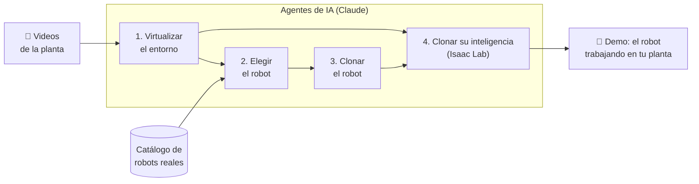

# VIAZ

**De videos de tu planta a un robot real trabajando en ella, antes de comprarlo.**

VIAZ es el puente entre la industria y la robótica.
Muchas industrias todavía no usan robots. No saben qué robot sirve ni cómo trabajaría en su planta.
VIAZ responde esas dos preguntas con un demo en simulación.

## Cómo funciona

1. **Virtualizar el entorno.** Un agente analiza los videos y genera una copia 3D de la planta para la simulación.
2. **Elegir el robot.** Un agente compara la planta y la tarea con un catálogo de robots reales. Después elige el que mejor calza y explica por qué.
3. **Clonar el robot.** Un agente arma un modelo simulado con las medidas, el alcance y la carga útil del robot real.
4. **Clonar su inteligencia.** Un agente entrena y ejecuta la tarea del robot en NVIDIA Isaac Lab, dentro del entorno virtual.
5. **Resultado.** El cliente ve un video del robot trabajando en su planta, con métricas: tareas hechas, tasa de éxito y tiempo por ciclo.

## Ejemplo: parque solar

Una empresa de energía verde construye megaparques solares e instala los paneles a mano.

- **Entrada:** videos del parque, con filas de estructuras y pilas de paneles.
- **VIAZ elige** un robot real de instalación de paneles solares.
- **VIAZ simula** al robot tomando paneles e instalándolos en las estructuras del parque.
- **Salida:** un demo de cómo trabajaría ese robot en ese parque, antes de comprar o importar nada.

## Por qué importa

- **Menos riesgo:** el cliente ve el robot en su propia planta antes de invertir.
- **Robot real:** VIAZ elige robots que ya existen en el mercado, no prototipos.
- **Automático:** los agentes hacen el análisis, la selección y la simulación, sin un equipo de ingeniería dedicado.

## Más detalle

- Arquitectura técnica: [`docs/arquitectura.md`](docs/arquitectura.md)
- Contrato de datos entre agentes: [`docs/contrato-datos.md`](docs/contrato-datos.md)

---

Platanus Hack 26 Santiago · Track 🌎 Physical World · team-4
