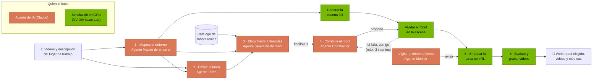

# VIAZ

**De videos de tu lugar de trabajo a un robot real trabajando ahí, antes de comprarlo.**

VIAZ es el puente entre la industria y la robótica.
Muchas industrias todavía no usan robots. No saben qué robot sirve ni cómo funcionaría en su lugar de trabajo.
VIAZ responde esas dos preguntas con un demo en simulación.
Sirve para **cualquier lugar de trabajo y cualquier tarea de manipulación**: un parque solar, una oficina, una bodega o un taller. Cada rubro entra como un perfil, sin cambiar los agentes.

## Cómo funciona

1. **Mapear el entorno.** El agente Mapeo de entorno analiza los videos y la descripción del cliente. Después describe el lugar de trabajo: medidas, objetos y terreno. Con esos datos, la simulación genera la escena 3D.
2. **Definir la tarea.** El agente Tarea lee el entorno y la descripción del cliente. Después define qué hace el robot y cómo se mide el resultado.
3. **Elegir el robot.** El código calcula los requisitos de la tarea y descarta los robots del catálogo que no los cumplen. El agente Selección de robot elige hasta 3 finalistas y explica por qué. Si hay más de uno, cada finalista sigue los pasos 4 a 6 en su propia corrida hija. El código elige al ganador con una regla fija. La configuración de deploy (`render.yaml`) fija 1 finalista. El deploy todavía no existe: [`docs/estado.md`](docs/estado.md).
4. **Construir el robot.** El agente Constructor arma el robot simulado con las medidas, el alcance y la carga útil del robot real. La simulación lo valida en la escena. Si falla, el agente corrige, con un máximo de 3 intentos.
5. **Entrenar la tarea.** El robot aprende la tarea con aprendizaje por refuerzo (RL) en NVIDIA Isaac Lab. El agente Monitor vigila el entrenamiento y avisa al equipo.
6. **Evaluar y mostrar.** La simulación evalúa al robot entrenado y graba los videos. La web muestra el robot elegido, los videos y las métricas: tareas hechas, tasa de éxito y tiempo por ciclo.

En los casos de referencia del demo, el equipo puede escribir a mano el entorno y la tarea. En ese caso los agentes Mapeo de entorno y Tarea no corren, y la web lo dice.

## Por qué importa

- **Menos riesgo:** el cliente ve el robot en su propio lugar de trabajo antes de invertir.
- **Robot real:** VIAZ elige robots que ya existen en el mercado, no prototipos.
- **Automático:** los agentes hacen el análisis, la selección y la simulación, sin un equipo de ingeniería dedicado.

## Más detalle

- Estado del proyecto (qué es real, qué no y dónde está la prueba): [`docs/estado.md`](docs/estado.md)
- Índice de la documentación: [`docs/README.md`](docs/README.md)
- Arquitectura técnica: [`docs/arquitectura.md`](docs/arquitectura.md)
- Contrato de datos entre agentes: [`docs/contrato-datos.md`](docs/contrato-datos.md)
- Cómo agregar un rubro nuevo: [`docs/agregar-dominio.md`](docs/agregar-dominio.md)

---

Platanus Hack 26 Santiago · Track 🌎 Physical World · team-4
