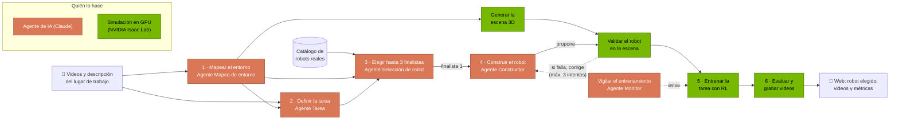

# VIAZ

**De videos de tu lugar de trabajo a un robot real trabajando ahí, antes de comprarlo.**

VIAZ es el puente entre la industria y la robótica.
Muchas industrias todavía no usan robots. No saben qué robot sirve ni cómo funcionaría en su lugar de trabajo.
VIAZ responde esas dos preguntas con un demo en simulación.

## Cómo funciona

1. **Mapear el entorno.** El agente Mapeo de entorno analiza los videos y la descripción del cliente. Después describe el lugar de trabajo: medidas, objetos y terreno. Con esos datos, la simulación genera la escena 3D.
2. **Definir la tarea.** El agente Tarea lee el entorno y la descripción del cliente. Después define qué hace el robot y cómo se mide el resultado.
3. **Elegir el robot.** El código calcula los requisitos de la tarea y descarta los robots del catálogo que no los cumplen. El agente Selección de robot elige hasta 3 finalistas y explica por qué. Hoy solo el primero sigue al paso 4.
4. **Construir el robot.** El agente Constructor arma el robot simulado con las medidas, el alcance y la carga útil del robot real. La simulación lo valida en la escena. Si falla, el agente corrige, con un máximo de 3 intentos.
5. **Entrenar la tarea.** El robot aprende la tarea con aprendizaje por refuerzo (RL) en NVIDIA Isaac Lab. El agente Monitor vigila el entrenamiento y avisa al equipo.
6. **Evaluar y mostrar.** La simulación evalúa al robot entrenado y graba los videos. La web muestra el robot elegido, los videos y las métricas: paneles instalados, tasa de éxito y tiempo por ciclo.

En el demo del parque solar, el equipo escribe a mano el entorno y la tarea. Por eso los agentes Mapeo de entorno y Tarea no corren en el demo.

## Ejemplo: parque solar

Una empresa de energía verde construye megaparques solares e instala los paneles a mano.

- **Entrada:** videos del parque, con filas de estructuras y pilas de paneles.
- **VIAZ elige** un robot real de instalación de paneles solares.
- **VIAZ simula** al robot tomando paneles e instalándolos en las estructuras del parque.
- **Salida:** un demo de cómo trabajaría ese robot en ese parque, antes de comprar o importar nada.

## Por qué importa

- **Menos riesgo:** el cliente ve el robot en su propio lugar de trabajo antes de invertir.
- **Robot real:** VIAZ elige robots que ya existen en el mercado, no prototipos.
- **Automático:** los agentes hacen el análisis, la selección y la simulación, sin un equipo de ingeniería dedicado.

## Más detalle

- Arquitectura técnica: [`docs/arquitectura.md`](docs/arquitectura.md)
- Contrato de datos entre agentes: [`docs/contrato-datos.md`](docs/contrato-datos.md)

---

Platanus Hack 26 Santiago · Track 🌎 Physical World · team-4
