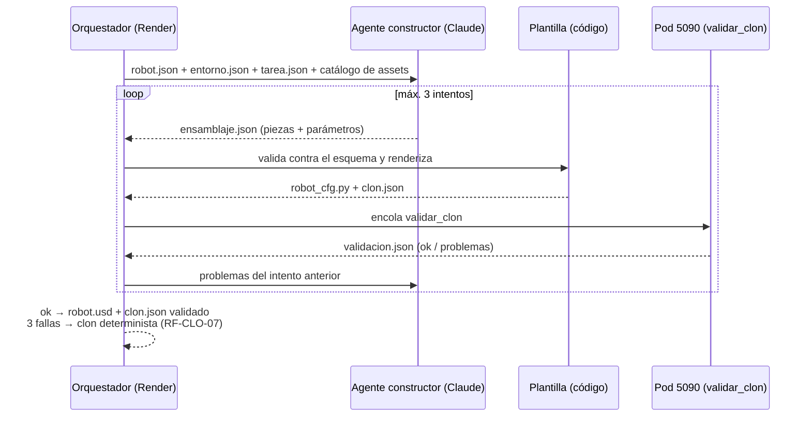

# Contrato: agente constructor del robot en Isaac Lab

> Etapa 4. Requerimientos: RF-CLO-01..08, RNF-03, RNF-13.
> Estado: **por implementar.** Hoy existe solo el clon determinista de [`urdf.py`](../../backend/viaz/urdf.py), que queda como respaldo (RF-CLO-07).
> Prompt: [`prompts/constructor.md`](../../backend/viaz/agentes/prompts/constructor.md) (todavía no lo carga el código).



## 1. Propósito

- **Decide:** con qué assets de Isaac Lab se arma el robot y con qué parámetros, para que se parezca al robot real en lo que importa para la tarea.
- **No escribe código libre.** Devuelve un JSON estructurado (`ensamblaje.json`). Una plantilla genera `robot_cfg.py`. Así el agente no rompe Isaac Lab con código inválido.
- **Por qué un agente:** cada robot real combina base, brazo y efector distintos. El agente elige la combinación y corrige con los errores del pod.

## 2. Entradas

| Entrada | Origen |
|---|---|
| `robot.json` | Agente de selección (specs del catálogo) |
| `entorno.json`, `tarea.json` | Escritos a mano por el equipo |
| Catálogo de assets | `sim/assets_isaaclab.json` **[Por crear]**: assets disponibles en la versión de Isaac Lab del pod, con sus medidas y límites |
| `validacion.json` del intento anterior | Pod (solo en los intentos 2 y 3) |

### Catálogo de assets (punto de partida, a verificar en el pod)

| Pieza | Candidatos | Nota |
|---|---|---|
| Brazo | UR10 de Isaac Lab | Isaac Lab trae tareas del UR10 con ventosa corta y larga |
| Efector | Ventosa larga o corta (surface gripper) | Mismo origen |
| Base móvil | Ridgeback de Isaac Sim (existe con Franka y con UR5) | No está confirmado como configuración de Isaac Lab **[Verificar]** |
| Base fija | Pedestal simple | Opción más rápida para entrenar (ver pregunta abierta de RL) |

**Riesgo de carga:** el panel pesa unos 32 kg. Varios brazos de catálogo cargan menos. El agente puede subir los límites de esfuerzo de las articulaciones hasta la carga útil del robot real, y lo anota en `diferencias_con_real`.

## 3. Salidas

### `ensamblaje.json` (lo devuelve el agente) **[Contrato nuevo: agregar esquema]**

```json
{
  "version": 1,
  "robot_id": "ejemplo-robot",
  "base": { "asset": "pedestal", "altura_m": 0.8 },
  "brazo": { "asset": "ur10", "escala_alcance": 1.6, "esfuerzo_max_nm": 900 },
  "efector": { "asset": "ventosa_larga" },
  "carga_util_kg": 40,
  "velocidad_max_rad_s": 2.0,
  "diferencias_con_real": ["brazo UR10 escalado, no el brazo del fabricante"],
  "razonamiento": "Por qué esta combinación y qué corrigió del intento anterior"
}
```

### Archivos que genera el sistema

| Archivo | Lo genera | Para qué |
|---|---|---|
| `robot_cfg.py` | Plantilla, desde `ensamblaje.json` | Configuración del robot (`ArticulationCfg`) para el entorno RL |
| `robot.usd` | Pod, en `validar_clon` | Robot listo para Isaac |
| `clon.json` | Sistema | Contrato actual, con `validado_en_escena` y `diferencias_con_real` |
| `robot.urdf` | Pod (Could, RF-CLO-08) | Visor web |

## 4. Reglas que verifica el código

1. `ensamblaje.json` cumple su esquema y usa solo assets del catálogo de assets.
2. `carga_util_kg` y el alcance resultante coinciden con `robot.json` (±5 %). El agente no puede cambiar las specs del robot real.
3. Alcance resultante ≥ `alcance_necesario()` del agente de selección.
4. `validar_clon` revisa: el robot carga en Isaac, no choca al inicio, la ventosa alcanza el panel y el tubo, y soporta el peso del panel.
5. Máximo 3 intentos. Después, el sistema usa el clon determinista y la web lo indica (RF-CLO-07).

## 5. Instrucciones (resumen del prompt)

- Elige base, brazo y efector **solo** del catálogo de assets.
- Prioriza: (1) alcance y carga iguales al real, (2) efector ventosa, (3) piezas que ya tengan una tarea de ejemplo en Isaac Lab.
- Si el intento anterior falló, lee `problemas` y cambia **una** cosa a la vez. Explica el cambio en `razonamiento`.
- Lista todas las diferencias con el robot real, en español, en frases cortas.
- Nunca cambies `carga_util_kg` ni el alcance del robot real para que la validación pase.

## 6. Errores

| Caso | Resultado |
|---|---|
| Asset fuera del catálogo | El intento cuenta como fallido; el agente recibe el error |
| `validar_clon` falla 3 veces | Clon determinista (RF-CLO-07); la corrida sigue |
| Error de Isaac que no depende del agente (pod caído) | La corrida pasa a `error`; no consume intentos |

## 7. Pruebas

- **Plantilla:** un `ensamblaje.json` de ejemplo genera un `robot_cfg.py` que Isaac Lab importa sin error.
- **Reglas:** un ensamblaje con carga distinta al real se rechaza antes de ir al pod.
- **En el pod:** el robot generado carga en la escena y levanta un panel de 32 kg en una prueba sin RL.
