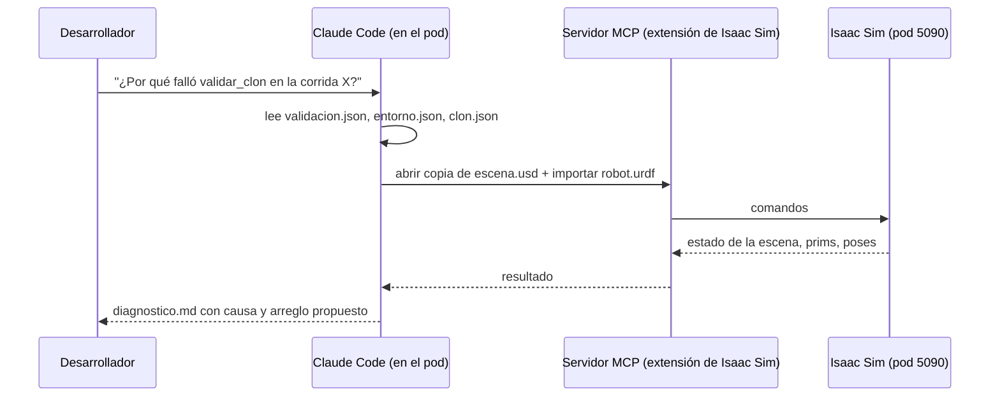

# Contrato: agente MCP de Isaac Sim

> **Solo desarrollo.** El pipeline no depende de este agente. Así lo definió la primera versión de la arquitectura.
> Requerimientos que ayuda a cumplir: RF-MAP-05..06, RF-CLO-05..06, RF-INT-10..12 (depurar el robot construido y el entorno RL).
> Servidor MCP: **[Por definir]**. Hay extensiones comunitarias de MCP para Isaac Sim; hay que elegir una y fijar su versión.



## 1. Propósito

- **Decide:** nada del pipeline. Diagnostica problemas de escena, clon y simulación.
- **Por qué existe:** depurar Isaac por SSH sin GUI es lento. Claude inspecciona la escena con herramientas MCP.
- **Por qué no va en el pipeline:** el MCP puede ser inestable y bloquearía las corridas. La primera versión de la arquitectura ya lo marcaba como riesgo.

## 2. Entradas

| Entrada | Origen |
|---|---|
| Pregunta del desarrollador | Chat de Claude Code |
| Archivos de una corrida | Almacén (`corridas/<id>/`) copiados al pod |
| Scripts de `sim/` | Repo clonado en el pod |

## 3. Salida

- **`diagnostico.md`** en `.datos/diagnosticos/<corrida>-<AAAAMMDD-HHMMSS>.md`, fuera de git.
- **Contenido:** síntoma, causa, evidencia (prims, poses, distancias medidas), arreglo propuesto y archivo a cambiar.
- **No produce:** archivos del contrato. Nunca escribe en `corridas/<id>/`.

## 4. Reglas

1. **Solo lectura por defecto.** El agente trabaja sobre una **copia** de `escena.usd`.
2. **Sin cambios al repo** sin aprobación del desarrollador. El agente propone el diff; el desarrollador lo aplica.
3. **Sin puertos públicos.** El servidor MCP escucha en `localhost` del pod. El acceso es por SSH con llave (RNF-11).
4. **Un trabajo a la vez.** No usar el MCP mientras el runner ejecuta un trabajo: Isaac usa casi toda la GPU (RF-GPU-03).
5. **Convenciones de la escena:** Z arriba; la fila `i` tiene su tubo en `y = −i · separacion_m`; el robot avanza por `y > 0` mirando a `+X` ([`contrato-datos.md`](../contrato-datos.md)).

## 5. Instrucciones (para el `CLAUDE.md` del pod)

```text
Eres el agente de depuración de simulación de VIAZ. Usas las herramientas MCP de Isaac Sim.
Tu trabajo es diagnosticar, no arreglar en producción.

Antes de usar el MCP:
1. Confirma que el sim runner no está ejecutando un trabajo (Isaac usa casi toda la GPU).
2. Copia escena.usd a /tmp y trabaja sobre la copia.

Para cada problema:
1. Lee validacion.json, entorno.json, clon.json y robot.urdf de la corrida.
2. Reproduce el problema en la escena con el mínimo de pasos.
3. Mide: posiciones de prims, distancia del efector al tubo, colisiones al inicio, articulaciones importadas.
4. Compara contra sim/plan.py y backend/viaz/urdf.py. Ellos definen la geometría esperada.
5. Escribe diagnostico.md: síntoma, causa, evidencia con números, arreglo propuesto, archivo a cambiar.

Reglas:
- No escribas en corridas/<id>/ ni en archivos del contrato.
- No cambies código del repo sin que el desarrollador lo apruebe.
- No expongas puertos del pod. El servidor MCP escucha solo en localhost.
- Usa unidades SI. Ángulos de articulaciones en radianes.
```

## 6. Errores

| Caso | Qué hacer |
|---|---|
| El servidor MCP no responde | Reiniciar Isaac en modo GUI/livestream; si sigue, depurar con scripts headless |
| Isaac ocupado por el runner | Esperar a que termine el trabajo o detener el runner |

## 7. Pendiente

- [ ] Elegir el servidor MCP para Isaac Sim y verificar que funciona con la versión del pod ([`infraestructura.md`](../infraestructura.md)).
- [ ] Escribir el `CLAUDE.md` del pod con las instrucciones de §5.
- [ ] Documentar el túnel SSH para usarlo desde un Mac.
