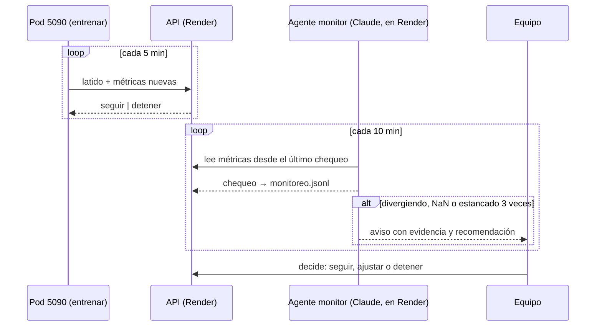

# Contrato: agente monitor del entrenamiento

> Etapa 5 (entrenamiento RL). Requerimientos: RF-MON-01..08, RF-GPU-06, RF-API-06, RNF-17.
> Estado: **por implementar.** Prompt: [`prompts/monitor.md`](../../backend/viaz/agentes/prompts/monitor.md) (todavía no lo carga el código).



## 1. Propósito

- **Decide:** si el entrenamiento va bien, y qué recomendar.
- **Por qué existe:** el entrenamiento dura horas. Nadie mira la curva todo el tiempo. El monitor avisa cuando hay que actuar.
- **Para el demo:** marca los hitos del video en cámara rápida y escribe el resumen final.
- **Límite:** recomienda. Solo detiene el entrenamiento por sí mismo si aparece NaN (RF-MON-08).

## 2. Entradas

| Entrada | Origen | Contenido |
|---|---|---|
| Métricas | Latidos del pod (RF-GPU-06), guardadas por la API | Una fila por iteración de PPO: `iteracion`, `pasos`, `recompensa_media`, `tasa_exito`, `largo_episodio`, `perdida_valor`, `perdida_politica`, `entropia`, `tiempo_s` |
| Chequeos anteriores | `monitoreo.jsonl` | Para detectar estancamiento sostenido |
| Contexto | `tarea.json`, umbral de éxito (RF-INT-11), presupuesto de tiempo (RNF-17) | Para saber qué es "bueno" |

## 3. Salida: una línea de `monitoreo.jsonl` por chequeo **[Contrato nuevo: agregar esquema]**

```json
{
  "version": 1,
  "t": "2026-11-22T01:40:00Z",
  "iteracion": 420,
  "estado": "mejorando",
  "evidencia": {
    "recompensa_media": 18.4,
    "tasa_exito": 0.35,
    "tendencia_recompensa": 0.8,
    "tiempo_usado_h": 1.2,
    "tiempo_restante_h": 2.8
  },
  "recomendacion": "seguir",
  "detalle": "La tasa de éxito subió de 0,22 a 0,35 en los últimos 10 min",
  "hito": "primer_exito",
  "checkpoint_recomendado": "model_400.pt"
}
```

| Campo | Valores |
|---|---|
| `estado` | `mejorando` \| `estancado` \| `divergiendo` \| `terminado` |
| `recomendacion` | `seguir` \| `ajustar` \| `detener` \| `revisar` |
| `hito` | `null` \| `primer_exito` \| `mejor_recompensa` \| `umbral_alcanzado` |
| `checkpoint_recomendado` | Nombre del mejor checkpoint hasta ahora, o `null` |

## 4. Reglas que verifica el código

1. Cada chequeo cumple su esquema.
2. `evidencia` usa solo números que vienen de las métricas. El código compara contra la fuente.
3. **NaN en una pérdida o en la recompensa:** el código responde `detener` en el siguiente latido, sin esperar al agente (RF-MON-08).
4. `ajustar` y `detener` por otras causas solo se aplican con aprobación de una persona del equipo.

## 5. Instrucciones (resumen del prompt)

| Estado | Cuándo |
|---|---|
| `mejorando` | La recompensa media o la tasa de éxito suben en la ventana |
| `estancado` | Cambian menos de 2 % en la ventana y la tasa de éxito está bajo el umbral |
| `divergiendo` | La recompensa cae más de 20 %, o las pérdidas crecen sin parar |
| `terminado` | La tasa de éxito superó el umbral en 3 chequeos seguidos, o se acabó el tiempo |

- **Ajustes que puede sugerir:** bajar la tasa de aprendizaje, cambiar el peso de un término de recompensa, volver al mejor checkpoint. Siempre uno por vez.
- **Avisos:** con `divergiendo`, con NaN o con `estancado` por 3 chequeos seguidos (RF-MON-04).
- **Resumen final (RF-MON-07):** horas, pasos, mejor tasa de éxito, hitos y checkpoint elegido, en 4 a 6 oraciones.

## 6. Errores

| Caso | Resultado |
|---|---|
| Sin métricas nuevas en 15 min | `revisar`: el pod puede estar caído |
| El modelo no responde | El chequeo se salta; el entrenamiento sigue. La regla de NaN no depende del agente |

## 7. Pruebas

- **Curvas sintéticas:** una creciente, una plana y una que cae. El monitor debe dar `mejorando`, `estancado` y `divergiendo`.
- **NaN:** una métrica NaN hace que el siguiente latido reciba `detener`.
- **Hitos:** el primer `tasa_exito > 0` produce `primer_exito`.

## 8. Pendiente

- [ ] Elegir el canal de avisos: consola, archivo o Discord.
- [ ] Definir cada cuánto chequea (10 min es una propuesta).
- [ ] Agregar el esquema de `monitoreo.jsonl` y la tabla de métricas en la API.
