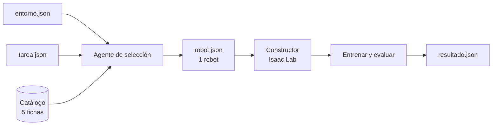
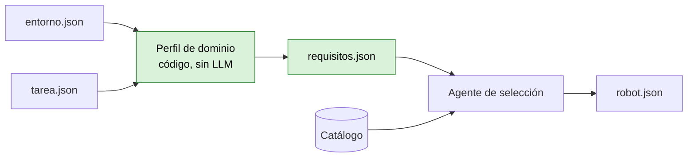
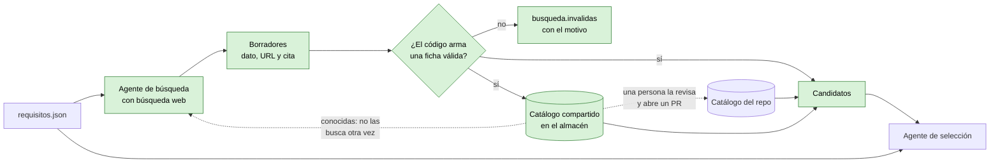
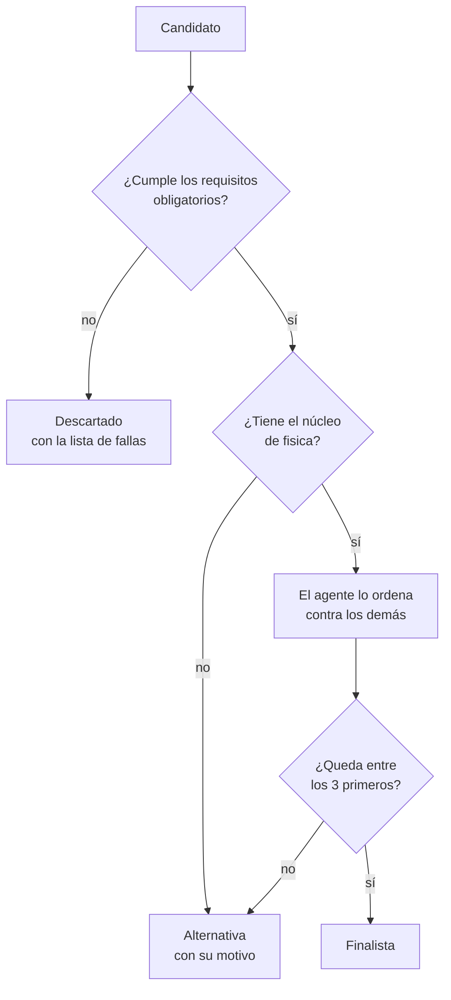
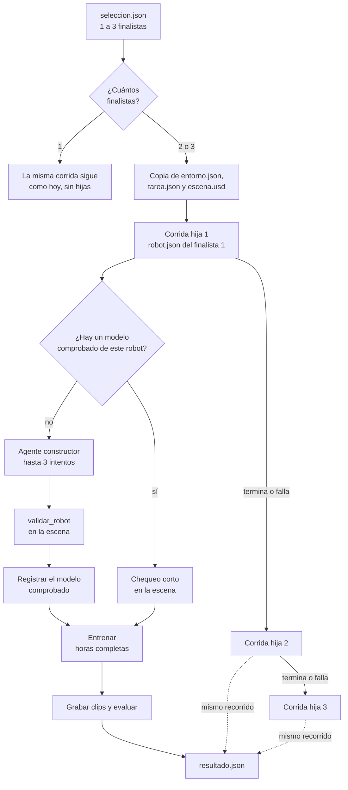
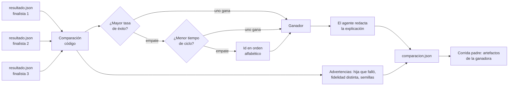
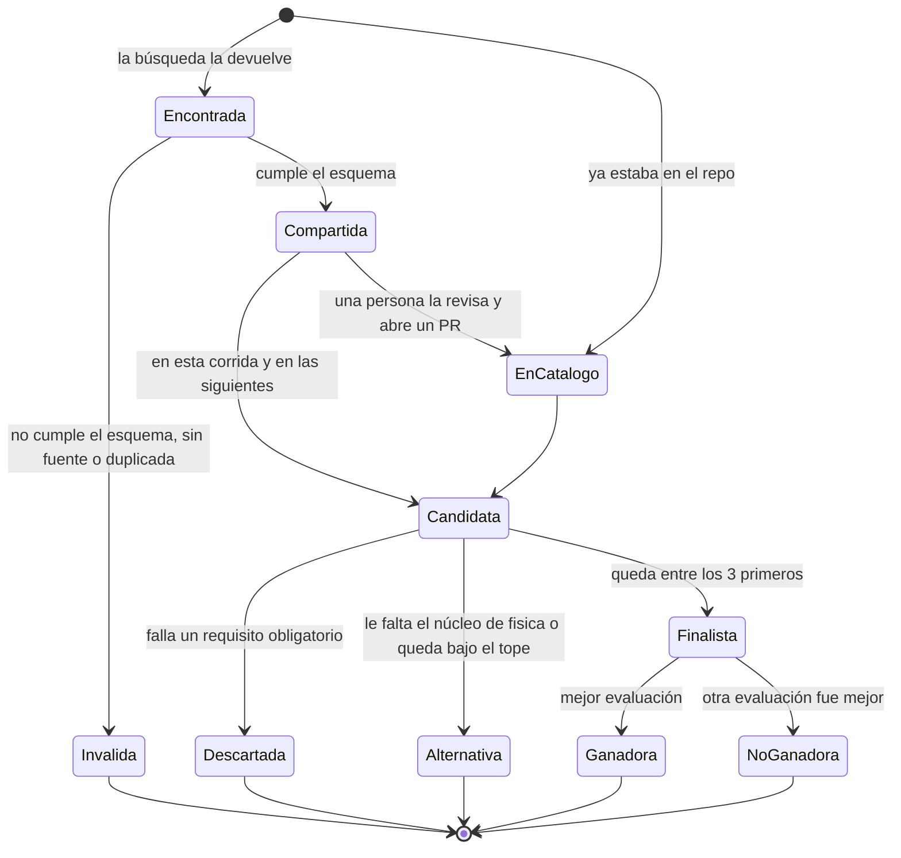

# Cómo decide la etapa de robot

> Explicación del contrato [`seleccion-robot.md`](seleccion-robot.md) (v3). El contrato dice qué entra y qué sale. Esta página dice por qué el flujo tiene esa forma.
> **Estado:** los diagramas 2, 3 y 4 existen en el código (la búsqueda del diagrama 3 solo se probó contra modelos falsos). El diagrama 1 es el flujo anterior. Los diagramas 5 y 6 describen el diseño acordado. Cada uno nombra el PR que lo implementa.

Cada diagrama repite el anterior y agrega una parte. Lo nuevo va en verde.

## 1. Hoy: un robot, un catálogo cerrado

- El agente elige un robot entre las fichas del catálogo. Una ficha es el JSON de un robot real, con su fuente.
- Los criterios del prompt hablan de paneles, ventosas y tubos. Por eso el agente solo sirve para un parque solar.
- La simulación prueba un solo robot. No hay con qué compararlo.

## 2. Los requisitos separan el rubro del agente

- Un perfil de dominio es código que traduce el lugar y la tarea a números: carga mínima, alcance mínimo por robot, efectores aceptados, movilidad y pendiente.
- El agente lee `requisitos.json`. Ya no lee "panel" ni "tubo".
- Las reglas solares de hoy pasan al perfil `solar`. Otro rubro agrega su perfil y no toca el agente.
- **Límite:** el agente queda general, pero la simulación sigue siendo solar. Otro rubro todavía no corre de punta a punta.
- **Llega en:** PR 2.

## 3. La búsqueda agrega robots que no estaban

- El agente de búsqueda parte de los requisitos y busca robots reales que hagan la tarea. Recibe la lista de fichas conocidas para buscar otras.
- El modelo devuelve borradores. El código arma la ficha: `origen: "busqueda"`, fuente con URL y fecha, y un `id` propio.
- Cada spec de selección lleva su `evidencia` (URL y la oración exacta de la fuente) o un `estimado` con su motivo. Sin eso, la ficha es inválida.
- El código valida cada ficha. Una ficha inválida no llega al agente de selección y queda registrada con su motivo.
- Las fichas válidas quedan en el catálogo compartido del almacén. Las corridas siguientes las usan como fichas conocidas.
- Una persona las pasa al catálogo del repo con un PR, porque un modelo escribió esas specs y alguien debe revisarlas.
- Si la búsqueda falla, la corrida sigue con las fichas conocidas.
- **Llega en:** PR 3.

## 4. Qué le pasa a cada candidato

| Decisión | Quién decide | Por qué |
|---|---|---|
| ¿Cumple los requisitos obligatorios? | Código | Es una comparación de números. Se puede probar |
| ¿Tiene el núcleo de `fisica`? | Código | Sin largo, ancho, masa, altura de cubierta y tracción, el clon usa la base genérica. Por eso un candidato con núcleo va antes que uno sin núcleo |
| Orden entre los que pasan | Agente | Pesa margen, ritmo y datos estimados. Es un juicio |
| Tope de 3 | Código | Cada finalista cuesta un entrenamiento completo |

- Si ningún candidato cumple los requisitos obligatorios, pasa uno solo: el que falla menos. La justificación lo dice en la primera oración.
- Si algunos cumplen pero ninguno tiene el núcleo de `fisica`, pasa uno solo: el primero por las preferencias. El clon usa la base genérica y la justificación lo dice en la primera oración. Los demás quedan como alternativas. Así un dominio nuevo, sin robots medidos, igual corre.
- **Llega en:** PR 2.

## 5. Cada finalista hace el recorrido completo

- **Un finalista:** la corrida sigue igual que antes. No hay hijas ni `comparacion.json`.
- **Dos o tres finalistas:** cada uno corre en una corrida hija. La hija es una fila de `corridas` con `padre_id`.
- La corrida padre arma la escena una vez. Cada hija recibe una copia y el `robot.json` de su finalista.
- Las hijas corren en orden, una después de otra, dentro de la corrida padre. Hay un solo pod.
- Una hija nunca entra a la cola. `procesar_una` no la toma.
- La hija corre las mismas etapas que la corrida de un finalista: clon e inteligencia (`entrenar_y_evaluar`).
- El estado de la hija pasa a la corrida padre (`clonando`, `entrenando`, `evaluando`). No hay estados nuevos.
- Los avisos del monitor nombran al finalista, por ejemplo "finalista 2 de 3: relu-bison".
- `POST /corridas/{id}/detener` sobre el padre detiene el entrenamiento de la hija que corre.
- Una hija que falla guarda su error en su fila. El padre sigue con el finalista siguiente.
- Un modelo comprobado es el clon de un robot que ya pasó `validar_robot` y la rúbrica de calidad. Su clave es el `id`, la huella de su ficha y la versión de las piezas de Isaac Lab.
- Con un modelo comprobado, la corrida se salta el agente constructor.
- El chequeo en la escena corre siempre, porque el alcance y los choques dependen del lugar.
- La política entrenada no se reusa entre tareas ni entre lugares.
- **Costo:** cada finalista entrena las horas completas (`VIAZ_HORAS_ENTRENAMIENTO`). Con 3 finalistas, la corrida tarda 3 veces lo que tarda uno. El log lo dice al empezar.
- **Llega en:** PR 4 para el modelo comprobado y PR 5 para las corridas hijas.

## 6. Las reglas eligen al ganador

- Los finalistas usan la misma escena, las mismas horas de entrenamiento y las mismas tolerancias.
- **Semillas:** el entrenamiento no fija semillas (`sim/rl/entrenar.py` no tiene ese parámetro). `condiciones.semillas` vale `null` y una advertencia lo dice.
- El código elige al ganador (`comparacion.py`). El agente solo redacta la explicación, porque el resultado debe salir igual cada vez. Si la llamada falla, queda una frase de plantilla.
- Una hija que falló queda fuera del ranking, con una advertencia. Si fallan todas, la corrida padre queda en `error`.
- Cada clon declara su `fidelidad`: `generico`, `medido` o `verificado`. Sin ese campo, el código usa `medido` si la ficha tiene `fisica` y `generico` si no. Si los finalistas tienen niveles distintos, el resultado lo advierte.
- La corrida padre recibe una copia de los artefactos de la ganadora y su `robot.json`. Así la web muestra al padre igual que hoy, más `comparacion.json`.
- **Lo que la simulación compara:** alcance, tamaño, masa, carga útil y velocidad.
- **Lo que no compara:** los motores y el control de cada marca. Todos los clones usan el mismo brazo escalado.
- **Llega en:** PR 5.

## 7. La vida de una ficha

- `seleccion.json` guarda a las inválidas, las descartadas, las alternativas y las finalistas, cada una con su motivo.
- Una ficha compartida vive en `catalogo/encontrados/<id>.json` del almacén hasta que un PR la pasa al repo.
- `comparacion.json` guarda el orden final de las finalistas.

## Dónde llega cada parte

| PR | Qué agrega | Diagramas |
|---|---|---|
| 1 | Contrato, esquemas y esta página | Todos, como diseño |
| 2 | Requisitos, perfil solar, finalistas | 2 y 4 |
| 3 | Agente de búsqueda | 3 |
| 4 | Registro de modelos comprobados | 5 |
| 5 | Corridas hijas y comparación | 5 y 6 |
| 6 | Web | Ninguno |
