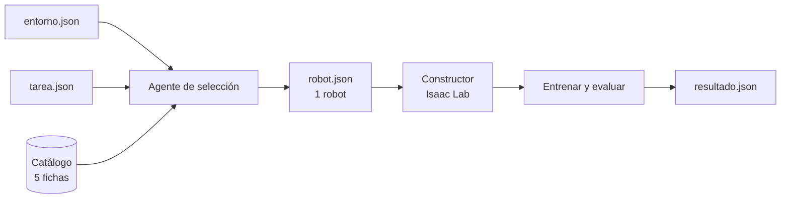
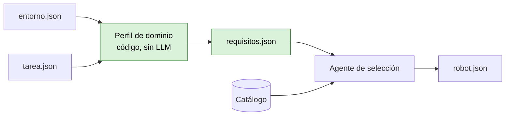
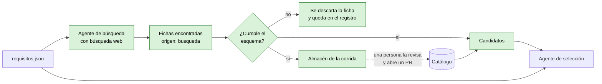
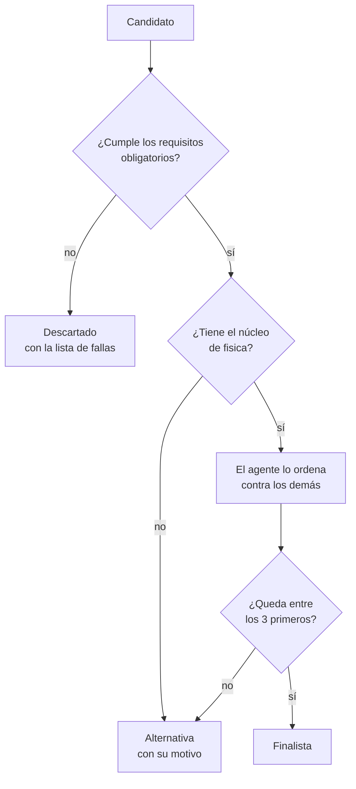
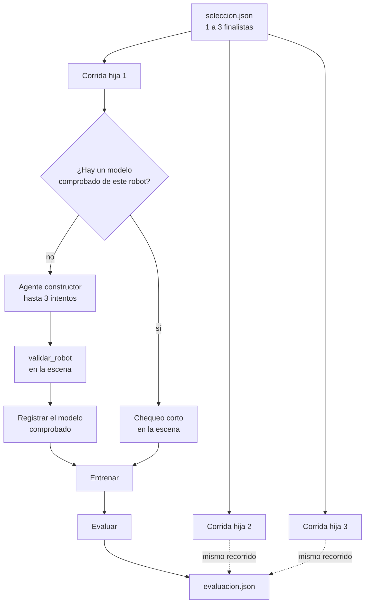
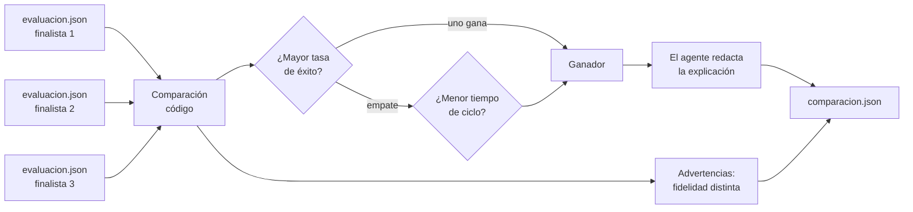
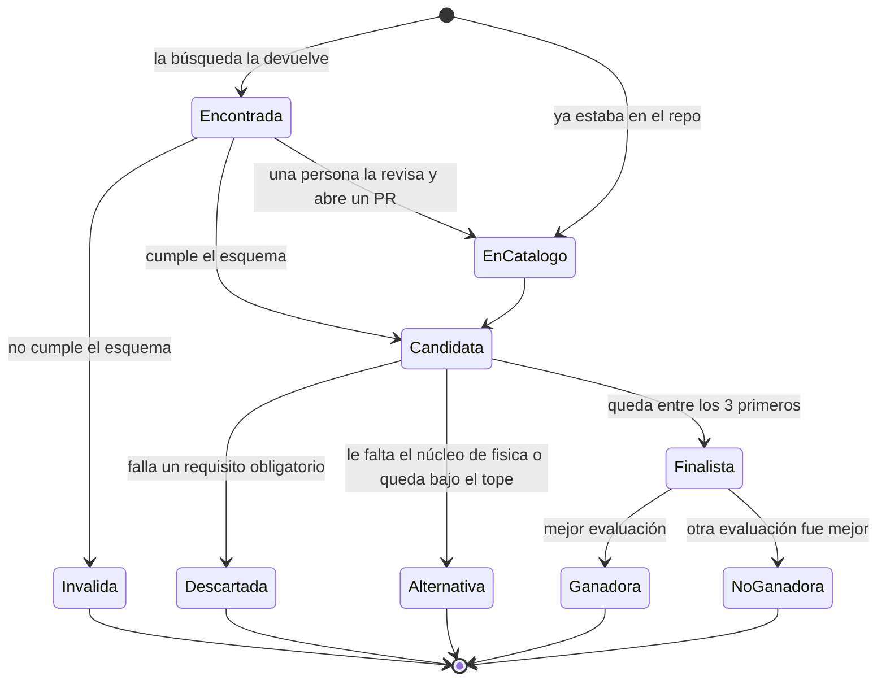

# Cómo decide la etapa de robot

> Explicación del contrato [`seleccion-robot.md`](seleccion-robot.md) (v3). El contrato dice qué entra y qué sale. Esta página dice por qué el flujo tiene esa forma.
> **Estado:** solo el diagrama 1 existe en el código. Los diagramas 2 a 7 describen el diseño acordado. Cada uno nombra el PR que lo implementa.

Cada diagrama repite el anterior y agrega una parte. Lo nuevo va en verde.

## 1. Hoy: un robot, un catálogo cerrado

- El agente elige un robot entre las fichas del catálogo. Una ficha es el JSON de un robot real, con su fuente.
- Los criterios del prompt hablan de paneles, ventosas y tubos. Por eso el agente solo sirve para un parque solar.
- La simulación prueba un solo robot. No hay con qué compararlo.

## 2. Los requisitos separan el rubro del agente

- Un perfil de dominio es código que traduce el lugar y la tarea a números: carga mínima, alcance mínimo por robot, efectores aceptados, movilidad y pendiente.
- El agente lee `requisitos.json`. Ya no lee "panel" ni "tubo".
- Las reglas solares de hoy pasan al perfil `solar`. Otro rubro agrega su perfil y no toca el agente.
- **Límite:** el agente queda general, pero la simulación sigue siendo solar. Otro rubro todavía no corre de punta a punta.
- **Llega en:** PR 2.

## 3. La búsqueda agrega robots que no estaban

- El agente de búsqueda parte de los requisitos y busca robots reales que hagan la tarea.
- Cada ficha encontrada cita su fuente con URL y fecha. Lo que la fuente no publica va en `estimados`, con el motivo.
- El código valida cada ficha. Una ficha inválida no llega al agente de selección.
- Las fichas válidas quedan en el almacén de la corrida. Una persona las pasa al catálogo con un PR, porque un modelo escribió esas specs y alguien debe revisarlas.
- Si la búsqueda falla, la corrida sigue con el catálogo.
- **Llega en:** PR 3.

## 4. Qué le pasa a cada candidato

| Decisión | Quién decide | Por qué |
|---|---|---|
| ¿Cumple los requisitos obligatorios? | Código | Es una comparación de números. Se puede probar |
| ¿Tiene el núcleo de `fisica`? | Código | Sin largo, ancho, masa, altura de cubierta y tracción, el clon sería una caja genérica |
| Orden entre los que pasan | Agente | Pesa margen, ritmo y datos estimados. Es un juicio |
| Tope de 3 | Código | Cada finalista cuesta un entrenamiento completo |

- Si ningún candidato cumple los requisitos obligatorios, pasa uno solo: el que falla menos. La justificación lo dice en la primera oración.
- **Llega en:** PR 2.

## 5. Cada finalista hace el recorrido completo

- Una corrida hija es una corrida normal con el robot ya fijado. Reusa el flujo de hoy sin cambios.
- Un modelo comprobado es el clon de un robot que ya pasó `validar_robot` y la rúbrica de calidad. Su clave es el `id`, la huella de su ficha y la versión de las piezas de Isaac Lab.
- Con un modelo comprobado, la corrida se salta el agente constructor.
- El chequeo en la escena corre siempre, porque el alcance y los choques dependen del lugar.
- La política entrenada no se reusa entre tareas ni entre lugares.
- **Costo:** con un pod, 3 finalistas tardan 3 veces lo que tarda uno.
- **Llega en:** PR 4 para el modelo comprobado y PR 5 para las corridas hijas.

## 6. Las reglas eligen al ganador

- Los 3 finalistas usan la misma escena, las mismas horas de entrenamiento y las mismas semillas.
- El código elige al ganador. El agente solo redacta la explicación, porque el resultado debe salir igual cada vez.
- Cada clon declara su `fidelidad`: `generico`, `medido` o `verificado`. Si los finalistas tienen niveles distintos, el resultado lo advierte.
- **Lo que la simulación compara:** alcance, tamaño, masa, carga útil y velocidad.
- **Lo que no compara:** los motores y el control de cada marca. Todos los clones usan el mismo brazo escalado.
- **Llega en:** PR 5.

## 7. La vida de una ficha

- `seleccion.json` guarda a las descartadas, las alternativas y las finalistas, cada una con su motivo.
- `comparacion.json` guarda el orden final de las finalistas.

## Dónde llega cada parte

| PR | Qué agrega | Diagramas |
|---|---|---|
| 1 | Contrato, esquemas y esta página | Todos, como diseño |
| 2 | Requisitos, perfil solar, finalistas | 2 y 4 |
| 3 | Agente de búsqueda | 3 |
| 4 | Registro de modelos comprobados | 5 |
| 5 | Corridas hijas y comparación | 5 y 6 |
| 6 | Web | Ninguno |
