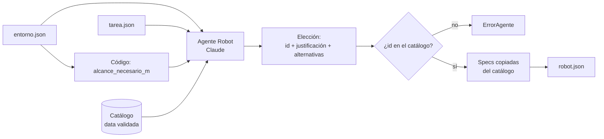
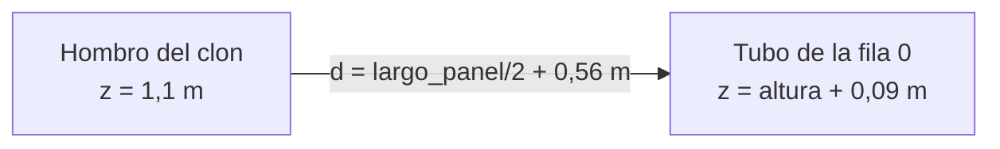

# Contrato: agente de selección de robot

> Etapa 3. Requerimientos: RF-ROB-01..07, RNF-02, RNF-03.
> Código: [`agentes/__init__.py`](../../backend/viaz/agentes/__init__.py) → `robot()`. Prompt: [`prompts/robot.md`](../../backend/viaz/agentes/prompts/robot.md). Catálogo: [`catalogo/robots/`](../../backend/viaz/catalogo/robots/).

## 1. Propósito

- **Decide:** qué robot real del catálogo hace mejor la tarea en esa planta.
- **Explica:** el cliente lee la justificación en la web. Debe ser verificable con números.
- **No decide:** las specs. El código las copia del catálogo, nunca del modelo.

## 2. Entradas

| Entrada | Origen |
|---|---|
| `entorno.json` | Escrito a mano por el equipo (demo) o agente de mapeo |
| `tarea.json` | Escrito a mano por el equipo (demo) o agente Tarea |
| `alcance_necesario_m` | Código (`alcance_necesario()`), con la geometría del clon y de `sim/plan.py` |
| Catálogo | `catalogo/robots/*.json`, validado contra `robot.schema.json` al cargar |

### Cálculo de `alcance_necesario_m`

- **Fórmula:** `√(d² + dz²) + 0,30 m de muñeca + 0,05 m de margen`, con `dz = altura + 0,09 + 0,30 − 1,1`.
- **Ejemplo:** tracker de 1,5 m y panel de 2,38 m → **2,28 m**.
- **Verificado:** para alturas de 0,8 a 4 m y paneles de 1,7 a 2,8 m, un clon con ese alcance pasa `plan.validar()`.

## 3. Salida: `robot.json`

| Campo | Lo llena | Regla |
|---|---|---|
| `id` | Agente | `enum` con los ids del catálogo |
| `justificacion` | Agente | 3 a 6 oraciones en español, con números y unidades |
| `alternativas` | Agente | Todos los demás robots del catálogo, con `por_que_no` |
| `version`, `nombre`, `fabricante`, `tipo`, `ficticio`, `carga_util_kg`, `alcance_m`, `velocidad_base_m_s`, `efector`, `fuente` | Código | Copia exacta del catálogo |

## 4. Reglas que verifica el código

1. `id` existe en el catálogo. Si no, `ErrorAgente` (RF-ROB-03).
2. Las specs salen del catálogo (RNF-02).
3. La salida cumple `robot.schema.json`.
4. **[Por hacer]** `len(alternativas) ≥ 2` cuando el catálogo tiene 3 o más robots (RF-ROB-05).

## 5. Instrucciones (resumen del prompt)

| # | Criterio | Obligatorio |
|---|---|---|
| 1 | `carga_util_kg ≥ panel.peso_kg` | Sí |
| 2 | Efector `ventosa` para paneles | Sí |
| 3 | `alcance_m ≥ alcance_necesario_m` | Sí |
| 4 | Tipo según terreno: pendiente > 10° → `vehiculo_con_brazo`; nunca `brazo_fijo` | Sí |
| 5 | Mayor velocidad de base | No |
| 6 | Mayor margen de carga y alcance | No |
| 7 | Real sobre ficticio | No |

- **Ningún robot cumple:** elige el que falla menos y lo dice en la primera oración.
- **Robot ficticio:** lo dice en la justificación.
- **Confianza baja en el entorno:** la justificación lo advierte.
- **Vocabulario ISO 8373:** manipulador, efector final, carga útil, robot móvil (RF-WEB-11).

## 6. Errores

| Caso | Resultado |
|---|---|
| `id` fuera del catálogo | `ErrorAgente` → corrida en `error` |
| Catálogo vacío o inválido | `ValueError` al cargar → corrida en `error` |

## 7. Pruebas

- **Catálogo:** cada robot valida contra el esquema y su `id` coincide con el nombre del archivo.
- **Regla de alcance:** `alcance_necesario()` vs `sim/plan.py` → `validar()` (ver §2).
- **Con Claude:** con el catálogo real (5 a 10 robots), revisar a mano 3 corridas. La justificación debe citar carga, alcance y terreno.
