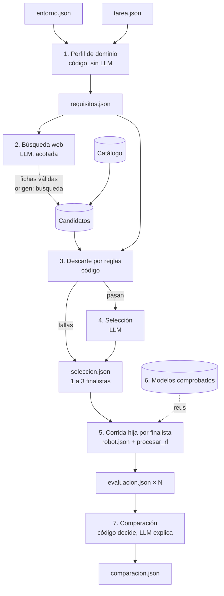
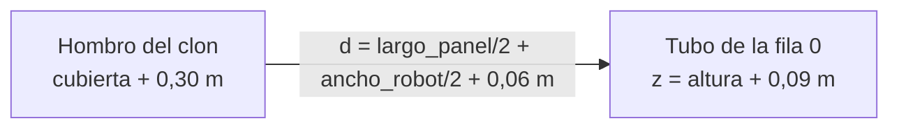

# Contrato: agente de selección de robot

> Etapa 3. **Contrato v3** (2026-11-21). **Implementado: v2** (un robot, catálogo cerrado, criterios solares en el prompt).
> Requerimientos: RF-ROB-01..12, RF-CLO-10..11, RF-ORQ-07..08, RNF-02, RNF-03.
> Código v2: [`agentes/__init__.py`](../../backend/viaz/agentes/__init__.py) → `robot()`. Prompt v2: [`prompts/robot.md`](../../backend/viaz/agentes/prompts/robot.md). Catálogo: [`catalogo/robots/`](../../backend/viaz/catalogo/robots/).
> Explicación paso a paso, con un diagrama por parte: [`seleccion-robot-flujo.md`](seleccion-robot-flujo.md).
> Esquemas v3: [`requisitos`](../../backend/viaz/esquemas/requisitos.schema.json), [`seleccion`](../../backend/viaz/esquemas/seleccion.schema.json), [`comparacion`](../../backend/viaz/esquemas/comparacion.schema.json). Ejemplos en [`fixtures/`](../../backend/viaz/fixtures/).

## Estado de cada paso

| Paso | Real y probado | Sin probar | Falso o de relleno | No existe |
|---|---|---|---|---|
| 1. Requisitos (perfil de dominio) | Reglas solares en `_fallas()` y `alcance_necesario()`, con tests | — | — | `requisitos.json` y el perfil `solar` como código aparte |
| 2. Búsqueda web | — | — | — | Todo el paso |
| 3. Descarte por reglas | `_fallas()` para el dominio solar | — | — | Descarte genérico que lee `requisitos.json` |
| 4. Selección | Un robot (`robot()`, modo `fijo` con tests; modo `claude` revisado a mano) | — | — | 1 a 3 finalistas, `seleccion.json` |
| 5. Corridas hijas | `procesar_rl` con un robot | — | — | Una corrida hija por finalista |
| 6. Modelo comprobado | — | — | — | Registro y reuso de recetas de clon |
| 7. Comparación | — | — | Métricas de `fixtures/comparacion.json` (ilustrativas) | Regla, `comparacion.json`, `fidelidad` en el código |

- **Esquemas y fixtures v3:** existen y validan (`test_esquemas.py`). Ningún código los escribe ni los lee todavía.
- **Otro dominio:** con este contrato el agente puede **elegir** para otro dominio. La **simulación** de ese dominio no corre todavía: `entorno.json`, `tarea.json` y `sim/rl` son solo solares.

## Flujo v3



## 1. Propósito

- **Decide:** qué robots reales sirven para la tarea en ese lugar, y cuáles 1 a 3 vale la pena entrenar.
- **Explica:** el cliente lee cada justificación en la web. Debe ser verificable con números.
- **No decide:** las specs ni el ganador. Las specs salen de la ficha (RNF-02). El ganador sale de una regla sobre `evaluacion.json`.
- **Por qué cambia:** la v2 solo sirve para paneles y solo elige del catálogo. VIAZ virtualiza cualquier industria.

## 2. Entradas

| Entrada | Origen |
|---|---|
| `entorno.json`, `tarea.json` | Escritos a mano por el equipo (demo) o agentes de mapeo y tarea |
| `requisitos.json` | Perfil de dominio (código), desde `entorno.json` y `tarea.json` |
| Catálogo | `catalogo/robots/*.json`, validado contra `robot.schema.json` al cargar |
| Fichas encontradas | Paso de búsqueda, validadas contra `robot.schema.json`; se guardan en el almacén de la corrida |
| Modelos comprobados | `sim/assets_aprobados/<id>/` (receta) + `robot.usd` en el almacén |

### Paso 1: perfil de dominio

- **Qué hace:** traduce el dominio a requisitos neutros. La selección lee `requisitos.json`; no lee "panel" ni "tubo".
- **Perfil `solar`:** contiene las reglas de hoy (`_fallas()`, `alcance_necesario()`). Otro dominio agrega su propio perfil.

| Campo de `requisitos.json` | Perfil `solar` |
|---|---|
| `objeto` | `entorno.panel` (largo, ancho, peso) |
| `carga_min_kg` | `panel.peso_kg` |
| `efectores_aceptados` | `["ventosa"]` |
| `movilidad`, `tipos_aceptados` | `movil`; pendiente > 10° → solo `vehiculo_con_brazo`; nunca `brazo_fijo` |
| `por_robot[].alcance_min_m` | `alcance_necesario(entorno, ficha)` |
| `preferencias` | Velocidad de base, margen de carga y alcance, real sobre ficticio, menos specs estimadas |
| `advertencias` | Cada dato de `entorno.confianza` menor a 1 |

#### Cálculo de `alcance_min_m` (perfil `solar`)



- **Fórmula:** `√(d² + dz²) + muñeca + 0,05 m de margen`, con `dz = altura + 0,09 + muñeca − hombro_z`. La muñeca mide 0,30 m.
- **Depende del robot:** un vehículo más ancho queda más lejos del tubo. Uno más alto sube el hombro. Por eso hay una fila por robot.
- **Ejemplo (fixture):** tracker de 1,5 m y panel de 2,38 m → **2,28 m** con la base genérica y **2,53 m** para `leapting-mmr` (1,8 m de ancho).
- **Verificado:** para alturas de 0,8 a 4 m y paneles de 1,7 a 2,8 m, un clon con ese alcance pasa `plan.validar()`.

### Paso 2: búsqueda web

- **Qué hace:** busca robots reales que hagan la tarea y no estén en el catálogo. Devuelve fichas con el formato del catálogo.
- **Cada ficha encontrada:** `origen: "busqueda"`, `fuente.url`, `fuente.consultado`. Cada valor que la fuente no publica va en `estimados` con su motivo.
- **Validación:** el código valida cada ficha contra el esquema. Las inválidas van a `seleccion.busqueda.invalidas` y al log. Nunca se botan en silencio.
- **Límites:** máximo de robots y de tiempo, por configuración. Al llegar al límite, `busqueda.estado` es `cortada`.
- **Falla:** no hace fallar la corrida. `busqueda.estado` queda `fallida` y la selección sigue con el catálogo.
- **Promoción:** una persona pasa una ficha encontrada a `catalogo/robots/` con un PR.

### Paso 3: descarte por reglas

- Cada candidato (catálogo + encontrados) se compara con los requisitos obligatorios. Las fallas son objetivas y se listan por robot en `descartados`.

## 3. Salida

### `seleccion.json`

| Campo | Lo llena | Regla |
|---|---|---|
| `requisitos` | Código | Nombre del archivo usado |
| `busqueda` | Código | `estado` (`completa`, `cortada`, `fallida`, `omitida`), `detalle`, `invalidas` |
| `encontrados` | Código | Ids de las fichas válidas de la búsqueda |
| `descartados` | Código | `{id, fallas}` del paso 3 |
| `finalistas` | Agente | 1 a 3 `{id, puesto, justificacion}`. Tope fijo 3; `VIAZ_MAX_FINALISTAS` (por defecto 3) puede bajarlo |
| `alternativas` | Agente | Candidatos válidos no finalistas, con `por_que_no` |

### `robot.json` (uno por finalista)

- **Mismo formato que hoy.** El constructor y el flujo RL no cambian.
- Cada finalista corre en una **corrida hija** que reutiliza `procesar_rl` con el robot fijo.
- Las specs se copian de la ficha (catálogo o encontrada), nunca de la respuesta del modelo.

### `comparacion.json`

| Campo | Lo llena | Regla |
|---|---|---|
| `ganador`, `regla`, `ranking` | Código | Primero `tasa_exito` (tolerancia de entrenamiento), luego menor `ciclo_s` |
| `condiciones` | Código | Misma escena, mismas horas, mismas semillas y tolerancias para todos |
| `ranking[].fidelidad` | Código | Copia de `clon.json → fidelidad` |
| `advertencias` | Código | Niveles de fidelidad distintos; corrida hija que falló |
| `que_compara`, `que_no_compara` | Código | Texto fijo (ver abajo) |
| `explicacion` | Agente | Explica la regla; no la cambia |

- **Qué compara la simulación:** alcance, tamaño, masa, carga útil y velocidad de la base.
- **Qué no compara:** los motores y el control reales. Todos los clones usan un brazo de Isaac Lab escalado (`ur10` o `franka_panda`).
- **Fixture:** `fixtures/comparacion.json` tiene **métricas ilustrativas**, no medidas. Lo dice en `advertencias` y en `explicacion`.

Ejemplo de ranking con dos finalistas (hipotético; hoy solo `leapting-mmr` puede ser finalista):

```json
"ranking": [
  { "id": "leapting-mmr", "corrida_id": "hija-1", "puesto": 1, "tasa_exito": 0.92, "ciclo_s": 48, "fidelidad": "medido" },
  { "id": "otro-robot",   "corrida_id": "hija-2", "puesto": 2, "tasa_exito": 0.92, "ciclo_s": 55, "fidelidad": "generico" }
],
"advertencias": ["Los clones tienen fidelidad distinta (medido y generico): la diferencia puede venir del clon."]
```

### `clon.json → fidelidad`

| Valor | Significado |
|---|---|
| `generico` | Base genérica, sin bloque `fisica` |
| `medido` | Usa `fisica` de la ficha, con datos publicados o medidos en fotos |
| `verificado` | `medido`, sin claves `fisica.*` en `estimados`, y pasó `validar_robot` y la rúbrica de calidad |

### Paso 6: modelo comprobado

- **Cuándo se registra:** el clon pasó `validar_robot` y la rúbrica de [`calidad-virtualizacion.md`](../calidad-virtualizacion.md) §5.
- **Qué se registra:** `ensamblaje.json`, `robot_cfg.py`, `robot.urdf`, `robot.usd`, `clon.json`, las 4 vistas y la rúbrica.
- **Clave:** id del robot + hash de su ficha + versión del catálogo de assets de Isaac Lab.
- **Dónde:** la receta de texto en `sim/assets_aprobados/<id>/`, por PR. `robot.usd` en el almacén.
- **Al reusar:** se salta el agente constructor. **Siempre** corre un chequeo corto en la escena, porque el alcance y los choques dependen del lugar.
- **No se reusa:** la política entrenada, ni entre tareas ni entre lugares.

## 4. Reglas que verifica el código

1. Cada ficha (catálogo o encontrada) cumple `robot.schema.json`. Las encontradas tienen `fuente.url` y `fuente.consultado` (RF-ROB-02, RF-ROB-03).
2. Cada `finalistas[].id` y `alternativas[].id` es un candidato que pasó el descarte. Si no, `ErrorAgente`.
3. Hay 1 a `VIAZ_MAX_FINALISTAS` finalistas, nunca más de 3. Los puestos son 1..N sin repetir.
4. **Núcleo de `fisica`:** para ser finalista, la ficha tiene `largo_m`, `ancho_m`, `masa_kg`, `altura_cubierta_m` y `traccion`. Sin él, el robot queda como alternativa con el motivo.
5. **Ninguno pasa las reglas:** exactamente un finalista, el que falla menos. Su justificación lo dice en la primera oración (igual que hoy).
6. Las specs de cada `robot.json` salen de la ficha (RNF-02).
7. El ganador sale de la regla, no del LLM.
8. Cada salida cumple su esquema.

### Cambios planeados al esquema (próximo PR, con su código)

- **Núcleo de `fisica` obligatorio;** los campos solo solares (`remolque_*`, `ventosa_*`, `gabinete_*`) pasan a opcionales.
- **Más valores** en `efector` y `fisica.traccion` (hoy solo `ventosa`/`pinza` y `orugas`).
- **Por qué no ahora:** [`urdf.py`](../../backend/viaz/urdf.py) lee esos campos directo (`fisica["remolque_largo_m"]`, etc.). El cambio va con su código.

## 5. Instrucciones (resumen del prompt)

- **Hoy (v2):** el prompt trae los criterios solares (carga ≥ panel, ventosa, alcance, tipo según pendiente). No cambia en este PR.
- **v3:** el prompt de selección lee `requisitos.json` y no nombra el dominio. Ordena los candidatos que pasan con `preferencias`.
- **Búsqueda:** un prompt nuevo, con búsqueda web, que devuelve fichas del catálogo. **[Por escribir]**
- **Sigue igual:** decir si un robot es ficticio, advertir datos con confianza baja y usar vocabulario ISO 8373 (RF-WEB-11).

## 6. Errores

| Caso | Resultado |
|---|---|
| Id de finalista o alternativa fuera de los candidatos | `ErrorAgente` → corrida en `error` |
| Catálogo vacío o inválido | `ValueError` al cargar → corrida en `error` |
| Búsqueda falla o se pasa del tiempo | `busqueda.estado` = `fallida` o `cortada`; la selección sigue con el catálogo |
| Ficha encontrada inválida | Va a `busqueda.invalidas` y al log; no entra a los candidatos |
| Una corrida hija falla | Queda fuera del ranking, con aviso en `comparacion.advertencias` |
| Todas las corridas hijas fallan | Corrida padre en `error` |

## 7. Pruebas

- **Hoy:** cada ficha del catálogo valida y su `id` coincide con el archivo. Los 3 fixtures v3 validan contra su esquema.
- **Hoy:** `requisitos.json → por_robot` coincide con `alcance_necesario()` para cada ficha (`test_esquemas.py`).
- **Regla de alcance:** `alcance_necesario()` vs `sim/plan.py` → `validar()` (ver §2).
- **Por hacer:** descarte por reglas con fichas que fallan cada requisito; tope de finalistas; regla de la comparación con empates.
- **Con Claude:** revisar a mano 3 corridas. La justificación debe citar carga, alcance y terreno.

## Decisiones abiertas

| Tema | Qué decidir |
|---|---|
| Costo de 3 finalistas | Cuántos pods y cuántas horas por entrenamiento. 3 finalistas cuestan 3 veces las horas de pod |
| Prioridad MoSCoW | RF-ROB-08..12, RF-CLO-10..11 y RF-ORQ-07..08 están en **S** hasta que el equipo decida |
| Alcance de la generalización | Si generalizar `entorno.json`, `tarea.json` y `sim/rl` (hoy solo solares) entra en el hack |
| Catálogo actual | Solo `leapting-mmr` tiene el núcleo de `fisica`. Sin agregarlo a otras fichas, habrá un solo finalista |
| Definición de `fidelidad` | La tabla de §3 es una propuesta |
