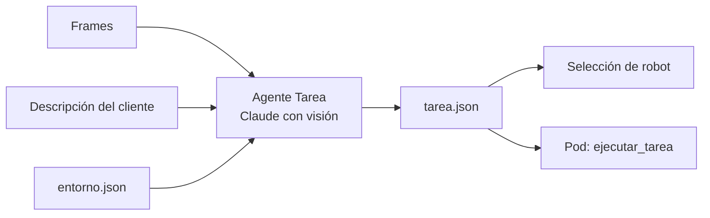

# Contrato: agente Tarea

> Etapa 2. Requerimientos: RF-TAR-01..03.
> **En el demo no se usa (Could):** el equipo escribe `tarea.json` a mano (RF-TAR-04).
> Código: [`agentes/__init__.py`](../../backend/viaz/agentes/__init__.py) → `tarea()`. Prompt: [`prompts/tarea.md`](../../backend/viaz/agentes/prompts/tarea.md).

## 1. Propósito

- **Decide:** qué trabajo hace el robot en la simulación y cómo se mide.
- **Hoy:** una sola tarea, `instalar_panel`.

## 2. Entradas

| Entrada | Origen |
|---|---|
| Frames | Los mismos del mapeo (pueden faltar) |
| Descripción del cliente | `proyectos.descripcion` |
| `entorno.json` | Agente de mapeo |

## 3. Salida: `tarea.json`

| Campo | Lo llena | Regla |
|---|---|---|
| `version` | Orquestador | `1` |
| `tarea` | Agente | `"instalar_panel"` |
| `descripcion` | Agente | Una oración en español |
| `pila_paneles.en_robot` | Agente | `true` |
| `pila_paneles.cantidad` | Agente | 3 a 10 (esquema: 1 a 30) |
| `objetivo.paneles` | Agente | 1 a `pila_paneles.cantidad`; demo: 3 a 5 |
| `objetivo.ciclo_s` | Agente | 30 a 120 (esquema: 1 a 600) |
| `restricciones` | Agente | 2 a 5 frases; siempre incluye "no chocar con las estructuras" y "panel horizontal durante el traslado" |

## 4. Reglas que verifica el código

1. La salida cumple `tarea.schema.json`.
2. **[Por hacer]** `objetivo.paneles ≤ pila_paneles.cantidad`. Hoy lo corrige `sim/plan.py` al planificar (`cantidad()` toma el mínimo).

## 5. Instrucciones (resumen del prompt)

- **Sin pedido del cliente:** 5 paneles y 60 s por panel.
- **Con pedido:** se respeta dentro de los rangos.
- **Restricciones de los frames:** personas cerca, pendiente fuerte, suelo blando, viento.
- **Duración:** la tarea cabe en menos de 10 min simulados.

## 6. Errores

| Caso | Resultado |
|---|---|
| Salida fuera del esquema | `ErrorAgente` → corrida en `error` |
| El modelo rechaza | Respaldo automático; si falla, `ErrorAgente` |

## 7. Pruebas

- **Esquema:** el fixture [`fixtures/tarea.json`](../../backend/viaz/fixtures/tarea.json) valida en `pytest`.
- **Plan:** `sim/plan.py` → `cantidad()` devuelve al menos 1 panel con el `entorno.json` de la corrida.
