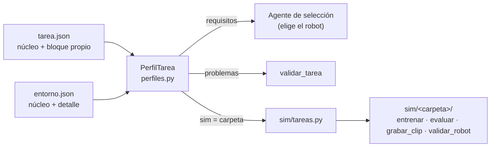

# Cómo agregar un dominio (lugar + tarea)

> Estado: **v1** (2026-11-22). Requerimientos: RF-GEN-01..08, RNF-21 ([`requerimientos.md`](requerimientos.md) §4.0).
> Ejemplo real: `animar_evento` (un robot anima una fiesta en la sala del pitch), agregado sin tocar los agentes.

Un **dominio** es un par (tipo de lugar, tipo de tarea). Lo propio de cada dominio vive en su **perfil**. Los agentes, el orquestador, el runner y la web no cambian.

## Qué archivos se crean o tocan

| Paso | Archivo | Qué va | Ejemplo `animar_evento` |
|---|---|---|---|
| 1 | `backend/viaz/esquemas/tarea.schema.json` | Bloque propio de la tarea + regla `if/then/else` en `allOf` | `animacion`: puntos y coreografía |
| 2 | `backend/viaz/agentes/perfiles.py` | `PerfilTarea` con `requisitos`, `problemas` y `sim` | `perfil_animar`, `problemas_animar`, `sim="animar"` |
| 3 | `sim/tareas.py` → `CARPETAS` | Tarea → carpeta de simulación | `"animar_evento": "animar"` |
| 4 | `sim/<carpeta>/` | Los 4 comandos del contrato ([`contrato-entorno-rl.md`](contrato-entorno-rl.md)) | `sim/animar/` |
| 5 | `backend/viaz/fixtures/` | Un `entorno.json` y un `tarea.json` de ejemplo | `entorno_evento.json`, `tarea_animar.json` |
| 6 | `backend/tests/` | Pruebas del perfil y del despacho | `test_animar.py`, `test_tareas_sim.py` |

## Reglas

- **Los requisitos son físicos, no eligen el robot.** El perfil dice lo que la tarea exige (carga, alcance, ancho libre, movilidad). El tipo de robot lo elige el agente de selección. Lo que la tarea agradece va en `capacidades_deseadas`, como preferencia.
- **Los límites de VIAZ se dicen como límites de VIAZ.** Si la simulación solo corre con ciertos robots, el perfil lo pone en un requisito explícito (`requiere_modelo_sim`). Así el agente sabe por qué se descarta un robot.
- **Tolerancias y metas salen de `tarea.json`** (`criterios_exito`, `objetivo`). Ningún script ni prompt las fija.
- **Si falta el perfil, la corrida se detiene con un error claro** (`exigir_pipeline`), después de escribir `entorno.json`, `escena.usd` y `tarea.json`.

## El robot en el simulador: dos caminos

| Camino | Cuándo | Qué escribe el orquestador |
|---|---|---|
| Ensamblaje (agente constructor) | El robot no tiene modelo publicado | `ensamblaje.json`, `robot_cfg.py`, `clon.json` con `piezas` y `geometria` |
| Modelo del fabricante | La ficha trae `modelo_sim` (Isaac Lab) | `robot_cfg.py` que importa el modelo, `clon.json` con `modelo` |

Los dos pasan por `validar_robot` en la escena de la corrida.

## Escena

- `generar_escena.py` dibuja cualquier `tipo` con el núcleo: suelo, paredes y una caja o cilindro por elemento, con colisión.
- Un elemento con `detalle` (`sillas`, `tarima`, `pantalla`, `mesa_alta`, `graderia`, `parlante`, `letras`) se dibuja con piezas ([`sim/detalles.py`](../sim/detalles.py)). La colisión sigue siendo la caja.
- Una pieza nueva agrega su función en `sim/detalles.py` y su valor en el `enum` de `entorno.schema.json`.

## Estado

| | Qué |
|---|---|
| Real y probado | Perfil, esquemas, selección y despacho de `animar_evento` (`pytest`). `validar_robot` del H1 en la sala del pitch, en Isaac. |
| Sin probar | Ver la sección de estado del PR de esta rama. |
| No existe | Un perfil de `tomar_y_dejar` con simulación (la sala de `entorno_sala.json` no corre de punta a punta). |
