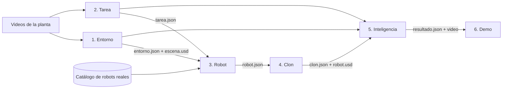
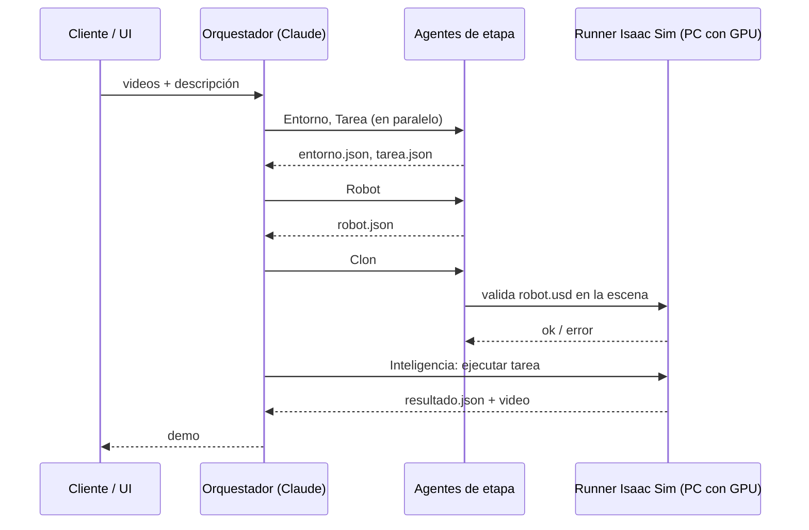

# Arquitectura propuesta

> Estado: **propuesta** para que el equipo la revise. Lo marcado **[Por definir]** lo decide el equipo.
> Contrato entre etapas: [`contrato-datos.md`](contrato-datos.md).

## 1. Qué construimos

Somos el puente entre una industria sin robots y los robots que ya existen.
El cliente entrega videos de su planta. El sistema le devuelve un demo de un robot real trabajando en esa planta.

**Caso del demo:** un megaparque solar. El robot instala paneles en las estructuras.



| # | Etapa | Entrada | Salida | Qué hace |
|---|---|---|---|---|
| 1 | **Entorno** | Videos | `entorno.json`, `escena.usd` | Extrae parámetros de la planta y genera la escena 3D |
| 2 | **Tarea** | Videos + texto del cliente | `tarea.json` | Define qué trabajo hace el robot y cómo se mide |
| 3 | **Robot** | `entorno.json`, `tarea.json`, catálogo | `robot.json` | Elige el robot real que mejor calza y justifica la elección |
| 4 | **Clon** | `robot.json` | `clon.json`, `robot.usd` | Arma un modelo simulado con las medidas y la carga del robot real |
| 5 | **Inteligencia** | Escena + clon + tarea | `resultado.json`, `video.mp4` | Hace que el clon ejecute la tarea en Isaac Lab y la mide |
| 6 | **Demo** | Todo lo anterior | Página web | Muestra el flujo, el robot elegido, el video y las métricas |

## 2. Agentes



- **Orquestador:** un proceso en Python que llama a Claude con tool use. Corre las etapas en orden y guarda cada salida en `runs/<id>/`.
- **Un agente por etapa:** cada uno tiene su prompt, sus herramientas y su archivo de salida. No comparten estado: solo leen archivos del contrato.
- **Validación:** el orquestador valida cada salida contra su esquema JSON. Si falla, reintenta la etapa una vez y después se detiene.
- **Re-ejecución:** cada etapa lee solo archivos. Así se puede repetir una etapa sin volver a correr las anteriores.
- **Runner de Isaac Sim:** corre en la PC Linux con GPU. Recibe un script de Python, lo ejecuta en modo headless y devuelve la salida y los archivos.
- **MCP de Isaac Sim:** sirve para explorar la escena desde Claude en desarrollo. El pipeline no depende de él. **[Por definir]** si lo usamos.

## 3. Decisiones técnicas

### Entorno: híbrido
- **Escena física procedural.** Un parque solar repite filas, estructuras y terreno. El agente saca los parámetros del video y un script genera la escena USD con colisiones.
- **Fondo visual reconstruido (opcional).** NVIDIA NuRec u OVER convierten el video en una reconstrucción 3D. La usamos solo como fondo, sin física.
- **Por qué:** una malla sacada de video trae agujeros y ruido. El robot chocaría con artefactos.

### Robot: catálogo curado
- **Catálogo** en `data/robots/*.json`: 5 a 10 robots reales de instalación solar, con specs y fuente.
- **Candidatos ya investigados** (datos del 2026-09-28, hay que reverificarlos): Maximo (AES), Gritt, Charge Robotics, Luminous, Cosmic Robotics.
- **Robots chinos de instalación:** **[Por investigar]**. Son el ángulo del negocio: en Chile se pueden comprar y en EE. UU. no.
- **El agente elige solo dentro del catálogo.** La búsqueda web en vivo agrega riesgo durante el demo.

### Clon: paramétrico
- El agente arma el clon con piezas que ya existen en Isaac Lab: una base móvil, un brazo industrial y una ventosa.
- Ajusta lo que importa para la tarea: dimensiones, alcance, carga útil y velocidad.
- Las mallas visuales pueden ser aproximadas. `clon.json` lista las diferencias con el robot real.

### Inteligencia: dos capas
- **Secuencia completa con planificador** (cuRobo o RMPflow): tomar el panel, llevarlo y ponerlo en la estructura.
- **RL para una sub-tarea** (Isaac Lab + PPO): por ejemplo, alinear el panel sobre los rieles.
- **Por qué:** entrenar con RL la tarea completa no converge en las horas del hack.

### Demo web
- **Frontend estático** con el flujo, las salidas de cada etapa y el video.
- **Resultados precalculados.** La simulación corre en la PC con GPU, y la web muestra los `runs/` ya generados.
- **Deploy:** Vercel o similar desde un repo personal espejado. El README del hack explica por qué.

## 4. Estructura del repo

```
docs/                 arquitectura, contrato de datos, decisiones
orquestador/          pipeline: corre las etapas y valida salidas
agentes/<etapa>/      prompt + herramientas de cada agente
sim/                  scripts de Isaac Sim/Lab: escena procedural, clon, tarea, grabación
data/robots/          catálogo de robots reales (un JSON por robot)
data/videos/          videos de ejemplo (fuera de git si pesan mucho)
esquemas/             JSON Schema de cada archivo del contrato
runs/<id>/            salidas de una corrida (fuera de git, salvo la del demo)
web/                  demo
```

## 5. Quién hace qué **[Por definir]**

| Área | Carpetas | Responsable |
|---|---|---|
| Orquestador y agentes 2, 3 y 4 | `orquestador/`, `agentes/`, `data/robots/` | **[Por definir]** |
| Simulación y agentes 1 y 5 | `sim/`, `agentes/entorno/`, `agentes/inteligencia/` | **[Por definir]** (necesita la PC con GPU) |
| Demo, deploy y pitch | `web/` | **[Por definir]** |

- Un cambio en `contrato-datos.md` o en `esquemas/` se avisa a todo el equipo antes del merge.

## 6. Plan por checkpoint

```mermaid
timeline
  title Hitos del hack
  Checkpoint 1 (sáb 11:00) : Escena procedural de 3 filas en Isaac Sim : Clon del robot cargado en la escena : Pipeline de punta a punta con salidas fijas
  Checkpoint 2 (sáb 23:00) : Parámetros sacados de un video real : Selección de robot con justificación : El clon instala 1 panel con el planificador
  Freeze (dom 05:00) : Video del demo y métricas : Web desplegada : Pitch
```

- **Regla:** primero el flujo completo con datos fijos, después reemplazar cada etapa por la real.

## 7. Riesgos

| Riesgo | Impacto | Mitigación |
|---|---|---|
| No hay GPU RTX disponible | Sin simulación no hay demo | Confirmar la PC Linux o una instancia cloud **antes de todo** |
| RL no converge | No hay robot funcionando | El planificador hace la tarea; RL es un extra |
| Reconstrucción ruidosa | Choques falsos | Física procedural, reconstrucción solo visual |
| MCP de Isaac Sim inestable | Bloquea al equipo | Runner propio con scripts headless |
| Datos de robots desactualizados | Pitch con cifras falsas | Cada robot del catálogo cita su fuente y su fecha |
| "Demo fiel" sobrevendido | Pierde credibilidad con los jueces | Mostrar métricas y diferencias con el real, no prometer un gemelo exacto |

## 8. Preguntas abiertas

- ¿Qué GPU tenemos y dónde corre Isaac Sim?
- ¿Tenemos videos reales de un parque solar o usamos videos públicos?
- ¿Qué robot usamos de referencia para el demo?
- ¿Quién es responsable de cada área de la §5?
