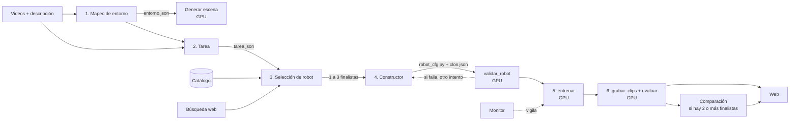
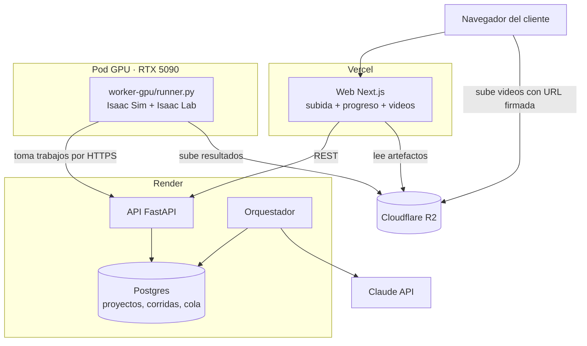
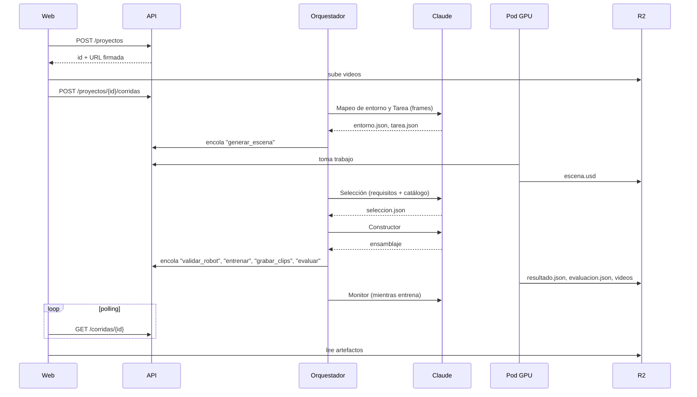
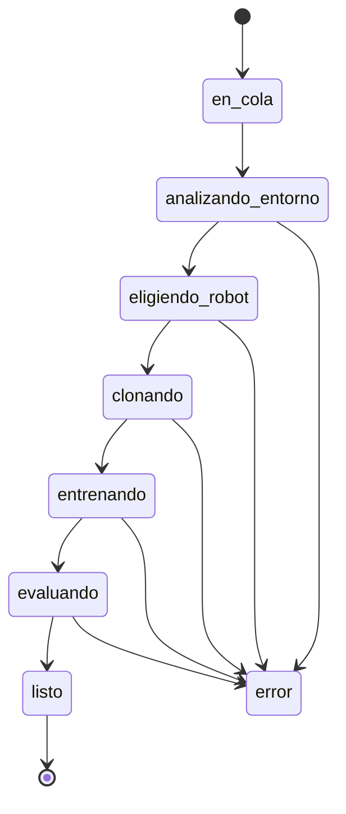

# Arquitectura de VIAZ

> Describe lo que existe hoy en `main`. Qué está probado y qué no: [`estado.md`](estado.md) (única fuente del estado).
> Contrato entre etapas y API: [`contrato-datos.md`](contrato-datos.md). Qué es VIAZ: [`../README.md`](../README.md).
> Requerimientos (MoSCoW + ISO): [`requerimientos.md`](requerimientos.md). Ciclo de desarrollo: [`ciclo-desarrollo.md`](ciclo-desarrollo.md). Versiones del pod: [`infraestructura.md`](infraestructura.md).

## 1. Qué construimos

VIAZ es una **aplicación web**. El cliente sube videos y una descripción de su lugar de trabajo.
Agentes de Claude describen el lugar y la tarea, y eligen un robot real de un catálogo.
El código arma un clon simulado del robot y lo entrena con RL (aprendizaje por refuerzo) en NVIDIA Isaac Lab.
La web muestra el robot elegido, los videos y las métricas.

**Alcance:** cualquier lugar de trabajo y cualquier tarea. Lo propio de cada rubro vive en un perfil de dominio ([`requerimientos.md`](requerimientos.md) §4.0, [`backend/viaz/agentes/perfiles.py`](../backend/viaz/agentes/perfiles.py)).

| Caso | Lugar | Tarea (`PERFILES_TAREA`) | Entorno RL |
|---|---|---|---|
| 1 | Megaparque solar | `instalar_panel`: tomar un panel y dejarlo en la estructura | [`sim/rl/`](../sim/rl/) |
| 2 | Sala de eventos (la del pitch) | `animar_evento`: el humanoide Unitree H1 recorre la sala | [`sim/animar/`](../sim/animar/) |
| 3 | Sala u oficina | Tomar una caja y dejarla en un estante | No existe. Solo fixtures de ejemplo |

[`sim/tareas.py`](../sim/tareas.py) lee `tarea.json → tarea` y llama a la carpeta de esa tarea (`CARPETAS`). El runner y el orquestador no saben qué tarea es.

## 2. Flujo por defecto: `rl`

`VIAZ_FLUJO` vale `rl` por defecto ([`backend/viaz/config.py`](../backend/viaz/config.py), campo `flujo`). El código está en `procesar_rl` y `entrenar_y_evaluar` ([`backend/viaz/orquestador.py`](../backend/viaz/orquestador.py)).



| # | Agente o paso | Quién lo hace | Salida |
|---|---|---|---|
| 1 | **Mapeo de entorno** | Claude con visión (`prompts/entorno.md`). Corre si hay videos, no hay `VIAZ_ENTORNO_MANUAL` y está `VIAZ_MEDIR` o `VIAZ_AGENTES=claude`. Si no, se lee el entorno a mano | `entorno.json`, `escena.usd` |
| 2 | **Tarea** | Claude con visión (`prompts/tarea.md`), con `VIAZ_TAREA_AGENTE=1`. Si no, se lee a mano | `tarea.json` |
| 3 | **Selección de robot** | Código (requisitos y descarte por reglas, `agentes/seleccion.py`) + Claude (`prompts/robot.md`) | `requisitos.json`, `seleccion.json` |
| 3b | **Búsqueda** | Claude con búsqueda web y citas (`agentes/busqueda.py`, `prompts/busqueda.md`, `prompts/busqueda_fichas.md`). Solo en modo `claude` con `VIAZ_BUSQUEDA=1` | Fichas nuevas en el catálogo |
| 4 | **Constructor** | Claude (`prompts/constructor.md`), hasta `VIAZ_INTENTOS_CONSTRUCTOR` intentos. Después, ensamblaje por defecto sin LLM. Si el robot trae `modelo_sim` (hoy el H1), usa ese modelo sin agente | `robot_cfg.py`, `clon.json`, `robot.urdf` |
| 5 | **Entrenamiento** | Isaac Lab en el pod (trabajo `entrenar`) | `curva.json`, `checkpoints.json` |
| — | **Monitor** | Claude (`prompts/monitor.md`) con cupo `VIAZ_MONITOR_MAX_LLAMADAS`. Después, reglas ([`monitor.py`](../backend/viaz/monitor.py)) | `monitoreo.jsonl`, `hitos.json` |
| 6 | **Evaluación** | Isaac Lab (`grabar_clips`, `evaluar`) | `resultado.json`, `evaluacion.json`, videos |
| — | **Comparación** | El código elige al ganador. Claude escribe la explicación (`prompts/comparacion.md`, [`comparacion.py`](../backend/viaz/comparacion.py)) | `comparacion.json` |

- **Finalistas:** con 2 o 3, cada uno corre en una corrida hija ([`hijas.py`](../backend/viaz/hijas.py)).
- **Código determinista, sin LLM:** el clon paramétrico ([`urdf.py`](../backend/viaz/urdf.py)), las reglas del robot ([`robot_cfg.py`](../backend/viaz/robot_cfg.py)), el descarte de la selección y el ganador de la comparación.

### Flujo antiguo: `planificador` (legado)

Con `VIAZ_FLUJO=planificador`, `procesar` corre Entorno → Tarea → Selección → clon determinista (`agentes.clon`) → `validar_clon` → `ejecutar_tarea`. Este último reproduce un plan fijo ([`sim/plan.py`](../sim/plan.py)). No corre Constructor, RL, Monitor ni Comparación. Queda como respaldo y no es el flujo del demo.

## 3. Infraestructura

Ningún computador del equipo corre Isaac Sim: tenemos 2 Mac y 1 Windows ARM.
Por eso la simulación corre en una **RTX 5090 arrendada en Vast.ai** ([`infraestructura.md`](infraestructura.md)).



- **Diseño de deploy:** [`render.yaml`](../render.yaml). Si el deploy existe hoy: [`estado.md`](estado.md).
- **Sin Render ni R2:** [`worker-gpu/pod/todo_en_el_pod.sh`](../worker-gpu/pod/todo_en_el_pod.sh) levanta API, orquestador y `runner.py --modo isaac` en el pod.

### Decisiones clave
- **El worker GPU tira trabajos de la API (pull).** El pod no expone puertos. La cola vive en Postgres (`SELECT … FOR UPDATE SKIP LOCKED`). Si el pod se reinicia, retoma la cola.
- **Los archivos no pasan por Render.** El navegador y el pod suben directo a R2 con URLs firmadas. La web pide el progreso por polling a `GET /corridas/{id}`.
- **La clave de Claude vive solo en el orquestador.** El pod GPU no la necesita.

### Valores por defecto: `config.py` frente a `render.yaml`

| Variable | `config.py` (local) | `render.yaml` (demo) |
|---|---|---|
| `VIAZ_AGENTES` | `fijo` | `claude` |
| `VIAZ_MAX_FINALISTAS` | 3 (`TOPE_FINALISTAS` del esquema `seleccion`) | 1 |
| `VIAZ_HORAS_ENTRENAMIENTO` | 4 | 1 |
| `VIAZ_MONITOR_S` | 600 | 1800 |
| `VIAZ_MONITOR_MAX_LLAMADAS` | 12 | 6 |
| `VIAZ_TAREA_AGENTE` | 0 | 1 |

`config.py` sirve para desarrollar sin servicios externos. `render.yaml` fija la primera corrida real ([`pendientes-corrida-real.md`](pendientes-corrida-real.md), problemas 9 y 12). Por eso una corrida local sin variables corre hasta 3 finalistas de 4 h, uno tras otro (12 h de GPU).

## 4. Flujo de una corrida





El flujo `planificador` usa el estado `simulando` en vez de `entrenando` y `evaluando`.

## 5. Agentes

> Contratos e instrucciones de cada agente: [`agentes/`](agentes/README.md). Prompts: [`backend/viaz/agentes/prompts/`](../backend/viaz/agentes/prompts/).

- **Un archivo de salida por agente.** Cada agente lee solo archivos del contrato. Así se puede repetir una etapa sin correr las anteriores.
- **Modelo:** Claude Opus 5.5 (`VIAZ_MODELO`). Todas las llamadas pasan por `pedir_json` ([`agentes/base.py`](../backend/viaz/agentes/base.py)): structured outputs con el JSON Schema de la etapa, streaming y `fallbacks: "default"`.
- **Errores de la API:** `pedir_json` reintenta 3 veces los errores pasajeros (esperas `ESPERAS_S`: 5, 20 y 60 s). Si sigue fallando, lanza `ErrorAgente`.
- **Validación:** cada salida se valida contra su JSON Schema. Si falla, la corrida pasa a `error` con el motivo. Una etapa completa no se reintenta. Solo el Constructor tiene varios intentos.
- **Modo `fijo`:** `VIAZ_AGENTES=fijo` devuelve fixtures, para desarrollar sin gastar API.
- **Videos a frames:** el orquestador extrae 1 frame cada 3 s (máx. 8) con `ffmpeg` para Mapeo de entorno y Tarea.
- **Selección:** las specs del robot se copian del catálogo, nunca del modelo.
- **Chequeo previo:** en modo `claude`, `comprobar_claude` prueba la clave al arrancar. Si falla, el orquestador sale con código 2.
- **Fuente:** `monitoreo.jsonl` y `comparacion.json` dicen si la salida vino de Claude o de las reglas.

## 6. Simulación en el pod

Escena física (capas, masas, fricción y prueba de física): [`escena-isaac.md`](escena-isaac.md). Contrato del entorno RL: [`contrato-entorno-rl.md`](contrato-entorno-rl.md).

### Runner
- [`worker-gpu/runner.py`](../worker-gpu/runner.py) toma trabajos de la API, de a uno, corre scripts de `sim/` y sube los resultados.
- **Trabajos del flujo `rl`:** `generar_escena`, `medir_entorno`, `validar_robot`, `entrenar`, `grabar_clips` y `evaluar`.
- **Trabajos del flujo `planificador`:** `validar_clon` y `ejecutar_tarea`.
- **Modo `isaac`:** exige `VIAZ_CMD_ENTRENAR`, `VIAZ_CMD_EVALUAR`, `VIAZ_CMD_GRABAR_CLIP` y `VIAZ_CMD_VALIDAR_ROBOT`. Los cuatro pasan por `sim/tareas.py`.
- **Modo `simulado`:** usa [`sim/rl_simulado.py`](../sim/rl_simulado.py). **Inventa las métricas y los videos.** Sirve solo para desarrollar en un Mac.

### Qué hace cada script
- **`generar_escena`** ([`sim/generar_escena.py`](../sim/generar_escena.py)): crea `escena.usd` (USDA) desde `entorno.json`. Es Python puro.
- **`sim/rl/`:** entorno Isaac Lab de `instalar_panel` (entrenar, evaluar, grabar clip, validar robot).
- **`sim/animar/`:** entorno Isaac Lab de `animar_evento` (humanoide H1, PPO con `rsl_rl`).
- **Legado:** [`sim/validar_clon.py`](../sim/validar_clon.py) y [`sim/ejecutar_tarea.py`](../sim/ejecutar_tarea.py), solo del flujo `planificador`.

Qué scripts se probaron en Isaac y con qué resultado: [`estado.md`](estado.md).

### Operación del pod
- Instalación: [`worker-gpu/pod/instalar.sh`](../worker-gpu/pod/instalar.sh). Prueba de humo: [`worker-gpu/pod/humo.sh`](../worker-gpu/pod/humo.sh). Acceso solo con `ssh viaz-pod` ([`infraestructura.md`](infraestructura.md) §4).
- **Apagar el pod cuando nadie lo use.** El volumen persistente conserva el caché de shaders y los assets.

## 7. Web

[`web/`](../web/) (Next.js 15 con react-three-fiber) muestra la subida de videos, el progreso, el robot elegido con su justificación, las diferencias del clon con el real, los videos y las métricas. El visor 3D genera la escena desde `entorno.json`, con las mismas reglas que `generar_escena`.

## 8. Estructura del repo

```
docs/                         arquitectura, contratos, desarrollo, estado
backend/viaz/api.py           FastAPI: proyectos, corridas, cola y URLs firmadas
backend/viaz/orquestador.py   corre los agentes en orden (flujos rl y planificador)
backend/viaz/agentes/         lógica y prompts de los agentes, perfiles de dominio
backend/viaz/esquemas/        JSON Schema de cada archivo del contrato
backend/viaz/catalogo/robots/ catálogo de robots (un JSON por robot)
backend/viaz/urdf.py          clon paramétrico del robot
backend/tests/                tests del backend
worker-gpu/runner.py          runner: toma trabajos y ejecuta scripts de sim/
worker-gpu/pod/               instalador, prueba de humo y corrida en el pod
sim/                          escena, entornos RL (rl/, animar/) y scripts de Isaac
web/                          Next.js: subida, progreso, videos y visor 3D
render.yaml                   blueprint de Render: API, orquestador y Postgres
```

Cómo correr todo en local y desplegar: [`desarrollo.md`](desarrollo.md).

## 9. Quién hace qué

| Área | Carpetas | Responsable |
|---|---|---|
| Web, deploy y pitch | `web/` | **[Por definir]** |
| API, orquestador y agentes | `backend/` | **[Por definir]** |
| Pod GPU, runner y entornos RL | `worker-gpu/`, `sim/` | **[Por definir]** |

Lo abierto está en [`estado.md`](estado.md). Un cambio en `contrato-datos.md` o en `backend/viaz/esquemas/` se avisa a todo el equipo antes del merge.

## 10. Costos estimados

| Servicio | Plan | Costo |
|---|---|---|
| Vercel | Hobby | US$0 |
| Render: API, Background Worker y Postgres | Starter, Starter, Basic 256 MB | ~US$7 + ~US$7 + ~US$6 al mes |
| Cloudflare R2 | Plan gratis (10 GB) | US$0 |
| RTX 5090 | Por hora, en pod | [`investigacion-isaac-gpu.md`](investigacion-isaac-gpu.md); horas por fase en [`plan-entrenamiento.md`](plan-entrenamiento.md) |
| Claude API | Por uso | Depende de la corrida |

## 11. Corrida de respaldo para el pitch

`GET /corridas/demo` muestra la corrida cuyo id está en `VIAZ_CORRIDA_DEMO` ([`backend/viaz/api.py`](../backend/viaz/api.py)), aunque el pod esté apagado. Si esa corrida existe: [`estado.md`](estado.md).

## 12. Riesgos

| Riesgo | Impacto | Mitigación |
|---|---|---|
| El pod se cae o se acaba el saldo | Se corta el demo | Volumen persistente + corrida de respaldo |
| RL no converge | No hay robot funcionando | Bajo 50 % de éxito, `resultado.json` lo anota (plan B con planificador, RF-INT-01) |
| Claude falla a mitad de la corrida | Etapa sin respuesta | Reintentos en `pedir_json`; Monitor y Comparación caen a reglas y lo marcan en `fuente` |
| La escena web no calza con la de Isaac | El visor muestra otra cosa | Las dos salen del mismo `entorno.json` con las mismas reglas |
| Datos de robots desactualizados | Cifras falsas en el pitch | Cada robot del catálogo cita su fuente y su fecha |
| "Demo fiel" sobrevendido | Pierde credibilidad | Mostrar métricas, diferencias con el real y el estado en [`estado.md`](estado.md) |
