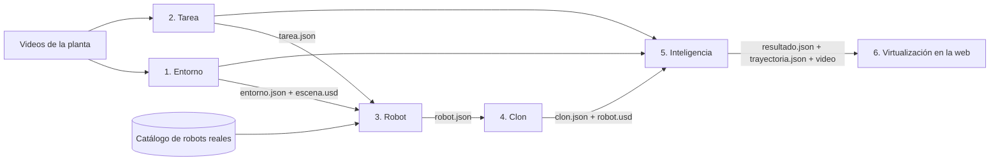
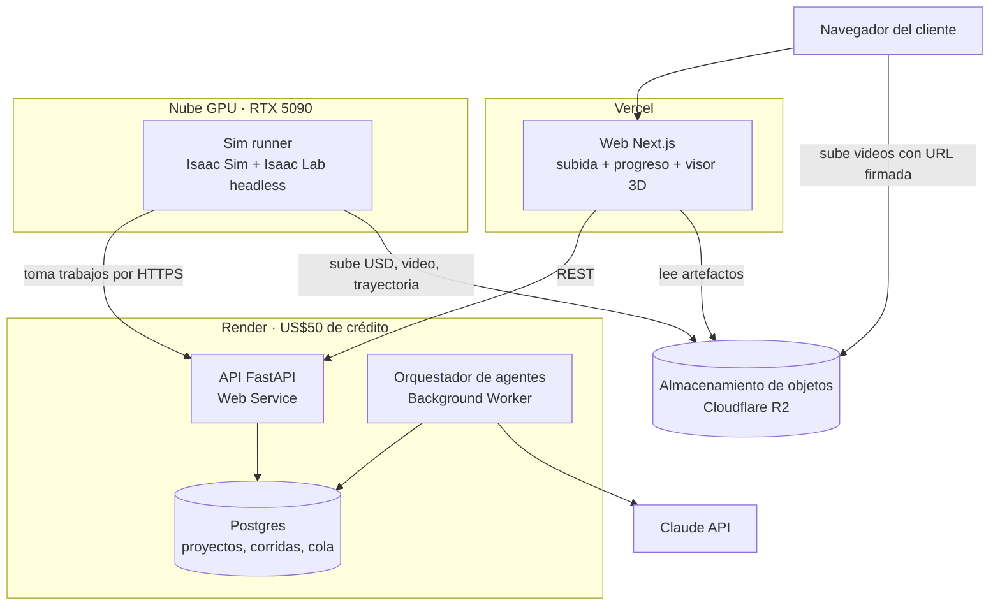
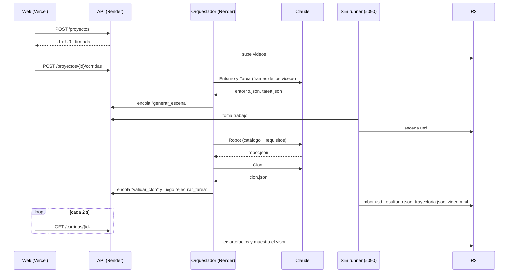
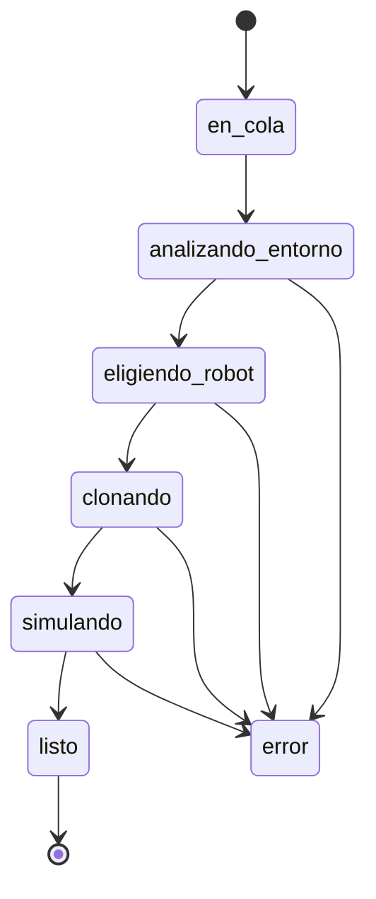

# Arquitectura de VIAZ

> Estado: **propuesta** para que el equipo la revise. Lo marcado **[Por definir]** lo decide el equipo.
> Contrato entre etapas y API: [`contrato-datos.md`](contrato-datos.md). Qué es VIAZ: [`../READMEVIAZ.md`](../READMEVIAZ.md).
> Requerimientos (MoSCoW + ISO): [`requerimientos.md`](requerimientos.md). Ciclo de desarrollo: [`ciclo-desarrollo.md`](ciclo-desarrollo.md). Versiones del pod: [`infraestructura.md`](infraestructura.md).

## 1. Qué construimos

VIAZ es una **aplicación web**. El cliente sube videos de su planta.
Agentes en la nube virtualizan la planta, eligen un robot real, lo clonan y le ponen inteligencia en Isaac Lab.
La web le entrega al cliente la virtualización: un visor 3D y un video del robot trabajando en su planta.

**Alcance:** cualquier lugar de trabajo y cualquier tarea de manipulación. Lo propio de cada rubro vive en un perfil de dominio ([`requerimientos.md`](requerimientos.md) §4.0).
**Caso de referencia 1:** un megaparque solar. El robot instala paneles en las estructuras. El caso 2 está **[Por definir]**.



| # | Etapa | Dónde corre | Salida | Qué hace |
|---|---|---|---|---|
| 1 | **Entorno** | Render (análisis) + GPU (escena) | `entorno.json`, `escena.usd` | Saca parámetros de la planta desde los videos y genera la escena 3D |
| 2 | **Tarea** | Render | `tarea.json` | Define qué hace el robot y cómo se mide |
| 3 | **Robot** | Render | `robot.json` | Elige el robot real que mejor calza y justifica la elección |
| 4 | **Clon** | Render (diseño) + GPU (validación) | `clon.json`, `robot.usd`, `robot.urdf` | Arma el modelo simulado con medidas, alcance y carga del robot real |
| 5 | **Inteligencia** | GPU | `resultado.json`, `trayectoria.json`, `video.mp4` | Ejecuta la tarea en Isaac Lab, la mide y la graba |
| 6 | **Virtualización** | Vercel | Visor 3D + video | Muestra al cliente el robot trabajando en su planta |

## 2. Infraestructura

Ningún computador del equipo corre Isaac Sim: tenemos 2 Mac y 1 Windows ARM.
Por eso la simulación corre en una **RTX 5090 arrendada en la nube**. Todo lo demás corre en Vercel y Render.



| Pieza | Servicio | Por qué |
|---|---|---|
| **Web** | Vercel, Next.js | Deploy gratis y la URL pública que pide el hack |
| **API** | Render Web Service, Python FastAPI | Mismo lenguaje que Isaac Lab y los agentes |
| **Orquestador** | Render Background Worker, Python | Corre los agentes sin límite de tiempo por request |
| **Base de datos y cola** | Render Postgres | Una sola pieza para estado y cola de trabajos, sin Redis |
| **Archivos** | Cloudflare R2 | Videos y USD pesan mucho, y R2 no cobra egreso. Alternativa: Vercel Blob |
| **Simulación** | RTX 5090 en RunPod o Vast.ai **[Por definir]** | Isaac Sim necesita GPU NVIDIA RTX |
| **LLM** | Claude API | Visión para los videos y tool use para los agentes |

### Decisiones clave
- **El worker GPU tira trabajos de la API (pull).** El pod no expone puertos. Si el pod se reinicia, retoma la cola.
- **La cola vive en Postgres.** El worker toma trabajos con `SELECT … FOR UPDATE SKIP LOCKED`.
- **Los archivos no pasan por Render.** El navegador y el pod suben directo a R2 con URLs firmadas.
- **Progreso en la web por polling** cada 2 s a `GET /corridas/{id}`. Es más simple que WebSockets.
- **La clave de Claude vive solo en Render.** El pod GPU no la necesita.

## 3. Flujo de una corrida





## 4. Agentes

> Contratos e instrucciones de cada agente: [`agentes/`](agentes/README.md).

- **Un agente por etapa:** cada uno tiene su prompt, sus herramientas y su archivo de salida. Solo leen archivos del contrato.
- **Modelo:** Claude Opus 5.5 (`VIAZ_MODELO`). Las respuestas usan structured outputs (`output_config.format`) con el JSON Schema de la etapa, y `fallbacks: "default"` por si el modelo rechaza la consulta.
- **Modo `fijo`:** `VIAZ_AGENTES=fijo` devuelve fixtures, para desarrollar el flujo sin gastar API.
- **Videos a frames:** el orquestador extrae 1 frame cada 3 s (máx. 8) con `ffmpeg` y se los manda a los agentes Entorno y Tarea.
- **Robot:** el agente elige un `id` del catálogo y justifica. Las specs se copian del catálogo, nunca del modelo.
- **Clon:** es código determinista, sin LLM ([`backend/viaz/urdf.py`](../backend/viaz/urdf.py)). Después el trabajo `validar_clon` lo revisa en la escena.
- **Validación:** cada salida se valida contra su JSON Schema. Si falla, la corrida pasa a `error` con el motivo. **[Por hacer]** reintentar la etapa 1 vez.
- **Re-ejecución:** cada etapa lee solo archivos. Así se puede repetir una etapa sin correr las anteriores.

## 5. Simulación en la 5090

Escena física (capas, masas, fricción y prueba de física): [`escena-isaac.md`](escena-isaac.md).

### Sim runner
- **Programa Python** en el pod. Toma trabajos de la API, corre scripts de `sim/` en Isaac Sim headless y sube los resultados a R2.
- **Tipos de trabajo:** `generar_escena`, `validar_clon`, `ejecutar_tarea` y `entrenar_subtarea`.
- **Un trabajo a la vez.** Isaac Sim usa casi toda la GPU.

### Qué hace cada script
- **`generar_escena`** ([`sim/generar_escena.py`](../sim/generar_escena.py)): crea `escena.usd` (USDA) desde `entorno.json`, con suelo, tubos y postes, todo con colisión. Es Python puro.
- **`validar_clon`** ([`sim/validar_clon.py`](../sim/validar_clon.py)): importa `robot.urdf` en la escena. Revisa las 6 articulaciones y que el plan alcance la pila y la estructura.
- **`ejecutar_tarea`** ([`sim/ejecutar_tarea.py`](../sim/ejecutar_tarea.py)):
  - **v0:** reproduce el plan de [`sim/plan.py`](../sim/plan.py) con física, mide dónde quedó cada panel y graba `video.mp4`.
  - **Siguiente versión:** planificador (cuRobo o RMPflow) en vez del plan fijo.
- **`entrenar_subtarea`:** RL con PPO en Isaac Lab para una sub-tarea, por ejemplo alinear el panel. Es opcional y **[Por hacer]**.
- **Modo `simulado`:** el runner hace la validación y la trayectoria solo con `sim/plan.py`, sin Isaac. Sirve para desarrollar en un Mac.
- **Sin probar:** los scripts de Isaac **no se han probado en Isaac**. Probarlos en el pod es lo primero.

### Puesta en marcha del pod (primera hora del hack)
1. Arrendar la 5090 con un **volumen persistente**. Ahí quedan el caché de shaders de Isaac y los assets.
2. Usar la imagen oficial de Isaac Sim (`nvcr.io/nvidia/isaac-sim`) en una versión con soporte para RTX 50 (Blackwell) **[Por definir: verificar versión]**.
3. Correr un ejemplo headless de Isaac Lab. Si falla, cambiar de proveedor **antes** de escribir código de simulación.
4. Desarrollar en el pod por SSH (VS Code Remote o Cursor). Para ver la GUI, usar el livestream WebRTC de Isaac Sim, solo para depurar.
5. **Apagar el pod cuando nadie lo use.** El volumen se conserva.

## 6. Virtualización en la web

- **Visor 3D** con three.js (react-three-fiber) en el navegador.
- **Escena:** la web la genera desde `entorno.json`, con las mismas reglas que `generar_escena`. No hace falta convertir USD a formato web.
- **Robot:** la web carga `robot.urdf` con `urdf-loader`.
- **Movimiento:** la web reproduce `trayectoria.json`. El cliente puede pausar, mover la cámara y ver la escena desde cualquier ángulo.
- **Video:** `video.mp4` renderizado en Isaac, como respaldo y para el pitch.
- **Panel lateral:** robot elegido y su justificación, diferencias del clon con el real, y métricas.

## 7. Estructura del repo

```
docs/                         arquitectura, contrato de datos, desarrollo y deploy
backend/viaz/api.py           FastAPI en Render: proyectos, corridas, cola y URLs firmadas
backend/viaz/orquestador.py   Background Worker en Render: corre los agentes en orden
backend/viaz/agentes/         prompt y lógica de cada agente (Entorno, Tarea, Robot, Clon)
backend/viaz/esquemas/        JSON Schema de cada archivo del contrato
backend/viaz/catalogo/robots/ catálogo de robots reales (un JSON por robot)
backend/viaz/urdf.py          clon paramétrico del robot
backend/tests/                flujo de punta a punta y contrato
worker-gpu/runner.py          sim runner: toma trabajos y ejecuta scripts de sim/
sim/                          plan de la tarea (Python puro) y scripts de Isaac Sim
web/                          Next.js en Vercel: subida, progreso y visor 3D
render.yaml                   blueprint de Render: API, orquestador y Postgres
```

Cómo correr todo en local y desplegar: [`desarrollo.md`](desarrollo.md).

## 8. Costos estimados

| Servicio | Plan | Costo |
|---|---|---|
| Vercel | Hobby | US$0 |
| Render Web Service (API) | Starter, para que no se duerma | ~US$7/mes |
| Render Background Worker | Starter | ~US$7/mes |
| Render Postgres | Basic 256 MB | ~US$6/mes |
| Cloudflare R2 | Plan gratis (10 GB) | US$0 |
| RTX 5090 | Por hora, en pod | **[Por verificar]**: comparar precios de RunPod y Vast.ai el día del hack |
| Claude API | Por uso | **[Por definir]**: créditos del hack o cuenta propia |

- **Render:** unos US$20 al mes, dentro del crédito de US$50.
- **GPU:** el costo depende de las horas encendidas. Apagar el pod es la principal forma de ahorrar.
- **Horas de GPU por fase:** [`plan-entrenamiento.md`](plan-entrenamiento.md) estima unas 3 a 5 h en total, con entrenamiento por lotes y el pod apagado entre fases.

## 9. Quién hace qué **[Por definir]**

| Área | Carpetas | Responsable |
|---|---|---|
| Web y visor 3D, deploy y pitch | `web/` | **[Por definir]** |
| API, orquestador y agentes 2, 3 y 4 | `api/`, `orquestador/`, `agentes/`, `data/robots/` | **[Por definir]** |
| Pod GPU, sim runner y agentes 1 y 5 | `worker-gpu/`, `sim/` | **[Por definir]** |

- Un cambio en `contrato-datos.md` o en `esquemas/` se avisa a todo el equipo antes del merge.
- Las tres áreas trabajan en paralelo desde el inicio: el contrato fija las interfaces.

## 10. Plan por checkpoint

```mermaid
timeline
  title Hitos del hack
  Checkpoint 1 (sáb 11:00) : Pod con Isaac corriendo un ejemplo : API + Postgres en Render y web en Vercel : Flujo de punta a punta con salidas fijas
  Checkpoint 2 (sáb 23:00) : Escena procedural desde un video real : Robot elegido y clon validado en el pod : Visor 3D reproduce la trayectoria
  Freeze (dom 05:00) : El clon hace la tarea en la escena de cada caso : Video, métricas y corrida de demo guardada : Pitch
```

- **Regla:** primero el flujo completo con datos fijos, después cambiar cada etapa por la real.
- **Corrida de respaldo:** se guarda una corrida completa de cada caso de referencia en R2. Si el pod falla en el pitch, la web la muestra igual.

## 11. Riesgos

| Riesgo | Impacto | Mitigación |
|---|---|---|
| Isaac no arranca en el pod (driver, Vulkan o versión sin soporte para la 5090) | Sin simulación | Probarlo en la primera hora; tener un segundo proveedor listo |
| El pod se cae o se acaba el saldo | Se corta el demo | Volumen persistente + corrida de respaldo en R2 |
| RL no converge | No hay robot funcionando | El planificador hace la tarea; RL es un extra |
| La escena web no calza con la de Isaac | El visor muestra otra cosa | Las dos se generan desde el mismo `entorno.json` con las mismas reglas |
| Render free se duerme | Primera carga lenta en el pitch | Plan Starter para la API |
| Datos de robots desactualizados | Cifras falsas en el pitch | Cada robot del catálogo cita su fuente y su fecha |
| "Demo fiel" sobrevendido | Pierde credibilidad | Mostrar métricas y diferencias con el real |

## 12. Preguntas abiertas

- ¿RunPod o Vast.ai? ¿Quién crea la cuenta y carga el saldo?
- ¿De dónde salen los créditos de la Claude API?
- ¿Tenemos videos reales de cada caso de referencia (parque solar y caso 2) o usamos videos públicos?
- ¿Qué robot usamos de referencia para el demo?
- ¿Quién es responsable de cada área de la §9?
