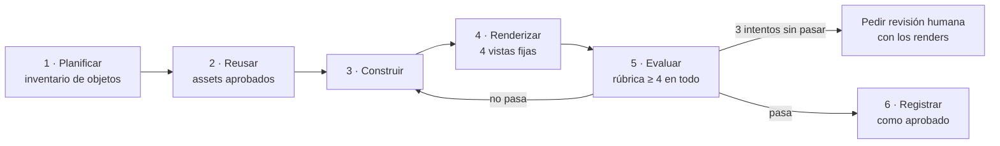

# Estándar de calidad de la virtualización

> Estado: **v1** (2026-11-21). Vale para **cualquier lugar y cualquier robot** que virtualice VIAZ: parque solar, bodega, mina, oficina, planta.
> Lo leen los agentes que construyen escenas, objetos y robots en Isaac Sim / Isaac Lab, y las personas que los revisan.
> Reglas cortas para agentes: [`CLAUDE.md`](../CLAUDE.md) y [`sim/CLAUDE.md`](../sim/CLAUDE.md).

## 0. Por qué existe

"Buena calidad" no estaba escrito. Cada agente la interpretaba distinto, y una escena aceptable tomó 6 intentos. Este documento convierte la calidad en **reglas medibles, ejemplos y una revisión obligatoria**.



## 1. Principios

1. **Fiel a los datos, nunca inventado.** Medidas, cantidades y posiciones salen de los archivos de entrada (`entorno.json`, `tarea.json`, `robot.json`, specs del fabricante). Si un dato falta, se marca como supuesto en el registro, no se rellena en silencio.
2. **Reusar antes de crear.** Orden de búsqueda: (1) assets aprobados del proyecto, (2) assets de Isaac Sim / Omniverse (incluidos los SimReady), (3) modelado propio. Un asset aprobado **no se regenera**: se reutiliza o se modifica con un cambio justificado.
3. **El detalle depende del papel del objeto**, no del gusto (§2).
4. **Lo visual y la física van separados.** La malla de colisión puede ser simple. La malla visual no.
5. **Se mide, no se opina.** Cada escena pasa la rúbrica (§5) con renders, antes de declararla lista.

## 2. Nivel de detalle según el papel del objeto

| Papel | Ejemplos (cualquier dominio) | Geometría visual | Materiales |
|---|---|---|---|
| **A · Interactúa con el robot** | Lo que agarra, donde lo deja, herramientas, puntos de montaje | Forma real: bordes, espesores, perforaciones, partes separadas (marco, vidrio, tapa, mango) | PBR completo, con mapas de normales o detalle donde la cámara se acerca |
| **B · Visible cerca de la cámara** | Estructuras de apoyo, estantes, postes, mesas, el robot entero | Forma reconocible a 1 m de distancia. Sin cajas lisas donde el objeto real tiene relieve | PBR con color, rugosidad y metalicidad reales |
| **C · Fondo** | Suelo lejano, horizonte, edificios, otras filas | Simple, pero con silueta correcta | Texturas sin estirar, sin color plano gris |
| **Solo física** | Mallas de colisión, volúmenes invisibles | Lo más simple que funcione | Ninguno (invisibles) |

**Regla del robot:** todo el robot es papel A o B. Ninguna pieza visible del robot puede ser un cilindro o una caja sin material.

## 3. Requisitos medibles

| Área | Requisito | Cómo se verifica |
|---|---|---|
| **Escala** | Metros, Z arriba (convención del proyecto). Cada medida de entrada a ±2 % | Render con referencia de escala (§4) y medición en el script |
| **Proporciones** | Las piezas guardan la relación del objeto real (ej.: espesor/largo de un panel, alto del robot vs. su alcance) | Comparar con la ficha o una foto real |
| **Materiales** | PBR (MDL de Omniverse u OmniPBR): color base, rugosidad y metalicidad físicamente plausibles. Vidrio con transmisión o reflejo; metales con metalicidad; suelos con textura | Vista de detalle (§4) |
| **Texturas** | Sin estiramiento ni costuras visibles. Densidad pareja: ≥ 512 px por metro en objetos A y B | Vista de detalle |
| **Iluminación** | Luz de cúpula (HDRI acorde al lugar: desierto, interior, galpón) + sol o luces de área. Sombras activas. Nada de solo luz ambiente plana | Vista general |
| **Render** | 1280 × 720 mínimo. Modo RTX Real-Time para clips; Path Traced si hay tiempo para la muestra final. Antialiasing activo | Archivo de salida |
| **Limpieza** | Sin objetos flotando, sin piezas que se atraviesan, sin parpadeo de caras (z-fighting), sin huecos en el suelo | Las 4 vistas |
| **Coherencia** | Mismo estilo en toda la escena: no mezclar un objeto fotorrealista con otro de baja calidad en el mismo plano | Vista general |

## 4. Las 4 vistas obligatorias

Cada escena, objeto o robot nuevo se entrega con estas capturas, siempre desde las mismas cámaras para poder comparar entre intentos:

| Vista | Cámara | Para qué |
|---|---|---|
| **1 · General** | Lateral 3/4, alta, toda la zona de trabajo | Composición, iluminación, coherencia |
| **2 · Detalle** | A 1 m del objeto principal que manipula el robot | Geometría y materiales del papel A |
| **3 · Robot** | A la altura de la cámara del video, el robot completo | Piezas, materiales, proporciones del robot |
| **4 · Escala** | Vista general con una figura humana de 1,75 m y una puerta de 2,1 m (solo en esta captura) | Que nada esté gigante o enano |

Las capturas se guardan en `docs/referencias/<escena>/intento_NN/` con nombres `1_general.png`, `2_detalle.png`, `3_robot.png`, `4_escala.png`.

## 5. Rúbrica

Cada criterio, de 1 a 5. **Para aprobar: todos ≥ 4.** El agente se evalúa mirando sus propias capturas y las compara con las referencias aprobadas y rechazadas (§7).

| Criterio | 1 · Rechazo | 3 · Insuficiente | 5 · Excelente |
|---|---|---|---|
| **Geometría** | Cajas y cilindros en lugar de objetos | Forma reconocible pero sin detalles clave (bordes, espesores, partes) | Se reconoce el objeto real a 1 m |
| **Materiales** | Gris por defecto o color plano | Colores correctos, todo con el mismo brillo | Cada superficie se lee como su material (metal, vidrio, plástico, tierra) |
| **Iluminación** | Plana, sin sombras | Sombras, pero luz que no corresponde al lugar | Luz y cielo coherentes con el lugar y la hora |
| **Escala y proporción** | Algo claramente fuera de escala | Medidas bien, proporciones raras | Coincide con los datos y con la figura humana |
| **Limpieza** | Objetos flotando o atravesados | Defectos menores visibles en una vista | Sin defectos en las 4 vistas |
| **Fidelidad a los datos** | Cantidades o medidas inventadas | Algún dato sin respaldo y sin marcar | Todo sale de las entradas; los supuestos están registrados |

Formato del informe de cada intento (`docs/referencias/<escena>/intento_NN/evaluacion.md`):

```markdown
| Criterio | Nota | Evidencia (vista) | Qué falta |
|---|---|---|---|
| Geometría | 4 | 2_detalle: marco y celdas visibles | Perforaciones del marco |
...
Veredicto: aprobado / rechazado
```

## 6. Proceso obligatorio para el agente

1. **Planificar antes de construir.** Escribir un inventario: cada objeto, su papel (A, B, C), su origen (asset aprobado, asset de Isaac, modelado propio) y su material.
2. **Reusar.** Buscar primero en el registro de aprobados ([`sim/assets_aprobados/`](../sim/assets_aprobados/README.md)).
3. **Construir** según §2 y §3.
4. **Renderizar las 4 vistas** (§4).
5. **Evaluar con la rúbrica** (§5). Si algún criterio < 4: corregir **solo lo que falló** y repetir desde 4.
6. **Límite: 3 intentos.** Si al tercero no pasa, parar y pedir revisión humana con las capturas y el informe. No seguir iterando a ciegas.
7. **Registrar lo aprobado** (§8), incluido **qué cambió respecto al intento anterior que hizo que pasara**. Ese aprendizaje vale más que el asset.

**Prohibido declarar "listo" sin las 4 capturas y la rúbrica.**

## 7. Referencias

- `docs/referencias/aprobadas/`: capturas de escenas aprobadas, con su evaluación. Son el estándar a igualar.
- `docs/referencias/rechazadas/`: capturas rechazadas, cada una con **qué está mal** en una línea. Enseñan qué evitar.
- Una imagen de referencia vale más que cualquier adjetivo: cuando haya duda, comparar.

## 8. Registro de assets aprobados

Cada asset aprobado se guarda en `sim/assets_aprobados/<nombre>/` con: el USD (o la receta que lo genera), las 4 capturas, la evaluación y una ficha. Formato en [`sim/assets_aprobados/README.md`](../sim/assets_aprobados/README.md).

## 9. Errores típicos (no hacer)

- Representar un objeto que el robot manipula con una caja del tamaño correcto.
- Dejar el material gris por defecto "para después".
- Iluminar solo con luz ambiente.
- Regenerar desde cero una escena que ya estaba aprobada.
- Cambiar varias cosas a la vez entre intentos (no se sabe qué arregló qué).
- Declarar "listo" mirando el código y no las capturas.
- Mezclar en una toma objetos de calidades muy distintas.
- Inventar medidas que faltan sin registrarlas como supuesto.

## Anexo A · Ejemplo: el demo de paneles solares

Solo ilustra cómo se aplica el estándar. **No es el alcance del producto.**

| Objeto | Papel | Qué exige |
|---|---|---|
| Panel solar | A | Marco de aluminio con espesor, vidrio con reflejo, grilla de celdas visible con sus líneas de conexión, caja de conexiones atrás; medidas de `entorno.json` |
| Tubo de torsión y postes | B | Perfiles reales (no cilindros lisos si el real es cuadrado), metal galvanizado |
| Suelo del desierto | C | Textura de tierra sin estirar, con variación; HDRI de cielo despejado |
| Robot | A/B | Base, brazo y ventosa con sus piezas y materiales; proporciones de la ficha del robot real |
