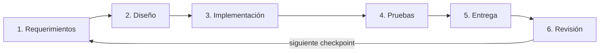
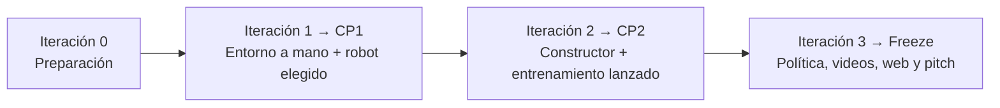

# Ciclo de desarrollo

> Estado: **propuesta**. Cómo pasamos de los requerimientos al demo en las horas del hack.
> Normas de referencia: ISO/IEC/IEEE 12207 (ciclo) y 29119 (pruebas), ver [`requerimientos.md` §7](requerimientos.md#7-normas-iso).
> Documentos base: [`requerimientos.md`](requerimientos.md) → [`arquitectura.md`](arquitectura.md) → [`contrato-datos.md`](contrato-datos.md).

## 1. Modelo

Usamos un ciclo **incremental por checkpoint**: cada checkpoint es una iteración corta que pasa por todas las fases y termina con algo que corre de punta a punta.

| Fase | Qué produce | Dónde vive | Estado |
|---|---|---|---|
| 1. Requerimientos | RF y RNF con ID, prioridad MoSCoW y normas ISO | `docs/requerimientos.md` | Borrador v0.6 |
| 2. Diseño | Arquitectura, contrato de datos, JSON Schemas | `docs/arquitectura.md`, `docs/contrato-datos.md`, `esquemas/` | Arquitectura y contrato propuestos; faltan esquemas |
| 3. Implementación | Código por etapa, primero el mapeo y con stubs | `web/`, `api/`, `orquestador/`, `agentes/`, `worker-gpu/`, `sim/` | Por empezar |
| 4. Pruebas | Validación de esquemas, pruebas por etapa, prueba de punta a punta | `tests/` | Por empezar |
| 5. Entrega | Web desplegada, corrida de respaldo, video, pitch | Vercel, Render, R2 | Por empezar |
| 6. Revisión | Qué cambió, qué se recorta | Sección "Bitácora" de este archivo | — |

## 2. Iteraciones

**Prioridad del equipo:** lanzar el entrenamiento RL lo antes posible. Dura horas y es el camino crítico del demo.

### Iteración 0 — Preparación (ahora → antes de CP1)
- [ ] Revisar y aprobar `requerimientos.md` v0.4 (los 3 integrantes).
- [ ] Arrendar el pod RTX 5090 y pasar la prueba de humo, incluido un ejemplo de RL de Isaac Lab ([`infraestructura.md`](infraestructura.md) §5).
- [ ] Elegir el parque real y escribir `entorno.json` y `tarea.json` a mano (RF-MAP-11, RF-TAR-04).
- [x] Decidir base, umbral y canal de avisos: base móvil con RL en el brazo, 90 % a 5 cm y 5° en 100 episodios, Discord.
- [ ] Crear el canal `#entrenamiento` en Discord y su webhook; guardar la URL en Render.

### Iteración 1 — Entorno y robot (→ CP1, sáb 11:00)
- [ ] `generar_escena` crea `escena.usd` desde el `entorno.json` a mano (RF-MAP-05..06).
- [ ] Catálogo de 5 a 10 robots reales con fuentes (RF-ROB-01..02).
- [ ] Agente de selección elige el robot y justifica (RF-ROB-03..04).
- [ ] Catálogo de assets de Isaac Lab verificado en el pod (`sim/assets_isaaclab.json`).
- [ ] Latido de trabajos largos en la API y el runner (RF-API-06, RF-GPU-06).

### Iteración 2 — Constructor y entrenamiento (→ CP2, sáb 23:00)
- [ ] Agente constructor: `ensamblaje.json` → `robot_cfg.py` → `validar_clon`, con 3 intentos (RF-CLO-01..06).
- [ ] Entorno RL `instalar_panel` en Isaac Lab con recompensa y condición de éxito (RF-INT-10..11), base con ruido (RF-INT-19) y controlador de la base (RF-INT-18).
- [ ] Entrenamiento lanzado con grabación de clips (RF-INT-12..13).
- [ ] Agente monitor leyendo métricas y avisando por Discord (RF-MON-01..04, RF-MON-08).
- [ ] Tras la primera hora: fijar las horas de entrenamiento con la pendiente de la curva (RNF-17).

### Iteración 3 — Política y demo (→ Freeze, dom 05:00)
- [ ] Elegir el checkpoint con el monitor y evaluar 100 episodios, a 5 cm/5° y a 2 cm/2° (RF-INT-14, RF-INT-20, RF-MON-05).
- [ ] Grabar `video.mp4` con la muestra y armar `entrenamiento_rapido.mp4` (RF-INT-13, RF-INT-15).
- [ ] Web con los dos videos, el robot elegido y las métricas (RF-WEB-06..09, RF-WEB-13, RF-WEB-15).
- [ ] Sección de la web que explica el flujo completo y rotula el parque de referencia (RF-WEB-19, RNF-20).
- [ ] Verificar los criterios de aceptación ([`requerimientos.md`](requerimientos.md) §8).
- [ ] Pitch.
- [ ] Plan B si el RL no llega al umbral: muestra con planificador (RF-INT-01).

**Regla de recorte:** si una tarea **M** está en riesgo 2 h antes del checkpoint, se deja su stub y se sigue. Un stub que funciona vale más que una etapa real a medias.

## 3. Pruebas

| Nivel | Qué prueba | Cómo | Cuándo |
|---|---|---|---|
| Esquema | Cada archivo del contrato | `jsonschema` contra `esquemas/` | En cada corrida (orquestador) y en CI |
| Etapa | Una etapa con entradas fijas | `pytest` con los stubs como fixture | Antes de cada merge que toca la etapa |
| Mapeo | `escena.usd` y la escena web salen iguales del mismo `entorno.json` | Comparar posiciones de filas y estructuras | Cada cambio en `generar_escena` o en el visor |
| API | Rutas de la web y del worker | `pytest` + cliente HTTP de FastAPI | Antes de cada merge en `api/` |
| Catálogo | Todo robot tiene `fuente.url` y `fuente.consultado` | Test que recorre `data/robots/` | En CI |
| Simulación | El clon carga y no atraviesa estructuras | Trabajo `validar_clon` del runner | En el pod RTX 5090 |
| Punta a punta | La corrida de demo cumple los 6 criterios de aceptación | Script `verificar_demo.py` | Antes del freeze |
| Web | Subida, progreso, visor, video y métricas | Revisión manual en la URL pública | Después de cada deploy |

## 4. Flujo de trabajo en git

- `main` siempre corre de punta a punta (aunque sea con stubs).
- Una rama por tarea: `feat/<etapa>-<algo>`, `docs/<algo>`, `fix/<algo>`.
- PR pequeño, una revisión de otra persona del equipo, y merge.
- Cambios en `contrato-datos.md` o `esquemas/`: se avisa a todo el equipo antes del merge (regla de la arquitectura).
- Commits citan el requerimiento cuando aplica: `feat(mapeo): escena procedural de 3 filas (RF-MAP-05)`.

## 5. Definición de "terminado"

Una tarea está terminada cuando:
1. Cumple el requerimiento que cita.
2. Su salida valida contra el esquema.
3. Tiene al menos una prueba (o un paso manual documentado si es de simulación).
4. Está en `main` y el flujo de punta a punta sigue corriendo.

## 6. Bitácora de revisiones

| Fecha | Checkpoint | Qué cambió | Decisiones |
|---|---|---|---|
| 2026-11-21 | — | Se crean requerimientos y ciclo de desarrollo | — |
| 2026-11-21 | — | Se agregan normas ISO e infraestructura | GPU: RTX 5090 en la nube; base: Ubuntu 22.04 + Isaac Sim 5.1 + Isaac Lab 2.3 (por verificar) |
| 2026-11-21 | — | Requerimientos v0.3 alineados con la arquitectura web + nube (PR #2) | El mapeo va primero; MoSCoW; normas ISO dentro de `requerimientos.md` |
| 2026-11-21 | — | Requerimientos v0.4: plan del demo con RL | Entorno y tarea a mano; agentes de selección, constructor y monitor; video en cámara rápida del entrenamiento en la web; tarea solo poner el panel |
| 2026-11-21 | — | Requerimientos v0.5 | Base móvil con navegación programada y RL en el brazo; meta 90 % a 5 cm y 5° en 100 episodios; tiempo fijo; avisos por Discord |
| 2026-11-21 | — | Requerimientos v0.6 | La subida de videos se explica en la web y en el pitch, pero no se usa en vivo; el demo muestra el parque de referencia |
