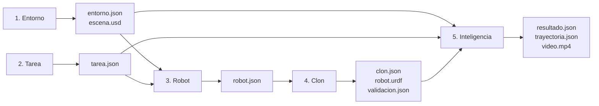

# Contrato de datos entre etapas

> **Fuente de verdad:** los JSON Schema de [`backend/viaz/esquemas/`](../backend/viaz/esquemas/). Este documento los explica.
> El orquestador valida cada archivo contra su esquema. Si no cumple, la corrida pasa a `error`.
> Si cambias un campo, edita en el mismo PR el esquema, este archivo y `web/lib/tipos.ts`, y avísale a todo el equipo.



## Reglas comunes

- **Archivos:** viven en `corridas/<id>/` del almacén (disco local o R2).
- **Unidades SI:** metros, kilogramos, segundos y grados. El nombre del campo lleva la unidad (`largo_m`). Los ángulos de `q` van en radianes.
- **Ejes:** Z arriba, como Isaac. El visor web lo rota a Y arriba.
- **`confianza`:** valor de 0 a 1 por cada dato que un agente infiere de un video.
- **`fuente`:** cada spec de un robot real lleva URL y fecha de consulta.
- **Versión:** cada archivo lleva `"version": 1`. Un cambio que rompe el formato sube la versión.

## Escena: mismas reglas en Isaac y en la web

[`sim/generar_escena.py`](../sim/generar_escena.py) y [`web/lib/escena.ts`](../web/lib/escena.ts) construyen la escena con las mismas reglas:

- **Filas:** la fila `i` tiene su tubo de torsión en `y = -i · separacion_m`, a `altura_m`, de `x = 0` a `x = largo_m`.
- **Postes:** van cada 7 m.
- **Robot:** avanza por el pasillo de la fila 0, en `y > 0`, mirando a `+X`.

## `entorno.json` (etapa 1)

```json
{
  "version": 1,
  "tipo": "parque_solar",
  "videos": ["planta-1.mp4"],
  "terreno": { "pendiente_grados": 2, "suelo": "tierra_compactada" },
  "filas": { "cantidad": 3, "largo_m": 30, "separacion_m": 6 },
  "estructura": { "tipo": "tracker_1_eje", "altura_m": 1.5, "inclinacion_grados": 0 },
  "panel": { "largo_m": 2.38, "ancho_m": 1.13, "peso_kg": 32 },
  "escena_usd": "escena.usd",
  "fondo_reconstruido_usd": null,
  "confianza": { "filas.separacion_m": 0.7, "panel.peso_kg": 0.5 }
}
```

- **Del agente:** el agente llena todo menos `version`, `videos`, `escena_usd` y `fondo_reconstruido_usd`. Esos los pone el orquestador.
- **`confianza` en el agente:** el agente la devuelve como lista `[{campo, valor}]`, porque structured outputs no acepta objetos con claves libres. El orquestador la convierte en objeto.
- **`escena.usd`:** texto USDA. Lo genera el trabajo de GPU `generar_escena`.

## `tarea.json` (etapa 2)

```json
{
  "version": 1,
  "tarea": "instalar_panel",
  "descripcion": "Tomar un panel de la pila que lleva el robot y dejarlo sobre el tubo de la fila 1",
  "pila_paneles": { "en_robot": true, "cantidad": 5 },
  "objetivo": { "paneles": 5, "ciclo_s": 60 },
  "restricciones": ["no chocar con las estructuras"]
}
```

## `robot.json` (etapa 3)

```json
{
  "version": 1,
  "id": "viaz-instalador-ficticio",
  "nombre": "Instalador de referencia (ficticio)",
  "fabricante": "VIAZ (robot de prueba, no existe)",
  "tipo": "base_movil_brazo",
  "ficticio": true,
  "carga_util_kg": 40,
  "alcance_m": 2.4,
  "velocidad_base_m_s": 1.0,
  "efector": "ventosa",
  "fuente": { "url": null, "consultado": null },
  "justificacion": "Por qué calza con entorno.json y tarea.json",
  "alternativas": [{ "id": "otro-robot", "por_que_no": "carga útil insuficiente" }]
}
```

- **Del agente:** el agente devuelve solo `id`, `justificacion` y `alternativas`. El `id` es un `enum` con los ids del catálogo.
- **Specs:** todas las specs salen de [`backend/viaz/catalogo/robots/`](../backend/viaz/catalogo/robots/), nunca del modelo.

## `clon.json` (etapa 4) + `robot.urdf` + `validacion.json`

```json
{
  "version": 1,
  "robot_id": "viaz-instalador-ficticio",
  "usd": null,
  "urdf": "robot.urdf",
  "piezas": { "base": "caja_4_ruedas", "brazo": "brazo_6_ejes", "efector": "ventosa" },
  "escala": { "alcance_m": 2.4, "carga_util_kg": 40 },
  "geometria": { "l1_m": 1.092, "l2_m": 1.008, "muneca_m": 0.3, "montaje_x_m": 0.45,
                 "hombro_z_m": 1.1, "cubierta_z_m": 0.8, "pila_x_m": -0.35 },
  "diferencias_con_real": ["geometría primitiva (cajas y cilindros), sin mallas del fabricante"],
  "validado_en_escena": true
}
```

- **Generación:** el clon lo arma código determinista ([`backend/viaz/urdf.py`](../backend/viaz/urdf.py)): una base con ruedas y un brazo de 6 ejes escalado al alcance del robot.
- **`geometria`:** tiene las medidas que usa el plan ([`sim/plan.py`](../sim/plan.py)). Coinciden con `robot.urdf`.
- **Articulaciones de `robot.urdf`:** `shoulder_pan`, `shoulder_lift`, `elbow`, `wrist_1`, `wrist_2` y `wrist_3`. El link de la ventosa se llama `efector`.
- **`validacion.json`:** sale del trabajo `validar_clon` con el formato `{"ok", "problemas": [], "fuente", "paneles_planificados"}`. Si `ok` es `false`, la corrida pasa a `error`.

## `resultado.json` (etapa 5)

```json
{
  "version": 1,
  "metodo": "planificador",
  "fuente": "isaac",
  "politica": null,
  "metricas": { "paneles_instalados": 4, "intentos": 5, "tasa_exito": 0.8, "ciclo_promedio_s": 11.5 },
  "video": "video.mp4",
  "notas": "Plan fijo v0 reproducido con física. Instalados: [0, 1, 2, 4]."
}
```

- **`fuente`:** `isaac` (con física) o `simulado` (trayectoria sintética del worker sin GPU). La web marca `simulado` como "sin física".
- **`video`:** `null` si no hay video, por ejemplo en modo simulado. Es la muestra del robot ya entrenado (RF-WEB-06).

### Campos opcionales del entrenamiento con RL

Los escribe el script de entrenamiento del pod. Si faltan, la web muestra la sección como pendiente.

```json
{
  "evaluacion": {
    "episodios": 100, "exitos": 92, "tasa_exito": 0.92,
    "tolerancia": { "pos_m": 0.05, "ang_grados": 5 }
  },
  "entrenamiento": {
    "pasos_sim": 48000000, "tiempo_real_s": 2700, "num_entornos": 4096,
    "video_rapido": "entrenamiento_rapido.mp4",
    "curva": [{ "paso": 0, "tasa_exito": 0.0 }, { "paso": 24000000, "tasa_exito": 0.61 }],
    "hitos": [{ "paso": 12000000, "texto": "El brazo ya llega al tubo; falta alinear el panel" }]
  }
}
```

- **`evaluacion` (RF-WEB-16):** la web la muestra como "92 % a 5 cm y 5°, en 100 episodios".
- **`entrenamiento.pasos_sim` y `tiempo_real_s` (RF-WEB-15):** dicen cuánto representa el video acelerado. `pasos_sim` suma los pasos de política de todos los entornos.
- **`video_rapido` (RF-WEB-13):** el video del entrenamiento en cámara rápida, en la misma carpeta.
- **`curva` y `hitos` (RF-WEB-14):** la tasa de éxito en el tiempo y los avisos del agente monitor.
- **Ejemplo:** los números del bloque de arriba son ilustrativos, no un resultado.

## `trayectoria.json` (etapa 5, para el visor 3D)

```json
{
  "version": 1,
  "fps": 30,
  "articulaciones": ["shoulder_pan", "shoulder_lift", "elbow", "wrist_1", "wrist_2", "wrist_3"],
  "paneles": [{ "id": 0, "pos_m": [2.565, 0, 1.57], "quat": [1, 0, 0, 0] }],
  "pila": { "en_base": true, "pos_m": [-0.35, 0, 0.8], "paso_m": 0.045 },
  "frames": [
    { "t_s": 0.0, "base": { "pos_m": [-1, 1.75, 0], "yaw_grados": 0 },
      "q": [0, 0, 1.2, 1.94, 0, 0], "agarre": null, "instalados": [] }
  ]
}
```

- **`paneles`:** pose final de cada panel. Con `quat` identidad (`w, x, y, z`), `ancho_m` va en X y `largo_m` en Y.
- **Estado de cada panel en un frame:**
  - Si su id está en `instalados`, el panel está en su pose final.
  - Si su id es `agarre`, el panel va pegado al link `efector`.
  - Si no, el panel está en la pila sobre la base, en `pila.pos_m` (marco de la base). El id más alto queda abajo.
- **Ritmo:** máximo 30 fps.

## API (Render)

Para la web:

| Método | Ruta | Body | Respuesta |
|---|---|---|---|
| `POST` | `/proyectos` | `{"nombre", "descripcion", "videos": ["<archivo>"]}` | `201 {"id", "subida": [{"archivo", "url_firmada"}]}` |
| `POST` | `/proyectos/{id}/corridas` | — | `201 {"corrida_id"}` |
| `GET` | `/corridas/{id}` | — | `200 {"id", "estado", "etapas": [{"nombre", "estado", "artefactos": {"<archivo>": "<url>"}}], "error"}` |
| `GET` | `/corridas/demo` | — | La corrida de `VIAZ_CORRIDA_DEMO` |
| `GET` | `/salud` | — | `200 {"ok", "agentes", "almacen"}` |

- **Subida:** la web sube cada video con `PUT` a su `url_firmada` (R2 o `/archivos/...` en local).
- **`estado` de la corrida:** `en_cola` → `analizando_entorno` → `eligiendo_robot` → `clonando` → `simulando` → `listo`, o `error` en cualquier punto.
- **`estado` de una etapa:** `pendiente` | `en_curso` | `listo` | `error`.

Para el sim runner (header `Authorization: Bearer <WORKER_TOKEN>`):

| Método | Ruta | Body | Respuesta |
|---|---|---|---|
| `POST` | `/worker/trabajos/tomar` | — | `200 {"trabajo_id", "tipo", "corrida_id", "entradas": {"<archivo>": "<url>"}, "subidas": {"<archivo>": "<url_firmada>"}}` · `204` si no hay trabajos |
| `POST` | `/worker/trabajos/{id}/fin` | `{"ok": true}` o `{"ok": false, "error": "..."}` | `200` · `409` si no estaba tomado |

- **`tipo`:** `generar_escena` | `validar_clon` | `ejecutar_tarea` | `entrenar_subtarea` (este último todavía no se usa).
- **Salidas:** el worker sube solo los archivos de `subidas` que generó. Por ejemplo, sin video no sube `video.mp4`.
- **Trabajo vencido:** un trabajo tomado y sin `fin` en 30 min vuelve a la cola.
