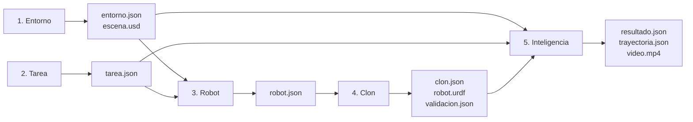

# Contrato de datos entre etapas

> **Fuente de verdad:** los JSON Schema de [`backend/viaz/esquemas/`](../backend/viaz/esquemas/). Este documento los explica.
> El orquestador valida cada archivo contra su esquema. Si no cumple, la corrida pasa a `error`.
> Si cambias un campo, edita en el mismo PR el esquema, este archivo y `web/lib/tipos.ts`, y avísale a todo el equipo.



## Reglas comunes

- **Archivos:** viven en `corridas/<id>/` del almacén (disco local o R2).
- **Unidades SI:** metros, kilogramos, segundos y grados. El nombre del campo lleva la unidad (`largo_m`). Los ángulos de `q` van en radianes.
- **Ejes:** Z arriba, como Isaac. El visor web lo rota a Y arriba.
- **`confianza`:** valor de 0 a 1 por cada dato que un agente infiere de un video.
- **`fuente`:** cada spec de un robot real lleva URL y fecha de consulta.
- **Versión:** cada archivo lleva `"version": 1`. Un cambio que rompe el formato sube la versión.

## Escena: mismas reglas en Isaac y en la web

[`sim/generar_escena.py`](../sim/generar_escena.py) y [`web/lib/escena.ts`](../web/lib/escena.ts) construyen la escena con las mismas reglas:

- **Filas:** la fila `i` tiene su tubo de torsión en `y = -i · separacion_m`, a `altura_m`, de `x = 0` a `x = largo_m`.
- **Postes:** van cada 7 m.
- **Robot:** avanza por el pasillo de la fila 0, en `y > 0`, mirando a `+X`.

## `entorno.json` (etapa 1)

Sirve para **cualquier espacio**: un núcleo genérico más perfiles opcionales por `tipo`. El parque solar es el perfil del demo.

Espacio genérico (ejemplo completo en [`fixtures/entorno_sala.json`](../backend/viaz/fixtures/entorno_sala.json)):

```json
{
  "version": 1,
  "tipo": "sala",
  "descripcion": "Sala pequeña con una mesa central y un estante.",
  "videos": ["sala-1.mp4"],
  "espacio": { "interior": true, "largo_m": 5, "ancho_m": 4, "alto_m": 2.5 },
  "terreno": { "pendiente_grados": 0, "suelo": "baldosa" },
  "elementos": [
    { "nombre": "mesa_central", "categoria": "superficie_trabajo", "forma": "caja",
      "dimensiones_m": { "largo_m": 1.8, "ancho_m": 0.9, "alto_m": 0.75 },
      "posicion_m": { "x_m": 2.5, "y_m": 2.0, "z_m": 0 }, "rotacion_grados": 0, "masa_kg": 40, "fijo": true }
  ],
  "escena_usd": "escena.usd",
  "fondo_reconstruido_usd": null,
  "confianza": { "espacio.largo_m": 0.8, "elementos.mesa_central": 0.8 }
}
```

Parque solar (perfil del demo): el mismo núcleo, más `filas`, `estructura` y `panel`:

```json
{
  "version": 1,
  "tipo": "parque_solar",
  "descripcion": "Sector de un parque solar con trackers de un eje.",
  "videos": ["planta-1.mp4"],
  "espacio": { "interior": false, "largo_m": 40, "ancho_m": 22, "alto_m": null },
  "terreno": { "pendiente_grados": 2, "suelo": "tierra_compactada", "friccion": 0.6 },
  "elementos": [],
  "filas": { "cantidad": 3, "largo_m": 30, "separacion_m": 6 },
  "estructura": { "tipo": "tracker_1_eje", "altura_m": 1.5, "inclinacion_grados": 0 },
  "panel": { "largo_m": 2.38, "ancho_m": 1.13, "peso_kg": 32 },
  "escena_usd": "escena.usd",
  "fondo_reconstruido_usd": null,
  "confianza": { "filas.separacion_m": 0.7, "panel.peso_kg": 0.5 }
}
```

- **`tipo`:** snake_case libre (`sala`, `bodega`, `taller`, `linea_produccion`, `parque_solar`, `otro`...).
- **Perfiles:** `filas`, `estructura` y `panel` son obligatorios si `tipo` es `parque_solar` y prohibidos en cualquier otro tipo.
- **Marco genérico:** origen en una esquina del espacio, a nivel del suelo. X a lo largo, Y a lo ancho, Z arriba. En `parque_solar` manda el marco de las filas (sección "Escena").
- **`elementos`:** cajas o cilindros verticales. `posicion_m` es el centro de la cara inferior; `rotacion_grados` gira sobre Z. Las paredes no van aquí: `generar_escena` las crea si `espacio.interior`.
- **Física de los elementos:** `fijo: true` es un colisionador inamovible; `fijo: false` con `masa_kg` es un cuerpo rígido. Las `abertura` no llevan colisión.
- **Etapas siguientes:** hoy Tarea → Inteligencia solo soportan `parque_solar`. Con otro `tipo`, la corrida deja `entorno.json` y `escena.usd` y termina en `error` con un mensaje claro.
- **Del agente:** el agente llena todo menos `version`, `videos`, `escena_usd` y `fondo_reconstruido_usd`. Esos los pone el orquestador. Los perfiles que no aplican vuelven como `null` y el orquestador los quita.
- **`confianza` en el agente:** el agente la devuelve como lista `[{campo, valor}]`, porque structured outputs no acepta objetos con claves libres. El orquestador la convierte en objeto.
- **`escena.usd`:** texto USDA. Lo genera el trabajo de GPU `generar_escena`.
- **`terreno.friccion`:** opcional, de 0,1 a 1,5. Es el coeficiente de fricción del suelo que usa la física (material de PhysX). El agente Entorno no lo llena. Si falta, `sim/fisica.py` usa el valor del tipo de `suelo`, o 0,6 si no conoce ese tipo. En el parque del demo es un valor estimado: por eso su `confianza` es 0,5.
- **Física que sale de `entorno.json`:** masa y tamaño del panel (`panel`), altura del tubo (`estructura.altura_m`), separación de filas (`filas`) y fricción del suelo (`terreno`). El resto de la física está en [`escena-isaac.md`](escena-isaac.md), sección "Decisiones de física del terreno".

## `tarea.json` (etapa 2)

Sirve para **cualquier tarea**: un núcleo genérico más perfiles opcionales por tipo de tarea. `instalar_panel` es el perfil del demo.

Tarea genérica (ejemplo completo en [`fixtures/tarea_sala.json`](../backend/viaz/fixtures/tarea_sala.json), sobre la sala de `entorno_sala.json`):

```json
{
  "version": 1,
  "tarea": "tomar_y_dejar",
  "descripcion": "Tomar la caja de cartón de la mesa central y dejarla en el estante",
  "proposito": "Despejar la mesa de reuniones sin que alguien interrumpa su trabajo",
  "pedido": { "origen": "inferido", "preguntas": ["¿Qué quiere que haga el robot en esta sala?", "¿En qué repisa van las cajas?"] },
  "objeto": { "elemento": "caja_carton_1", "descripcion": "caja de cartón", "masa_kg": 3 },
  "origen": { "elemento": "mesa_central", "descripcion": "cubierta de la mesa central", "altura_m": null },
  "destino": { "elemento": "estante", "descripcion": "repisa del medio", "altura_m": 0.9 },
  "objetivo": { "cantidad": 1, "ciclo_s": 45 },
  "criterios_exito": { "tolerancia_pos_m": 0.05, "tolerancia_ang_grados": 10, "sin_choques": true, "tiempo_max_s": 120 },
  "restricciones": [
    { "tipo": "no_chocar", "valor": null, "detalle": "no chocar con la mesa ni el estante" },
    { "tipo": "velocidad_max_m_s", "valor": 0.5, "detalle": "moverse lento en una sala con personas" }
  ],
  "geometria": {
    "origen_pose": { "x_m": 2.2, "y_m": 2.0, "z_m": 0.75, "giro_grados": 15 },
    "destino_pose": { "x_m": 4.3, "y_m": 3.8, "z_m": 0.9, "giro_grados": 0 },
    "distancia_m": 2.766, "altura_max_m": 1.15
  },
  "advertencias": ["la tarea es inferida: confirmar con el cliente (pedido.preguntas)"]
}
```

Perfil `instalar_panel` (el del demo): el mismo núcleo, con `elemento: null` en objeto, origen y destino, más la pila:

```json
{
  "tarea": "instalar_panel",
  "objetivo": { "cantidad": 5, "ciclo_s": 60 },
  "criterios_exito": { "tolerancia_pos_m": 0.05, "tolerancia_ang_grados": 5, "sin_choques": true, "tiempo_max_s": null },
  "pila_paneles": { "en_robot": true, "cantidad": 5 }
}
```

- **`proposito` y `pedido`:** para qué es la tarea y si la pidió el cliente o la infirió el agente. Con `inferido`, `pedido.preguntas` trae lo que hay que confirmar con el cliente.
- **`altura_m`:** superficie de apoyo en origen o destino (ej.: una repisa). `null` = cara superior del elemento.
- **`geometria` y `advertencias`:** las calcula el código ([`geometria.py`](../backend/viaz/geometria.py)), no el agente. Son la fase 1 del embudo de factibilidad: descartan tareas imposibles, no prueban que sean posibles.
- **`tarea`:** snake_case libre (`tomar_y_dejar`, `transportar`, `ordenar`, `inspeccionar`, `instalar_panel`, `otro`...).
- **Perfiles:** `pila_paneles` es obligatorio si `tarea` es `instalar_panel` y prohibido en las demás.
- **`elemento`:** nombre exacto de un elemento de `entorno.json`, o `null` (el robot, una zona libre o una estructura del perfil).
- **`criterios_exito`:** la simulación los usa para medir el éxito. El orquestador pasa `tolerancia_pos_m` y `tolerancia_ang_grados` a `entrenar` y `evaluar` (más la cifra fina de 2 cm y 2°, RF-INT-20).
- **`restricciones`:** `velocidad_max_m_s`, `distancia_personas_m` y `fuerza_max_n` llevan `valor` en SI. Las demás, `valor: null`.
- **Reglas contra `entorno.json`** (`problemas_tarea`): los elementos existen; el objeto de una manipulación no es `fijo`; origen ≠ destino; `instalar_panel` solo en `parque_solar`; `objetivo.cantidad` ≤ `pila_paneles.cantidad`; `tiempo_max_s` ≥ `ciclo_s`. Valen también para el `tarea.json` escrito a mano.
- **Etapas siguientes:** hoy Robot → Inteligencia solo simulan `instalar_panel`. Con otra tarea, la corrida deja `entorno.json`, `escena.usd` y `tarea.json` y termina en `error` con un mensaje claro.

## `robot.json` (etapa 3)

```json
{
  "version": 1,
  "id": "viaz-instalador-ficticio",
  "nombre": "Instalador de referencia (ficticio)",
  "fabricante": "VIAZ (robot de prueba, no existe)",
  "tipo": "base_movil_brazo",
  "ficticio": true,
  "carga_util_kg": 40,
  "alcance_m": 2.4,
  "velocidad_base_m_s": 1.0,
  "efector": "ventosa",
  "fuente": { "url": null, "consultado": null },
  "justificacion": "Por qué calza con entorno.json y tarea.json",
  "alternativas": [{ "id": "otro-robot", "por_que_no": "carga útil insuficiente" }]
}
```

- **Del agente:** el agente devuelve solo `id`, `justificacion` y `alternativas`. El `id` es un `enum` con los ids del catálogo.
- **Specs:** todas las specs salen de [`backend/viaz/catalogo/robots/`](../backend/viaz/catalogo/robots/), nunca del modelo.
- **Campos opcionales nuevos (contrato v3):** `origen` vale `catalogo` o `busqueda`, y sin el campo vale `catalogo`. `capacidades` lista las tareas que el robot hace según su fuente. `evidencia` guarda, por spec (`carga_util_kg`, `alcance_m`, `velocidad_base_m_s`, `efector`, `tipo`, `fisica.<campo>`), un objeto `{url, cita}`: la URL http(s) y la oración exacta de la fuente. La búsqueda web llena los tres. Una ficha `busqueda` tiene, por cada spec de selección, una entrada en `evidencia` o en `estimados`.
- **Catálogo compartido:** las fichas `busqueda` válidas quedan en el almacén en `catalogo/encontrados/<id>.json`, una por archivo y sin índice. Las corridas siguientes las cargan como fichas conocidas. En un choque de id gana `catalogo/robots/` del repo.

## Selección v3: `requisitos.json`, `seleccion.json`, `comparacion.json`

> **Estado:** la etapa robot de los dos flujos escribe `requisitos.json`, `encontrados.json` y `seleccion.json` ([`agentes.seleccionar()`](../backend/viaz/agentes/__init__.py)). Nadie escribe `comparacion.json` todavía. Detalle en [`agentes/seleccion-robot.md`](agentes/seleccion-robot.md).

| Archivo | Lo escribe | Contenido | Esquema | Ejemplo |
|---|---|---|---|---|
| `requisitos.json` | Perfil de dominio (código) | Objeto, carga mínima, efectores y tipos aceptados, movilidad, pendiente, alcance mínimo por robot, preferencias, advertencias | [`requisitos.schema.json`](../backend/viaz/esquemas/requisitos.schema.json) | [`fixtures/requisitos.json`](../backend/viaz/fixtures/requisitos.json) |
| `encontrados.json` | Código (paso 2) | Lista de las fichas válidas que trajo la búsqueda web en esta corrida (formato de `robot.schema.json` sin `justificacion` ni `alternativas`). Vacía si no corrió | [`robot.schema.json`](../backend/viaz/esquemas/robot.schema.json) | — |
| `seleccion.json` | Código + agente de selección | Estado de la búsqueda, encontrados, descartados con fallas, 1 a 3 finalistas, alternativas | [`seleccion.schema.json`](../backend/viaz/esquemas/seleccion.schema.json) | [`fixtures/seleccion.json`](../backend/viaz/fixtures/seleccion.json) |
| `comparacion.json` | Código (regla) + agente (explicación) | Ganador, regla, condiciones comunes, ranking con fidelidad, qué compara y qué no | [`comparacion.schema.json`](../backend/viaz/esquemas/comparacion.schema.json) | [`fixtures/comparacion.json`](../backend/viaz/fixtures/comparacion.json) (métricas ilustrativas) |

- **Un `robot.json` por finalista,** con el formato de arriba. Hoy la corrida guarda solo el del finalista 1. Las corridas hijas, una por finalista, no existen todavía.
- **`robot.json → alternativas`:** lista a cada otro candidato: los otros finalistas (`finalista N`), las alternativas (su `por_que_no`) y los descartados (sus fallas).

## `clon.json` (etapa 4) + `robot.urdf` + `validacion.json`

```json
{
  "version": 1,
  "robot_id": "viaz-instalador-ficticio",
  "usd": null,
  "urdf": "robot.urdf",
  "piezas": { "base": "caja_4_ruedas", "brazo": "brazo_6_ejes", "efector": "ventosa" },
  "escala": { "alcance_m": 2.4, "carga_util_kg": 40 },
  "geometria": { "l1_m": 1.092, "l2_m": 1.008, "muneca_m": 0.3, "montaje_x_m": 0.45,
                 "hombro_z_m": 1.1, "cubierta_z_m": 0.8, "pila_x_m": -0.35 },
  "diferencias_con_real": ["geometría primitiva (cajas y cilindros), sin mallas del fabricante"],
  "validado_en_escena": true
}
```

- **Generación:** el clon lo arma código determinista ([`backend/viaz/urdf.py`](../backend/viaz/urdf.py)): una base con ruedas y un brazo de 6 ejes escalado al alcance del robot.
- **`geometria`:** tiene las medidas que usa el plan ([`sim/plan.py`](../sim/plan.py)). Coinciden con `robot.urdf`.
- **`fidelidad` (contrato v3):** `generico` (base genérica), `medido` (usa `fisica` de la ficha) o `verificado` (`medido`, sin `fisica.*` estimados, y pasó `validar_robot` y la rúbrica). El código escribe `medido` o `generico` en cada clon ([`modelos.fidelidad()`](../backend/viaz/modelos.py)). Nunca escribe `verificado`, porque necesita la rúbrica humana.
- **`construccion.metodo` (flujo rl):** `agente`, `determinista` (RF-CLO-07) o `comprobado` (modelo reusado de una corrida anterior, RF-CLO-11).
- **Articulaciones de `robot.urdf`:** `shoulder_pan`, `shoulder_lift`, `elbow`, `wrist_1`, `wrist_2` y `wrist_3`. El link de la ventosa se llama `efector`.
- **`validacion.json`:** sale del trabajo `validar_clon` con el formato `{"ok", "problemas": [], "fuente", "paneles_planificados"}`. Si `ok` es `false`, la corrida pasa a `error`.

## `resultado.json` (etapa 5)

```json
{
  "version": 1,
  "metodo": "planificador",
  "fuente": "isaac",
  "politica": null,
  "metricas": { "paneles_instalados": 4, "intentos": 5, "tasa_exito": 0.8, "ciclo_promedio_s": 11.5 },
  "video": "video.mp4",
  "notas": "Plan fijo v0 reproducido con física. Instalados: [0, 1, 2, 4]."
}
```

- **`fuente`:** `isaac` (con física) o `simulado` (trayectoria sintética del worker sin GPU). La web marca `simulado` como "sin física".
- **`video`:** `null` si no hay video, por ejemplo en modo simulado.

## `trayectoria.json` (etapa 5, para el visor 3D)

```json
{
  "version": 1,
  "fps": 30,
  "articulaciones": ["shoulder_pan", "shoulder_lift", "elbow", "wrist_1", "wrist_2", "wrist_3"],
  "paneles": [{ "id": 0, "pos_m": [2.565, 0, 1.57], "quat": [1, 0, 0, 0] }],
  "pila": { "en_base": true, "pos_m": [-0.35, 0, 0.8], "paso_m": 0.045 },
  "frames": [
    { "t_s": 0.0, "base": { "pos_m": [-1, 1.75, 0], "yaw_grados": 0 },
      "q": [0, 0, 1.2, 1.94, 0, 0], "agarre": null, "instalados": [] }
  ]
}
```

- **`paneles`:** pose final de cada panel. Con `quat` identidad (`w, x, y, z`), `ancho_m` va en X y `largo_m` en Y.
- **Estado de cada panel en un frame:**
  - Si su id está en `instalados`, el panel está en su pose final.
  - Si su id es `agarre`, el panel va pegado al link `efector`.
  - Si no, el panel está en la pila sobre la base, en `pila.pos_m` (marco de la base). El id más alto queda abajo.
- **Ritmo:** máximo 30 fps.

## API (Render)

Para la web:

| Método | Ruta | Body | Respuesta |
|---|---|---|---|
| `POST` | `/proyectos` | `{"nombre", "descripcion", "videos": ["<archivo>"]}` | `201 {"id", "subida": [{"archivo", "url_firmada"}]}` |
| `POST` | `/proyectos/{id}/corridas` | — | `201 {"corrida_id"}` |
| `GET` | `/corridas/{id}` | — | `200 {"id", "estado", "etapas": [{"nombre", "estado", "artefactos": {"<archivo>": "<url>"}}], "error"}` |
| `GET` | `/corridas/demo` | — | La corrida de `VIAZ_CORRIDA_DEMO` |
| `GET` | `/corridas/{id}/metricas?desde=N` | — | `200 {"corrida_id", "metricas": [<línea de metricas.jsonl>]}` |
| `POST` | `/corridas/{id}/detener` | — (header `Authorization: Bearer <VIAZ_ADMIN_TOKEN>`) | `200` · `404` si no hay entrenamiento en curso |
| `GET` | `/salud` | — | `200 {"ok", "agentes", "almacen"}` |

- **Subida:** la web sube cada video con `PUT` a su `url_firmada` (R2 o `/archivos/...` en local).
- **`estado` de la corrida:** `en_cola` → `analizando_entorno` → `eligiendo_robot` → `clonando` → `simulando` (flujo planificador) o `entrenando` → `evaluando` (flujo rl) → `listo`, o `error` en cualquier punto.
- **`estado` de una etapa:** `pendiente` | `en_curso` | `listo` | `error`.

Para el sim runner (header `Authorization: Bearer <WORKER_TOKEN>`):

| Método | Ruta | Body | Respuesta |
|---|---|---|---|
| `POST` | `/worker/trabajos/tomar` | — | `200 {"trabajo_id", "tipo", "corrida_id", "parametros", "entradas": {"<archivo>": "<url>"}, "subidas": {"<archivo>": "<url_firmada>"}}` · `204` si no hay trabajos |
| `POST` | `/worker/trabajos/{id}/latido` | `{"metricas": [<líneas nuevas de metricas.jsonl>]}` | `200 {"accion": "seguir" \| "detener", "nan": bool}` · `409` si no estaba tomado |
| `POST` | `/worker/trabajos/{id}/fin` | `{"ok": true}` o `{"ok": false, "error": "..."}` | `200` · `409` si no estaba tomado |

- **`tipo`:** `generar_escena` | `validar_clon` | `ejecutar_tarea` (flujo planificador) | `validar_robot` | `entrenar` | `grabar_clips` | `evaluar` (flujo rl). Los del flujo rl llaman al entorno RL ([`contrato-entorno-rl.md`](contrato-entorno-rl.md)).
- **Latido:** `entrenar` manda uno cada `latido_s` con las métricas nuevas. Con NaN, o si el equipo pidió detener, la respuesta es `detener` (RF-API-06, RF-MON-08).
- **Salidas:** el worker sube solo los archivos de `subidas` que generó. Por ejemplo, sin video no sube `video.mp4`.
- **Trabajo vencido:** un trabajo tomado sin `fin` ni latido en 30 min vuelve a la cola.

## Archivos del flujo rl

| Archivo | Lo escribe | Esquema |
|---|---|---|
| `ensamblaje.json` | Agente constructor | [`ensamblaje.schema.json`](../backend/viaz/esquemas/ensamblaje.schema.json) |
| `robot_cfg.py` | Plantilla ([`robot_cfg.py`](../backend/viaz/robot_cfg.py)) | `PARAMETROS` ([`contrato-entorno-rl.md`](contrato-entorno-rl.md) §7) |
| `metricas.jsonl` | Entorno RL (en el pod); llega a la API por latido | [`metricas.schema.json`](../backend/viaz/esquemas/metricas.schema.json) |
| `curva.json`, `checkpoints.json` | Runner, al terminar `entrenar` | [`curva.schema.json`](../backend/viaz/esquemas/curva.schema.json) |
| `monitoreo.jsonl`, `hitos.json` | Orquestador (agente monitor) | [`monitoreo.schema.json`](../backend/viaz/esquemas/monitoreo.schema.json), [`hitos.schema.json`](../backend/viaz/esquemas/hitos.schema.json) |
| `construccion.mp4` | Entorno RL (`validar_robot --video`) + runner (rótulos y tarjetas por intento) | — |
| `entrenamiento_rapido.mp4`, `video_info.json` | Runner (`grabar_clips`) | — |
| `evaluacion.json`, `video.mp4`, `politica.pt` | Entorno RL (`evaluar`) | [`evaluacion.schema.json`](../backend/viaz/esquemas/evaluacion.schema.json) |
| `resultado.json` | Runner + orquestador | `resultado.schema.json`, con `evaluacion` y `entrenamiento` |
