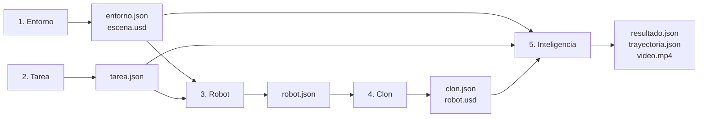

# Contrato de datos entre etapas

> Estado: **propuesta**. Cada etapa lee y escribe solo estos archivos, en `runs/<id>/`.
> Si cambias un campo: edita este archivo y `esquemas/` en el mismo PR, y avísale a todo el equipo.



## Reglas comunes

- **Unidades SI:** metros, kilogramos, segundos y grados. El nombre del campo lleva la unidad (`largo_m`, `peso_kg`).
- **Rutas:** relativas a `runs/<id>/`.
- **`confianza`:** valor de 0 a 1 para cada dato que un agente infiere de un video. Un dato que se escribe a mano lleva `1`.
- **`fuente`:** cada dato que viene de afuera (specs de un robot) lleva la URL y la fecha en que se consultó.
- **Versión:** cada archivo lleva `"version": 1`. Un cambio que rompe el formato sube la versión.

## `entorno.json` (etapa 1)

```json
{
  "version": 1,
  "tipo": "parque_solar",
  "videos": ["videos/planta-01.mp4"],
  "terreno": { "pendiente_grados": 3, "suelo": "tierra_compactada" },
  "filas": { "cantidad": 3, "largo_m": 60, "separacion_m": 6 },
  "estructura": { "tipo": "tracker_1_eje", "altura_m": 1.5, "inclinacion_grados": 0 },
  "panel": { "largo_m": 2.38, "ancho_m": 1.13, "peso_kg": 32 },
  "escena_usd": "escena.usd",
  "fondo_reconstruido_usd": null,
  "confianza": { "filas.separacion_m": 0.7, "panel.peso_kg": 0.5 }
}
```

- `estructura.tipo`: `tracker_1_eje` | `fijo`.
- `fondo_reconstruido_usd`: ruta a la reconstrucción visual (NuRec u OVER), o `null`.

## `tarea.json` (etapa 2)

```json
{
  "version": 1,
  "tarea": "instalar_panel",
  "descripcion": "Tomar un panel de la pila, llevarlo a la estructura y dejarlo sobre los rieles",
  "pila_paneles": { "posicion_m": [2, -3, 0], "cantidad": 10 },
  "objetivo": { "paneles": 5, "ciclo_s": 60 },
  "restricciones": ["no pisar las estructuras", "panel horizontal durante el traslado"]
}
```

- `tarea`: por ahora solo `instalar_panel`.

## `robot.json` (etapa 3)

```json
{
  "version": 1,
  "id": "ejemplo-robot",
  "nombre": "Nombre comercial",
  "fabricante": "Empresa",
  "tipo": "base_movil_brazo",
  "carga_util_kg": 40,
  "alcance_m": 2.5,
  "velocidad_base_m_s": 1.0,
  "efector": "ventosa",
  "fuente": { "url": "https://...", "consultado": "2026-11-21" },
  "justificacion": "Por qué calza con entorno.json y tarea.json",
  "alternativas": [{ "id": "otro-robot", "por_que_no": "carga útil insuficiente" }]
}
```

- `id`: coincide con el nombre de un archivo de `data/robots/`. El agente no inventa robots.
- `tipo`: `base_movil_brazo` | `brazo_fijo` | `vehiculo_con_brazo`.

## `clon.json` (etapa 4)

```json
{
  "version": 1,
  "robot_id": "ejemplo-robot",
  "usd": "robot.usd",
  "urdf": "robot.urdf",
  "piezas": { "base": "husky", "brazo": "ur10", "efector": "ventosa" },
  "escala": { "alcance_m": 2.5, "carga_util_kg": 40 },
  "diferencias_con_real": ["malla visual aproximada", "base con ruedas en vez de orugas"],
  "validado_en_escena": true
}
```

- `piezas`: nombres de assets de Isaac Lab. **[Por definir]** la lista final.
- `validado_en_escena`: `true` si el runner cargó el clon en `escena.usd` sin errores.
- `urdf`: lo usa el visor 3D de la web. Debe tener los mismos joints que `robot.usd`.

## `resultado.json` (etapa 5)

```json
{
  "version": 1,
  "metodo": "planificador",
  "politica": null,
  "metricas": {
    "paneles_instalados": 5,
    "intentos": 6,
    "tasa_exito": 0.83,
    "ciclo_promedio_s": 48
  },
  "video": "video.mp4",
  "notas": "un panel se soltó en el intento 3"
}
```

- `metodo`: `planificador` | `rl` | `planificador_rl`.
- `politica`: ruta al checkpoint entrenado, o `null` si no hay RL.

## `trayectoria.json` (etapa 5, para el visor 3D)

```json
{
  "version": 1,
  "fps": 30,
  "articulaciones": ["shoulder_pan", "shoulder_lift", "elbow", "wrist_1", "wrist_2", "wrist_3"],
  "frames": [
    {
      "t_s": 0.0,
      "base": { "pos_m": [0, 0, 0], "yaw_grados": 0 },
      "q": [0, -1.57, 1.57, 0, 0, 0],
      "paneles": [{ "id": 0, "pos_m": [2, -3, 0.1], "quat": [1, 0, 0, 0], "instalado": false }]
    }
  ]
}
```

- `articulaciones`: nombres iguales a los joints de `robot.urdf`. `q` va en radianes, en el mismo orden.
- `paneles`: solo los paneles que se mueven en ese frame. `quat` va en orden `w, x, y, z`.
- El sim runner guarda máximo 30 fps para que el archivo no pase de unos MB.

## API (Render)

Para la web:

| Método | Ruta | Body | Respuesta |
|---|---|---|---|
| `POST` | `/proyectos` | `{"nombre", "descripcion"}` | `201 {"id", "subida": [{"archivo", "url_firmada"}]}` |
| `POST` | `/proyectos/{id}/corridas` | — | `201 {"corrida_id"}` |
| `GET` | `/corridas/{id}` | — | `200 {"estado", "etapas": [{"nombre", "estado", "artefactos": {"<archivo>": "<url>"}}], "error"}` |
| `GET` | `/corridas/demo` | — | La corrida de respaldo del parque solar |

- `estado`: `subiendo` | `analizando_entorno` | `eligiendo_robot` | `clonando` | `simulando` | `listo` | `error`.

Para el sim runner (header `Authorization: Bearer <WORKER_TOKEN>`):

| Método | Ruta | Body | Respuesta |
|---|---|---|---|
| `POST` | `/worker/trabajos/tomar` | — | `200 {"trabajo_id", "tipo", "corrida_id", "entradas": {"<archivo>": "<url>"}, "subidas": {"<archivo>": "<url_firmada>"}}` · `204` si no hay trabajos |
| `POST` | `/worker/trabajos/{id}/fin` | `{"ok": true}` o `{"ok": false, "error": "..."}` | `200` |

- `tipo`: `generar_escena` | `validar_clon` | `ejecutar_tarea` | `entrenar_subtarea`.
- Un trabajo tomado y sin `fin` en 30 min vuelve a la cola.
