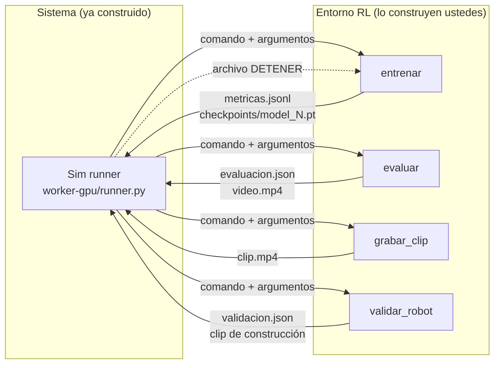

# Contrato del entorno RL de Isaac Lab

> Estado: **v1** (2026-11-21). Para el equipo que construye el entorno `instalar_panel` en Isaac Lab.
> Si el entorno cumple este contrato, el sistema lo lanza, lo vigila, lo evalúa y graba los videos sin cambios de código.
> Requerimientos: RF-INT-10..25, RF-MAP-12..14, RF-GPU-02, RF-GPU-06, RF-MON-01 (requerimientos v0.8). Esquemas: [`backend/viaz/esquemas/`](../backend/viaz/esquemas/).



## 1. Cuatro comandos

El runner lanza cada comando con el Python de Isaac Lab. El comando base sale de una variable de entorno del pod:

| Comando | Variable | Ejemplo |
|---|---|---|
| `entrenar` | `VIAZ_CMD_ENTRENAR` | `/workspace/IsaacLab/isaaclab.sh -p sim/rl/entrenar.py` |
| `evaluar` | `VIAZ_CMD_EVALUAR` | `/workspace/IsaacLab/isaaclab.sh -p sim/rl/evaluar.py` |
| `grabar_clip` | `VIAZ_CMD_CLIP` | `/workspace/IsaacLab/isaaclab.sh -p sim/rl/grabar_clip.py` |
| `validar_robot` | `VIAZ_CMD_VALIDAR_ROBOT` | `/workspace/IsaacLab/isaaclab.sh -p sim/rl/validar_robot.py` |

- **Headless siempre.** Ninguno abre ventana.
- **Código de salida:** `0` si terminó bien. Otro valor = error; el runner manda las últimas líneas de `stderr` a la corrida.
- **Rutas:** todas absolutas. El runner crea las carpetas.

## 2. Entradas comunes

| Argumento | Archivo | Qué lee el entorno |
|---|---|---|
| `--entorno` | `entorno.json` | `filas`, `estructura.altura_m`, `panel.largo_m`, `panel.ancho_m`, `panel.peso_kg`, `terreno` |
| `--tarea` | `tarea.json` | `pila_paneles.cantidad`, `objetivo.paneles`, `objetivo.ciclo_s` |
| `--robot` | `robot_cfg.py` | El diccionario `PARAMETROS` (§7). Opcional: la función `crear_articulacion_cfg()` |
| `--escena` | `escena.usd` | Parte estática de la planta, de `sim/generar_escena.py` |

**Nada del parque ni del robot va fijo en el código.** Todo sale de estos archivos.

## 3. `entrenar`

```text
$VIAZ_CMD_ENTRENAR --entorno E --tarea T --robot R --escena S --salida DIR
                   --max-horas 4 --tolerancia-pos-m 0.05 --tolerancia-ang-grados 5
                   [--reanudar DIR/checkpoints/model_N.pt]
```

| Debe… | Detalle |
|---|---|
| Escribir `DIR/metricas.jsonl` | Una línea JSON por iteración de PPO, con `flush` en cada línea. Esquema: [`metricas.schema.json`](../backend/viaz/esquemas/metricas.schema.json) |
| Guardar `DIR/checkpoints/model_N.pt` | Cada 50 iteraciones, **sin borrar los anteriores** (RF-INT-12). `N` = iteración |
| Revisar `DIR/DETENER` | Si el archivo existe, guarda un checkpoint y sale con código `0` |
| Respetar `--max-horas` | Al cumplirse, guarda un checkpoint y sale con código `0` |
| Medir el éxito con las tolerancias | Panel apoyado sobre el tubo, sin choque, a ≤ 5 cm y ≤ 5° (RF-INT-11) |
| Entrenar sin cámaras | Sin render durante el entrenamiento (v0.7) |
| Usar la escena de entrenamiento | Un tramo de tubo de la fila 0, el robot detenido frente al punto de montaje y su pila, copiado en N entornos (RF-MAP-12) |
| Usar la física del RL | Unión fija ventosa–panel con la masa real (RF-INT-22); torque y velocidad de `PARAMETROS["brazo"]["esfuerzo_max_nm"]` y `PARAMETROS["velocidad_max_rad_s"]` (RF-INT-23); masa ±10 % y fricción ±20 % por episodio (RF-INT-24) |
| Aceptar `--reanudar` | Continúa desde ese checkpoint (RF-GPU-05, Should) |

Línea de ejemplo de `metricas.jsonl`:

```json
{"iteracion": 400, "pasos": 19660800, "tiempo_s": 4310.5, "recompensa_media": 18.4, "tasa_exito": 0.35,
 "largo_episodio": 212.0, "perdida_valor": 0.41, "perdida_politica": -0.012, "entropia": 1.8}
```

- **`tasa_exito`:** fracción de episodios terminados con éxito en esa iteración, a la tolerancia de entrenamiento.
- **NaN:** escríbanlo tal cual (`NaN`). La API lo detecta y pide detener (RF-MON-08).

## 4. `evaluar`

```text
$VIAZ_CMD_EVALUAR --entorno E --tarea T --robot R --escena S --checkpoint C --episodios 100
                  --tolerancias 0.05:5,0.02:2 --salida DIR [--video DIR/video.mp4] [--trayectoria DIR/trayectoria.json]
```

| Debe… | Detalle |
|---|---|
| Correr `--episodios` episodios con la política, sin exploración | Base detenida con ruido de ±15 cm y ±5° (RF-INT-19) |
| Escribir `DIR/evaluacion.json` | Esquema: [`evaluacion.schema.json`](../backend/viaz/esquemas/evaluacion.schema.json). Una entrada por tolerancia, en el orden pedido |
| Con `--video`: grabar la muestra | La base avanza con el controlador programado (RF-INT-18) e instala varios paneles. Cámara lateral 3/4 fija. 20 a 40 s (RF-INT-15) |
| Con `--trayectoria`: guardar un episodio | Formato de [`trayectoria.schema.json`](../backend/viaz/esquemas/trayectoria.schema.json) (RF-INT-17, Should) |

## 5. `grabar_clip`

```text
$VIAZ_CMD_CLIP --entorno E --tarea T --robot R --escena S --checkpoint C --segundos 7 --salida DIR/clip.mp4 [--grilla]
```

- **Graba ~7 s** de la política de ese checkpoint con la cámara lateral 3/4 fija.
- **`--grilla`:** abre con 1–2 s de la vista de muchos entornos en paralelo (solo el primer clip).
- **Sin texto encima.** El runner agrega el tiempo de entrenamiento, la tasa de éxito y la mini curva (RF-INT-13).
- **1280 × 720, 30 fps, H.264.**

## 6. `validar_robot`

```text
$VIAZ_CMD_VALIDAR_ROBOT --entorno E --tarea T --robot R --escena S --salida DIR/validacion.json [--video DIR/construccion.mp4]
```

- Carga el robot de `robot_cfg.py` en la escena, revisa que no choque al inicio, que la ventosa alcance el panel y el tubo, y que soporte `panel.peso_kg`.
- Escribe `{"ok": bool, "problemas": ["..."], "fuente": "isaac"}`. Cada problema en una oración con números: el agente constructor los lee para corregir (RF-CLO-05).
- **Con `--video`: graba la construcción (RF-CLO-09).** 6 a 10 s, cámara lateral 3/4 fija, 1280 × 720, sin texto encima:
  1. La escena vacía (1 s).
  2. Aparece la base, después el brazo y al final la ventosa (≈ 1 s cada pieza).
  3. Movimiento de prueba: el brazo va hacia la pila y hacia el tubo. Si no alcanza, que se vea dónde se queda.
- El runner agrega el rótulo de cada intento ("Intento 2 de 3 · UR10 ×1,65 + ventosa larga · ✓ válido") y une los intentos en `construccion.mp4`.

## 7. `robot_cfg.py`

Lo genera el sistema desde `ensamblaje.json` ([`backend/viaz/robot_cfg.py`](../backend/viaz/robot_cfg.py)). **La interfaz estable es el diccionario `PARAMETROS`**:

```python
PARAMETROS = {
    "robot_id": "ejemplo-robot",
    "base": {"asset": "base_movil_simple", "altura_cubierta_m": 0.8},
    "brazo": {"asset": "ur10", "escala_alcance": 1.6, "esfuerzo_max_nm": 900.0},
    "efector": {"asset": "ventosa_larga"},
    "alcance_m": 2.4,            # alcance resultante, igual al del robot real (±5 %)
    "carga_util_kg": 40.0,       # carga útil del robot real
    "velocidad_max_rad_s": 2.0,
    "articulaciones": ["shoulder_pan", "shoulder_lift", "elbow", "wrist_1", "wrist_2", "wrist_3"],
}
```

- `crear_articulacion_cfg()` arma un `ArticulationCfg` desde los assets de Isaac Lab. **Sin probar en Isaac:** si no calza con su entorno, usen solo `PARAMETROS` y armen el robot a su manera.
- Catálogo de assets: [`backend/viaz/catalogo/assets_isaaclab.json`](../backend/viaz/catalogo/assets_isaaclab.json). Verifiquen los nombres y medidas en el pod.

## 8. Cómo probar sin el entorno

El runner tiene un **modo simulado** que imita los cuatro comandos sin Isaac. Genera métricas sintéticas, checkpoints vacíos y videos de prueba. Sirve para probar el sistema completo en un Mac:

```bash
python worker-gpu/runner.py --modo simulado
```

Cuando el entorno esté listo, el pod corre `--modo isaac` con las variables `VIAZ_CMD_*` de §1.
