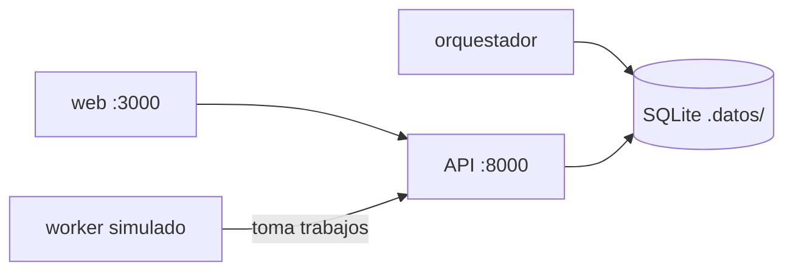

# Desarrollo y deploy

## Correr todo en local (sin GPU ni servicios externos)



- **Agentes en modo `fijo`:** devuelven fixtures y no gastan API.
- **Worker en modo `simulado`:** genera una trayectoria sintética sin física.
- **Resultado:** el flujo completo funciona en un Mac.

Requisitos: Python 3.11+ y Node 20+. Cada bloque va en su propia terminal.

```bash
# 1. API
cd backend
python -m venv .venv && source .venv/bin/activate   # Windows: .venv\Scripts\activate
pip install -e ".[dev]"
uvicorn viaz.api:app --reload
```

```bash
# 2. Orquestador (misma venv, misma carpeta backend/)
python -m viaz.orquestador
```

```bash
# 3. Worker GPU en modo simulado (desde la raíz del repo, con la venv de backend activa)
python worker-gpu/runner.py --modo simulado
```

```bash
# 4. Web
cd web && npm install && npm run dev
```

- **Abrir:** http://localhost:3000.
- **Prueba sin video:** sube cualquier nombre de planta. En modo `fijo`, los agentes no leen el video.

### Tests

```bash
cd backend && python -m pytest -q      # flujo de punta a punta + contrato
cd web && npm run build                # tipos + build de producción
```

### Agentes con Claude

```bash
export ANTHROPIC_API_KEY=...           # solo en la terminal del orquestador
export VIAZ_AGENTES=claude
python -m viaz.orquestador
```

- **Agentes que llaman a Claude:** Entorno y Tarea reciben frames del video (1 cada 3 s, máx. 8). Robot elige dentro de `backend/viaz/catalogo/robots/`.
- **Agente sin LLM:** Clon es código determinista.
- **Fallos:** si una salida no cumple su esquema, la corrida pasa a `error` con el motivo.

## Variables de entorno

| Variable | Dónde | Valor por defecto | Para qué |
|---|---|---|---|
| `DATABASE_URL` | API, orquestador | `sqlite:///./.datos/viaz.db` | Render la llena desde Postgres |
| `VIAZ_ALMACEN` | API, orquestador | `local` | `local` (disco) o `r2` |
| `VIAZ_URL_PUBLICA` | API, orquestador | `http://localhost:8000` | Base de las URLs del almacén local |
| `R2_ENDPOINT`, `R2_BUCKET`, `R2_ACCESS_KEY_ID`, `R2_SECRET_ACCESS_KEY` | API, orquestador | — | Cloudflare R2 |
| `VIAZ_AGENTES` | orquestador | `fijo` | `fijo` o `claude` |
| `VIAZ_MODELO` | orquestador | `claude-opus-5-5` | Modelo de los agentes |
| `ANTHROPIC_API_KEY` | orquestador | — | Solo en modo `claude` |
| `WORKER_TOKEN` | API, pod | `dev-token` | Autoriza al sim runner |
| `VIAZ_ORIGENES` | API | `http://localhost:3000` | CORS, separados por coma |
| `VIAZ_CORRIDA_DEMO` | API | — | Id de la corrida que muestra `/corridas/demo` |
| `NEXT_PUBLIC_API_URL` | web | `http://localhost:8000` | URL de la API |
| `VIAZ_API`, `VIAZ_MODO_SIM`, `ISAAC_PYTHON` | pod | — | Ver más abajo |

## Deploy

### 1. Cloudflare R2
1. Crear el bucket `viaz` y un token de API con permiso de lectura y escritura.
2. CORS del bucket: el navegador sube videos y lee resultados directo.

```json
[{ "AllowedOrigins": ["https://<tu-app>.vercel.app", "http://localhost:3000"],
   "AllowedMethods": ["GET", "PUT"], "AllowedHeaders": ["*"], "MaxAgeSeconds": 3600 }]
```

### 2. Render
1. **New → Blueprint**, apuntando al repo personal espejado. El README del hack explica por qué no sirve el repo de la organización.
2. Render crea `viaz-api`, `viaz-orquestador` y `viaz-db` desde [`render.yaml`](../render.yaml).
3. Cargar a mano las variables `sync: false`: R2, `ANTHROPIC_API_KEY` y `VIAZ_ORIGENES`.
4. Copiar `WORKER_TOKEN` del grupo `viaz-comun`. El pod lo necesita.

### 3. Vercel
1. Importar el repo personal con **Root Directory** `web`.
2. Definir `NEXT_PUBLIC_API_URL=https://viaz-api.onrender.com`.
3. Poner la URL de Vercel en `VIAZ_ORIGENES` (Render) y en el CORS de R2.

### 4. Pod GPU (RTX 5090)
1. Arrendar el pod con volumen persistente y la imagen de Isaac Sim (`nvcr.io/nvidia/isaac-sim`). Elegir una versión con soporte para RTX 50.
2. Probar Isaac antes de todo: `/isaac-sim/python.sh -c "from isaacsim import SimulationApp; SimulationApp({'headless': True}).close()"`.
   Después, correr la prueba de física de la escena en Isaac Lab ([`escena-isaac.md`](escena-isaac.md) § Prueba de física).
3. Instalar el ffmpeg del video: `/isaac-sim/python.sh -m pip install imageio-ffmpeg`.
4. Clonar el repo y correr:

```bash
pip install -r worker-gpu/requirements.txt
VIAZ_API=https://viaz-api.onrender.com WORKER_TOKEN=<de Render> \
ISAAC_PYTHON=/isaac-sim/python.sh python worker-gpu/runner.py --modo isaac
```

- **Si Isaac todavía no funciona:** `--modo simulado` en el pod mantiene vivo el flujo.
- **Estado de los scripts:** `sim/validar_clon.py`, `sim/ejecutar_tarea.py` y `sim/isaac_comun.py` **no se han probado en Isaac**. Escribí la API de Isaac Sim 5.x de memoria, así que el primer error real va a salir ahí.

### 5. Demo de la portada (RF-WEB-08)
La portada muestra la corrida del demo desde archivos estáticos en `web/public/demo/`. No usa la API ni el pod, así que funciona en Vercel aunque Render esté apagado. `/corridas/demo` redirige a la portada.

- **Regenerar el demo** (agentes fijos y plan sintético, marcado "sin física"):
  ```bash
  cd backend && python -m viaz.demo
  ```
  El test `test_demo_versionado_esta_al_dia` falla si el demo versionado quedó desactualizado.
- **Cuando el pod entregue resultados reales**, copiar en `web/public/demo/`:
  - `resultado.json` con `evaluacion` y `entrenamiento` (ver [`contrato-datos.md`](contrato-datos.md));
  - `trayectoria.json` de la política entrenada;
  - `video.mp4` y `entrenamiento_rapido.mp4`.

  La web muestra cada sección apenas existe su archivo. Si falta un archivo, la sección dice que está pendiente.
