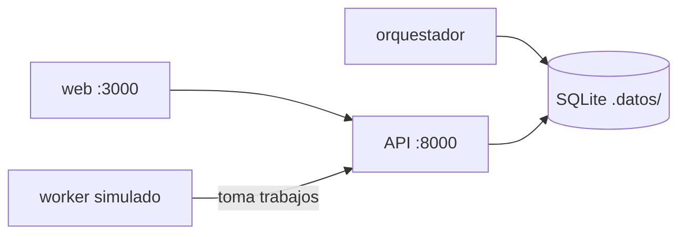

# Desarrollo y deploy

## Correr todo en local (sin GPU ni servicios externos)



- **Flujo `rl` (por defecto, el del demo):** entorno y tarea a mano → selección de robot → agente constructor → entrenar (con el monitor) → grabar clips → evaluar. El flujo anterior sigue con `VIAZ_FLUJO=planificador`.
- **Agentes en modo `fijo`:** devuelven fixtures y no gastan API. El monitor usa sus reglas.
- **Worker en modo `simulado`:** usa [`sim/rl_simulado.py`](../sim/rl_simulado.py), que imita el entorno RL de Isaac Lab ([`contrato-entorno-rl.md`](contrato-entorno-rl.md)): métricas sintéticas, checkpoints vacíos y videos de prueba rotulados "simulación".
- **Resultado:** el flujo completo funciona en un Mac, con los dos videos y las métricas en la web.
- **Más rápido en local:** `VIAZ_MONITOR_S=3` (orquestador) y `VIAZ_SIM_ITERACIONES=300 VIAZ_SIM_SEGUNDOS=25` (worker).

Requisitos: Python 3.11+ y Node 20+. Cada bloque va en su propia terminal.

```bash
# 1. API
cd backend
python -m venv .venv && source .venv/bin/activate   # Windows: .venv\Scripts\activate
pip install -e ".[dev]"
uvicorn viaz.api:app --reload
```

```bash
# 2. Orquestador (misma venv, misma carpeta backend/)
python -m viaz.orquestador
```

```bash
# 3. Worker GPU en modo simulado (desde la raíz del repo, con la venv de backend activa)
python worker-gpu/runner.py --modo simulado
```

```bash
# 4. Web
cd web && npm install && npm run dev
```

- **Abrir:** http://localhost:3000.
- **Prueba sin video:** sube cualquier nombre de planta. En modo `fijo`, los agentes no leen el video.

### Tests

```bash
cd backend && python -m pytest -q      # flujo de punta a punta + contrato
cd web && npm run build                # tipos + build de producción
```

### Agentes con Claude

```bash
export ANTHROPIC_API_KEY=...           # solo en la terminal del orquestador
export VIAZ_AGENTES=claude
python -m viaz.orquestador
```

- **Agentes que llaman a Claude:** Entorno y Tarea reciben frames del video (1 cada 3 s, máx. 8). Robot elige entre `backend/viaz/catalogo/robots/`, el catálogo compartido del almacén y lo que trae la búsqueda web ([`seleccion-robot.md`](agentes/seleccion-robot.md) §2).
- **Agente sin LLM:** Clon es código determinista.
- **Fallos:** si una salida no cumple su esquema, la corrida pasa a `error` con el motivo.

## Variables de entorno

| Variable | Dónde | Valor por defecto | Para qué |
|---|---|---|---|
| `DATABASE_URL` | API, orquestador | `sqlite:///./.datos/viaz.db` | Render la llena desde Postgres |
| `VIAZ_ALMACEN` | API, orquestador | `local` | `local` (disco) o `r2` |
| `VIAZ_URL_PUBLICA` | API, orquestador | `http://localhost:8000` | Base de las URLs del almacén local |
| `R2_ENDPOINT`, `R2_BUCKET`, `R2_ACCESS_KEY_ID`, `R2_SECRET_ACCESS_KEY` | API, orquestador | — | Cloudflare R2 |
| `VIAZ_AGENTES` | orquestador | `fijo` | `fijo` o `claude` |
| `VIAZ_MODELO` | orquestador | `claude-opus-5-5` | Modelo de los agentes |
| `ANTHROPIC_API_KEY` | orquestador | — | Solo en modo `claude` |
| `VIAZ_BUSQUEDA` | orquestador | `1` | Búsqueda web de robots (`1` o `0`). Solo corre en modo `claude` |
| `VIAZ_BUSQUEDA_MAX_ROBOTS` | orquestador | `3` | Fichas que acepta la búsqueda por corrida (1 a 5) |
| `VIAZ_BUSQUEDA_MAX_CONSULTAS` | orquestador | `6` | Búsquedas web por corrida, `max_uses` (1 a 15) |
| `VIAZ_BUSQUEDA_TIEMPO_S` | orquestador | `180` | Tiempo de la búsqueda, en segundos (10 a 1800) |
| `VIAZ_MAX_FINALISTAS` | orquestador | `3` | Tope de finalistas (1 a 3). Con 2 o 3, cada uno entrena en su corrida hija. `1` deja la corrida como antes |
| `WORKER_TOKEN` | API, pod | `dev-token` | Autoriza al sim runner |
| `VIAZ_ORIGENES` | API | `http://localhost:3000` | CORS, separados por coma |
| `VIAZ_CORRIDA_DEMO` | API | — | Id de la corrida que muestra `/corridas/demo` |
| `VIAZ_FLUJO` | orquestador | `rl` | `rl` (demo) o `planificador` (flujo anterior) |
| `VIAZ_ENTORNO_MANUAL`, `VIAZ_TAREA_MANUAL` | orquestador | fixtures | Rutas al `entorno.json` y `tarea.json` escritos a mano |
| `VIAZ_HORAS_ENTRENAMIENTO` | orquestador | `4` | Tope del entrenamiento (RNF-17). Vale para cada finalista: con 3, la corrida tarda 3 veces más |
| `VIAZ_EPISODIOS_EVALUACION` | orquestador | `100` | Episodios de evaluación (RF-INT-14) |
| `VIAZ_INTENTOS_CONSTRUCTOR` | orquestador | `3` | Intentos del agente constructor (RF-CLO-05) |
| `VIAZ_MONITOR_S` | orquestador | `600` | Cada cuánto chequea el monitor |
| `VIAZ_DISCORD_WEBHOOK` | orquestador | — | Avisos del monitor. Sin valor, los avisos van al log |
| `VIAZ_ADMIN_TOKEN` | API | `WORKER_TOKEN` | Token para `POST /corridas/{id}/detener` |
| `VIAZ_DIR_POD` | pod | `.datos/pod` | Carpeta persistente con checkpoints y métricas |
| `VIAZ_CMD_ENTRENAR`, `VIAZ_CMD_EVALUAR`, `VIAZ_CMD_GRABAR_CLIP`, `VIAZ_CMD_VALIDAR_ROBOT` | pod | — | Comandos del entorno RL ([`contrato-entorno-rl.md`](contrato-entorno-rl.md) §1) |
| `VIAZ_FUENTE` | pod | DejaVu / Arial | Fuente TTF de los rótulos del video (con tildes) |
| `NEXT_PUBLIC_API_URL` | web | `http://localhost:8000` | URL de la API |
| `VIAZ_API`, `VIAZ_MODO_SIM`, `ISAAC_PYTHON` | pod | — | Ver más abajo |

## Deploy

### 1. Cloudflare R2
1. Crear el bucket `viaz` y un token de API con permiso de lectura y escritura.
2. CORS del bucket: el navegador sube videos y lee resultados directo.

```json
[{ "AllowedOrigins": ["https://<tu-app>.vercel.app", "http://localhost:3000"],
   "AllowedMethods": ["GET", "PUT"], "AllowedHeaders": ["*"], "MaxAgeSeconds": 3600 }]
```

### 2. Render
1. **New → Blueprint**, apuntando al repo personal espejado. El README del hack explica por qué no sirve el repo de la organización.
2. Render crea `viaz-api`, `viaz-orquestador` y `viaz-db` desde [`render.yaml`](../render.yaml).
3. Cargar a mano las variables `sync: false`: R2, `ANTHROPIC_API_KEY` y `VIAZ_ORIGENES`.
4. Copiar `WORKER_TOKEN` del grupo `viaz-comun`. El pod lo necesita.

### 3. Vercel
1. Importar el repo personal con **Root Directory** `web`.
2. Definir `NEXT_PUBLIC_API_URL=https://viaz-api.onrender.com`.
3. Poner la URL de Vercel en `VIAZ_ORIGENES` (Render) y en el CORS de R2.

### 4. Pod GPU (RTX 5090)
1. Arrendar el pod con volumen persistente y la imagen de Isaac Sim (`nvcr.io/nvidia/isaac-sim`). Elegir una versión con soporte para RTX 50.
2. Probar Isaac antes de todo: `/isaac-sim/python.sh -c "from isaacsim import SimulationApp; SimulationApp({'headless': True}).close()"`.
   Después, correr la prueba de física de la escena en Isaac Lab ([`escena-isaac.md`](escena-isaac.md) § Prueba de física).
3. Instalar el ffmpeg del video: `/isaac-sim/python.sh -m pip install imageio-ffmpeg`.
4. Clonar el repo y correr:

```bash
pip install -r worker-gpu/requirements.txt
VIAZ_API=https://viaz-api.onrender.com WORKER_TOKEN=<de Render> \
ISAAC_PYTHON=/isaac-sim/python.sh \
VIAZ_CMD_ENTRENAR=... VIAZ_CMD_EVALUAR=... VIAZ_CMD_GRABAR_CLIP=... VIAZ_CMD_VALIDAR_ROBOT=... \
VIAZ_DIR_POD=/workspace/viaz python worker-gpu/runner.py --modo isaac
```

- **Fuentes para los rótulos:** `apt-get install -y fonts-dejavu-core` (si no, el texto del video sale sin tildes).
- **Si Isaac todavía no funciona:** `--modo simulado` en el pod mantiene vivo el flujo.
- **Estado de los scripts:** `sim/validar_clon.py`, `sim/ejecutar_tarea.py` y `sim/isaac_comun.py` **no se han probado en Isaac**. Escribí la API de Isaac Sim 5.x de memoria, así que el primer error real va a salir ahí.

### 5. Corrida de respaldo para el pitch
1. Correr una corrida completa en producción y anotar su id.
2. Poner ese id en `VIAZ_CORRIDA_DEMO` (Render). `/corridas/demo` la muestra aunque el pod esté apagado.
