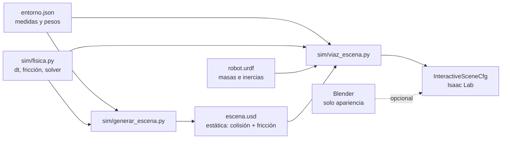

# Escena en Isaac Lab

Cómo se arma el mapa donde trabaja el robot, para que la física (pesos, fricción, contactos) sea creíble.



## Decisión: el mapa se genera con código, no en Blender

- **Física en el USD:** Blender no exporta masa, fricción ni cuerpos rígidos de PhysX en forma confiable. Esas propiedades se definen en código de todas formas.
- **Colisiones simples:** una malla detallada como colisión vuelve la simulación lenta e inestable. Por eso todo choca como cajas.
- **Una escena por cliente:** la escena sale de `entorno.json`. Una escena hecha a mano sirve para una sola planta.
- **Blender, opcional:** sirve para mallas visuales (panel con marco, tracker detallado). Se montan encima de la caja de colisión y no reemplazan la física.

## Cuatro capas

| Capa | Qué tiene | Archivo | Masa |
|---|---|---|---|
| **Estática** | Suelo, tubos de torsión y postes | `escena.usd` (de `sim/generar_escena.py`) | No. Un colisionador sin cuerpo rígido es fijo |
| **Visual** | Paneles ya instalados de la fila 1, llano, cerros, sol y cielo | `escena.usd` | No. Tampoco tiene colisión |
| **Dinámica** | Paneles | `sim/viaz_escena.py` → `RigidObjectCfg` | Sí: `panel.peso_kg` de `entorno.json` |
| **Robot** | Base, ruedas, brazo y ventosa | `robot.urdf` (de `backend/viaz/urdf.py`) → `ArticulationCfg` | Sí: por link, con inercia calculada de su forma |

- **El terreno no conoce al robot.** `generar_escena` corre antes de elegir el robot. `escena.usd` no trae nada que dependa de él.
- **La pila sí depende del robot.** `sim/viaz_escena.py` la pone donde dice `clon.json` (`geometria`). Sin `clon.json`, la pone sobre un pallet al lado de la fila 0.

## Dos escenas del mismo `entorno.json`

| | Escena de entrenamiento (RF-MAP-12) | Escena del demo (RF-MAP-06, RF-MAP-13, RF-MAP-15) |
|---|---|---|
| Para qué | Entrenar el brazo con PPO | `video.mp4`, clips de `entrenamiento_rapido.mp4` y la web |
| Qué tiene | Un tramo de tubo de la fila 0 con sus postes, el robot detenido frente al punto de montaje y su pila de paneles | 2 filas completas, el robot avanzando por el pasillo de la fila 0 y la fila 1 ya instalada |
| Copias | N entornos en paralelo (`num_envs`), con `replicate_physics=True` | 1 |
| Suelo | Una sola caja plana para todas las copias, con los mismos materiales del demo (ver [abajo](#materiales-visuales-de-la-escena-de-entrenamiento)) | Plano, con la apariencia del desierto |
| Cámaras | Ninguna al entrenar. `camara_entrenamiento()` muestra la grilla en los clips | Cámara lateral 3/4 fija (`camara_demo()`) |

- **Por qué dos escenas:** cada copia de entrenamiento solo necesita un punto de montaje. Cargar las 2 filas en cada copia gasta memoria y tiempo de GPU sin cambiar lo que aprende el brazo.
- **Mismo origen:** las dos escenas leen las medidas de `entorno.json` (altura del tubo, panel, separación). Así la política entrenada sirve en el parque del demo.
- **Misma geometría:** `generar_escena.cuerpos()` define la planta una sola vez. `escena_usda()` la escribe en `escena.usd` y `viaz_escena.describir_entrenamiento()` recorta su primer tramo, de poste a poste. Cada copia usa las coordenadas del parque.
- **`escena.usd` se revisa al cargar:** `viaz_escena.revisar_usd()` compara el archivo con `entorno.json`. Un `escena.usd` viejo o de otro parque hace fallar la prueba.
- **Base detenida con ruido:** en cada episodio, la base queda a ±15 cm y ±5° del punto de montaje (RF-INT-19). En el demo, la base llega a cada punto con el controlador programado (RF-INT-18).

## Parque del demo: desierto de Atacama

| Elemento | Valor | Física |
|---|---|---|
| Filas | 2, de 30 m, a 6 m entre sí | Sí: tubo y postes de acero |
| Estructura | Tracker de 1 eje, tubo horizontal a 1,5 m (posición de montaje) | Sí |
| Fila 0 | Vacía al inicio. El robot instala 3 a 5 paneles | Sí: paneles con masa |
| Fila 1 | 24 paneles ya instalados (los que caben según `sim/plan.py`) | No: solo visuales |
| Pila | Donde el robot la lleva, según `clon.json`. Mientras el robot no está en la escena, descansa sobre una caja fija | Sí: paneles con masa |
| Suelo | Plano, tierra ocre con gravilla (`suelo: "desierto_atacama"`) | Sí: fricción de tierra seca |
| Cielo y luz | Despejado, sol de mediodía | No |
| Fondo | Cerros lejanos | No: solo visuales |

- **Apariencia:** el color del suelo y los cerros son visuales. `generar_escena` los escribe en `escena.usd` con materiales simples y sin modelos de Omniverse, que el pod no puede bajar. La textura de gravilla está en [Materiales visuales del demo](#materiales-visuales-del-demo).
- **Sin pendiente:** el suelo plano deja la base siempre a z = 0. Así la política no tiene que compensar la inclinación.

## Materiales visuales del demo

El suelo, los paneles, los tubos y el cielo tienen texturas. Son solo visuales: la física no cambia.
`sim/texturas.py` las dibuja con numpy y PIL, sin descargar nada. `generar_escena.py` las escribe en `texturas/`, al lado de `escena.usd`, y los materiales las citan con ruta relativa. La carpeta de la corrida queda autocontenida (unos 22 MB).

| Superficie | Material | Decisión |
|---|---|---|
| Suelo y llano | OmniPBR con albedo, normales y rugosidad. Textura de 12 m, proyectada desde el mundo | Arena ocre clara con gravilla fina y pocas piedras. El tono cambia poco entre manchas, para que no parezcan manchas de agua |
| Un solo suelo | El llano queda a ras del tope del suelo físico, y el suelo físico se oculta | Dos superficies casi iguales parpadeaban y dejaban una costura. La colisión no cambia |
| Panel | Marco de aluminio (el cubo) y, encima, un vidrio con UV propio | Cubo con celdas en las 6 caras mostraba las celdas en el canto. El vidrio es un cuadrito a 2,5 cm del cubo |
| Celdas | 6 x 24 medias celdas, barras de plata, láminas blancas entre celdas | La proporción de la textura es la del módulo de 1,13 x 2,38 m |
| Tubo y poste | Acero galvanizado: gris zinc con flores, metálico 0,35 (con 0,85 la cámara de Isaac lo ve azul marino) | |
| Rocas | 90 rocas de 6 formas, referenciadas. Ninguna cae entre las filas ni en el pasillo de trabajo | Sin colisión. La semilla es fija |
| Luz | Sol a 45° de elevación, cálido, ángulo 0,53°. Cielo con imagen generada | Sombras que se leen bien |

**Cuidados que costaron una prueba:**
- Las normales, la rugosidad y el metal llevan `colorSpace = "raw"`. Sin eso Isaac los lee como color sRGB: las normales planas salen inclinadas y el suelo queda con una costura recta y más oscuro cerca de la cámara.
- Nunca reescribas un PNG mientras Isaac lo tiene cargado. Isaac cerró su proceso con "Corrupt PNG". Escribe archivos nuevos.
- Si Isaac abre el USD con su luz por defecto (`/Environment/defaultLight`, 3000, a 45°), la escena queda sobreexpuesta. Oculta esa luz en el panel Stage.
- Sin numpy o PIL, `generar_escena.py` avisa y escribe el USD con los colores planos de antes.
- La pila y los paneles con masa del **parque del demo** (`construir_cfg`) siguen con color plano. La escena de entrenamiento ya usa estos materiales (sección siguiente).

## Materiales visuales de la escena de entrenamiento

La escena de entrenamiento (`viaz_escena.construir_cfg_entrenamiento`) se ve como el demo: arena, cerros lejanos, cielo con degradado, sol, acero galvanizado, paneles con celdas y pallet de madera. Solo cambia lo que se ve. Colisiones, materiales de fricción y masas son los mismos.

| Superficie | Cómo se ve | Cuántos prims |
|---|---|---|
| Materiales | Los de `generar_escena._aspecto()`, la misma receta de `escena.usd`. Viven en `/World/Materiales/Vis*` | 7 para todo el stage |
| Suelo, cerros, cielo | Llano visual de 4 km a ras del suelo físico (que se oculta), cordón de cerros y domo con la imagen del cielo | 1 de cada uno para todo el stage |
| Tubo, postes, soporte | Acero galvanizado y madera de pallet, con proyección desde el mundo | 0 materiales nuevos por copia |
| Panel | Marco de aluminio (el cubo) con un `Vidrio` hijo del cuerpo rígido, sin colisión ni masa | 1 vidrio por copia en el panel que se instala y 1 en el de arriba de la pila |

- **Un material por aspecto, no por copia.** Cada caja cita el material por ruta absoluta (`visual_material_path="/World/Materiales/VisPanel"`), igual que el material de fricción compartido. Con `replicate_physics=True` Isaac Lab copia la copia 0 y la relación de material sigue apuntando al mismo prim.
- **Las celdas de la pila.** Los paneles de abajo de la pila quedan tapados por el de arriba, así que no llevan vidrio. Menos prims por copia.
- **Dónde están las texturas.** Cada trabajo del runner corre en su propia carpeta y el almacén solo lleva archivos sueltos (`salidas: ["escena.usd"]`). La carpeta `texturas/` de `generar_escena` no llega a `entrenar`, `evaluar`, `grabar_clips` ni `validar_robot`. Por eso la escena de entrenamiento no depende de ella: `viaz_escena.carpeta_texturas()` llama a `texturas.asegurar()`, que dibuja los PNG una vez por pod en `VIAZ_TEXTURAS` (si no, `VIAZ_DIR_POD/texturas`, si no, `.datos/texturas`) y los cita con ruta absoluta. La carpeta se llama `texturas-<huella>`: la huella cambia con `texturas.py`, así una textura nueva no pisa una que otro Isaac tenga abierta.
- **`escena.usd` en el demo.** Para `validar_clon` y `ejecutar_tarea`, que abren `escena.usd`, `runner.py` enlaza `texturas/` a ese mismo cache en la carpeta del trabajo (`_enlazar_texturas`, solo en modo `isaac`).
- **Sin numpy o PIL, o con `VIAZ_SIN_TEXTURAS=1`,** la escena sale con los colores planos de antes.
- **Costo medido (2026-11-21, 4 096 copias, pila de 5, headless).** Asentamiento y estado final idénticos con y sin texturas. Pasos de física por segundo en reposo: 333 y 336 sin texturas, 315 y 316 con ellas (5 a 6 % menos). Con vidrio en solo 2 paneles por copia. Quitar el vidrio recupera 3 puntos; quitar cerros y llano, 1. No se encontró el resto del costo. Con `VIAZ_SIN_TEXTURAS=1` vuelve a 331.
- **No incluye** las 90 rocas del demo: sus posiciones evitan el parque, no la grilla de copias.

## Física del entrenamiento RL

| Tema | Decisión | Requerimiento |
|---|---|---|
| Agarre | Unión física fija entre ventosa y panel. El brazo carga los 32 kg | RF-INT-22 |
| Motores | Límites de torque y velocidad de `robot.urdf` | RF-INT-23 |
| Base | Cinemática: se mueve por código, sin tracción de ruedas | RF-INT-18 |
| Variaciones | Por episodio: masa del panel ±10 %, base ±15 cm y ±5°. Por copia, fija al crear el entorno: fricción ±20 % | RF-INT-24, RF-INT-19 |
| Viento | Opcional, si sobra tiempo | RF-INT-25 |
| Fijación | El panel queda apoyado, sin abrazaderas | RF-TAR-04, RF-INT-11 |

- **Las variaciones son eventos de Isaac Lab** (`randomize_rigid_body_mass`, `randomize_rigid_body_material`, `apply_external_force_torque`). Isaac Lab no los aplica solo: se declaran en la configuración del entorno, una línea cada uno.
- **Los rangos ya están calculados.** `fisica.rangos_variacion(entorno)` los entrega, y `describir_entrenamiento()` los copia en `"variaciones"`. El terreno no declara los eventos: eso es del entorno RL.
- **El plan de `sim/ejecutar_tarea.py` no cambia.** Ahí el panel agarrado sigue a la ventosa por código. Eso sirve para el planificador de respaldo (RF-INT-01), no para el entorno RL.

## Decisiones de física del terreno

Decisiones tomadas el 2026-11-21 al construir el terreno. Cada valor está en [`sim/fisica.py`](../sim/fisica.py) o sale de `entorno.json`.

La columna Fuente usa cuatro palabras:

- **Medido:** lo midió `sim/prueba_fisica.py` o `sim/prueba_entrenamiento.py` en el pod (RTX 5090, Isaac Sim 5.1, Isaac Lab 2.3.2).
- **Calculado:** sale de una fórmula con los datos de la tabla.
- **Estimado:** no hay ficha ni medición del parque real. Hay que cambiarlo cuando exista el dato.
- **Equipo:** el valor ya estaba en el repo o en los requerimientos.

### Simulación

| Decisión | Valor | Por qué | Fuente |
|---|---|---|---|
| Paso de física | 1/120 s | Con este paso, un panel de 4 cm no atraviesa el tubo ni el suelo | Equipo. Medido: un panel soltado 10 cm sobre el tubo queda a 0,0 mm de su lugar |
| Pasos de física por acción | 4 (control a 30 Hz) | Calza con el video de 30 fps. Un brazo de 3 m no necesita más de 30 órdenes por segundo | Estimado |
| Gravedad | 9,81 m/s² | Es el valor estándar. En Atacama, a 2 300 m, es cerca de 9,78. La diferencia es 0,3 %, menor que la variación de masa de ±10 % | Calculado |
| Solver | TGS, con 16 iteraciones de posición y 1 de velocidad | Sostiene una pila de 5 paneles de 32 kg sin que se hunda ni se corra | TGS: valor por defecto de Isaac Lab. 16 y 1: equipo. Medido: la pila se corre 0,11 mm como máximo en 4 096 copias |
| Gravedad en cada iteración (`enable_external_forces_every_iteration`) | Activada | Sin ella la pila no se mueve, pero PhysX informa velocidades de 18 a 33 mm/s. Ese ruido entraría a las observaciones del RL | Medido: con la opción, la pila informa menos de 1 mm/s. Isaac Lab recomienda la opción en un aviso |
| CCD | Apagado | PhysX en GPU no lo hace. No hace falta: para saltarse el tubo en un paso, un panel tiene que ir a más de 16 m/s (14 cm en 1/120 s). Con 1,5 rad/s por articulación y 3,1 m de alcance, la muñeca del robot queda bajo 8 m/s | Medido: con CCD pedido, Isaac escribe "CCD is not supported on GPU, ignoring request". Calculado |
| Restitución | 0 en todos los materiales. Umbral de rebote: 0,2 m/s | Un panel de 32 kg que cae de plano no rebota. Un rebote en la simulación sería un error numérico | Equipo. Umbral: estimado |
| Margen de contacto | 5 mm. Distancia de reposo: 0 | PhysX crea el contacto 5 mm antes del toque. En cajas delgadas eso evita la penetración | Equipo. Medido: la penetración en reposo es de 0,03 mm |
| Velocidad máxima de separación | 1 m/s | Si dos cuerpos parten superpuestos, PhysX no los separa de golpe | Equipo |
| Tamaño de los búferes de GPU | Los de Isaac Lab | No hubo ningún aviso de búfer lleno | Medido hasta 16 384 copias |
| Material de fricción | Uno por valor, compartido por todas las copias | PhysX acepta 64 000 materiales. Con un material por cuerpo y por copia, la escena falla cerca de las 7 000 copias | Medido: con 16 384 copias PhysX escribió "limit of 64K materials reached" |

### Panel, tubo, suelo y pila

| Decisión | Valor | Por qué | Fuente |
|---|---|---|---|
| Masa del panel | 32 kg (`panel.peso_kg`) | Es el dato del parque | `entorno.json`. Medido: PhysX informa 32,0 kg en cada panel |
| Forma del panel | Caja rígida de 2,38 × 1,13 × 0,04 m | Largo y ancho son del parque. El espesor es el del modelo, igual que en `sim/plan.py` y en la web. PhysX calcula la inercia de la caja | `entorno.json` y `fisica.PANEL_ESPESOR_M`. Estimado: un marco real mide 30 a 35 mm |
| Coeficientes de fricción | Uno por material: la estática es igual a la dinámica | Con estática mayor que dinámica, PhysX en GPU no sostuvo la estática. Un empuje al 90 % del límite estático movió el panel 7,8 cm sobre el tubo. Con un solo coeficiente, el límite se cumple | Medido |
| Fricción del marco del panel (aluminio anodizado) | 0,40 | Es el coeficiente de deslizamiento, que es el menor. Así un panel mal dejado resbala antes en la simulación que en la realidad | Estimado |
| Fricción del acero galvanizado (tubo, postes, soporte) | 0,30 | Igual criterio. Las tablas de ingeniería dan 0,47 para aluminio sobre acero al deslizar en seco. El par panel y tubo queda en 0,35, bajo ese valor | Estimado |
| Fricción del suelo | 0,60 (`terreno.friccion`) | Tierra seca con gravilla. El dato va en `entorno.json` para que los agentes lo lean. Si falta, `fisica.SUELOS` da un valor por tipo de suelo | Estimado. NAVFAC DM-7.02 da 0,40 a 0,60 para acero y hormigón sobre grava |
| Combinación de fricción | Promedio de los dos materiales | PhysX no tiene fricción por par. Con el promedio quedan: panel y tubo 0,35, panel y panel 0,40, panel y suelo 0,50 | Valor por defecto de PhysX. Medido: el panel resbala lo que predice Coulomb (tabla de mediciones) |
| Fijación del panel | Apoyado sobre el tubo, sin abrazaderas | Decisión del equipo (RF-TAR-04). El panel aguanta un corrimiento de hasta 5 cm a lo largo de su lado largo. Con más, se cae | Equipo. Medido: con 4 cm queda, con 6 cm se cae |
| Paso de la pila | 0,040 m. La pila parte en reposo | Los paneles se apoyan uno sobre otro, así que el paso es el espesor. Si partieran separados, caerían al primer paso en las N copias | Calculado. Medido: la pila no se mueve en 5 s |
| Soporte de la pila | Caja fija con la planta del panel. Con `clon.json`: sobre la cubierta del robot, a su altura. Sin `clon.json`: pallet de 0,15 m al lado de la fila 0 | El terreno se genera antes de elegir el robot. La caja reemplaza a la base hasta que el robot entra a la escena (`con_robot=True`) | Equipo: la posición sale de `clon.json` y `sim/plan.py`. Pallet: estimado |
| Suelo | Plano. Una caja de 10 cm con la cara de arriba en z = 0 | RF-MAP-14. La pendiente de `entorno.json` todavía no se modela | Equipo |

### Escena de entrenamiento

| Decisión | Valor | Por qué | Fuente |
|---|---|---|---|
| Tramo de tubo | 7 m, de poste a poste, con el primer slot de la fila 0 | Es un recorte del parque con sus mismas coordenadas. La política ve en el demo lo que vio al entrenar | Calculado desde `entorno.json` |
| Tubo | Cuerpo rígido cinemático | No se mueve, pero el evento de fricción de Isaac Lab solo acepta cuerpos rígidos | Isaac Lab 2.3.2, `envs/mdp/events.py` |
| Postes y soporte | Colisionadores fijos | No necesitan variar | Calculado |
| Suelo | Una sola caja para todas las copias | Una forma en vez de N. RF-INT-24 no pide variar la fricción del suelo | Estimado |
| Copias | `replicate_physics=True`, a 8 m entre sí | PhysX lee una copia y la repite. Con 8 m, el tramo de 7 m no toca a la copia vecina | Isaac Lab. Medido: carga 4 096 copias en 3,6 s |
| Variación de masa del panel | Factor de 0,9 a 1,1 | RF-INT-24 | Equipo |
| Variación de fricción | ±20 %. Panel: 0,32 a 0,48. Acero: 0,24 a 0,36. Ventosa: 0,80 a 1,20 | RF-INT-24 | Equipo |
| Ruido de la base | ±0,15 m y ±5° | RF-INT-19 | Equipo |
| Viento sobre el panel agarrado | Hasta 65 N | F = ½ · ρ · v² · C · A, con v = 10 m/s, ρ = 0,97 kg/m³ (aire a 2 300 m), C = 0,5 y A = 2,69 m². Es opcional (RF-INT-25) | Estimado |

- **Solo configuración.** `fisica.rangos_variacion(entorno)` entrega los rangos de las 4 últimas filas. El entorno RL declara los eventos.
- **Luces y colores.** El sol, el cielo y los materiales visuales de `generar_escena.py` son apariencia. No cambian la física.
- **Referencias de fricción.** La tabla de aluminio sobre acero y NAVFAC DM-7.02 se citan de memoria. Falta revisarlas contra la fuente. Por eso las tres fricciones dicen Estimado.


### Mediciones en el pod (2026-11-21)

Pod: RTX 5090, Isaac Sim 5.1, Isaac Lab 2.3.2, sin cámaras.

**Asentamiento, 5 s de simulación.** Tolerancia: 5 mm, 1° y z mínimo de -1 mm.

| Caso | Resultado |
|---|---|
| Parque del demo: 3 paneles soltados 10 cm sobre el tubo | Error de 0,0 mm y 0,0°. Velocidad final 0 |
| Parque del demo: pila de 5 paneles | Baja 0,1 mm. Velocidad final menor que 1 mm/s |
| Entrenamiento: panel dejado sobre el tubo, y soltado desde 10 cm | Error de 0,0 mm y 0,0° |
| Entrenamiento: panel corrido 4 cm a lo largo de su lado largo | Queda. 0,0° |
| Entrenamiento: panel corrido 6 cm | Se cae: 21° y 45 cm. Es el control de la prueba |
| Entrenamiento: 4 096 copias, después de 27 caídas del panel sobre el tubo | 0 copias fuera de tolerancia. La pila se corre 0,11 mm como máximo |
| z mínimo de todos los paneles | -0,01 mm o más. El panel que se cae del tubo no atraviesa el suelo |

**Fricción.** Un empuje horizontal de 0,5 s sobre un panel de 32 kg (peso de 314 N).

| Par | Coeficiente | Límite | Empuje al 90 % | Empuje al 110 %: medido y previsto |
|---|---|---|---|---|
| Panel y tubo | 0,35 | 110 N | No se mueve | 4,72 cm y 4,72 cm |
| Panel y panel (pila) | 0,40 | 126 N | 0,1 mm | 5,42 cm y 5,40 cm |
| Panel y suelo | 0,50 | 157 N | No se mueve | 6,74 cm y 6,74 cm |

- **Previsto** es la distancia que da la fricción de Coulomb con el coeficiente del par. La prueba falla si el medido se aleja más de 15 %.

**Velocidad de la escena de entrenamiento.** Pila de 5 paneles, 6 cuerpos rígidos por copia. Cada cifra es la mediana de 3 bloques de 1 000 pasos de física, con su rango.

| Copias | Pasos de física por segundo, en reposo | Con el panel cayendo sobre el tubo cada 1 s | Pasos por copia por segundo | Memoria de GPU |
|---|---|---|---|---|
| 1 024 | 371 (352 a 372) | 359 (356 a 363) | 368 000 | 2 635 MiB |
| 4 096 | 336 (335 a 337) | 331 (322 a 334) | 1 354 000 | 2 897 MiB |
| 16 384 | 197 (192 a 197) | 187 (179 a 188) | 3 058 000 | No medida |

- **Qué mide.** Solo el lazo de un entorno RL sin robot: escribir estados, un paso de física y leer estados. No hay robot, red neuronal ni recompensas. El entrenamiento real va a ser más lento.
- **Pasos de la política.** Con 4 pasos de física por acción, 4 096 copias dan unos 338 000 pasos de política por segundo como techo.
- **Qué lo limita.** De 1 024 a 4 096 copias la velocidad baja 10 %. El costo fijo de cada paso (unos 2,7 ms) pesa más que la física de las copias. Es una deducción de la escala: no hay perfil.
- **Carga del pod.** Las filas de 1 024 y 4 096 copias se midieron con el pod sin otra carga. La fila de 16 384 se midió con otro proceso de Isaac en la misma GPU. En esa misma condición, 4 096 copias dieron 330 y 319.
- **Render.** El parque del demo carga y entrega una imagen de 1 280 × 720 con `--enable_cameras`. La primera vez tarda 125 s por la compilación de shaders. Después, 27 s.

### Contradicciones resueltas

| Qué chocaba | Dónde | Resolución |
|---|---|---|
| `enable_ccd=True` y el documento decía "CCD: Activado". PhysX en GPU no hace CCD | `sim/viaz_escena.py:83` y `docs/escena-isaac.md:81` (en `67a11ec`) | `fisica.CCD = False`, con el cálculo de la velocidad necesaria para atravesar |
| Fricción estática mayor que la dinámica. PhysX en GPU no sostiene la estática | `sim/fisica.py:20-23` (en `67a11ec`) | Un coeficiente por material. Lo cuida `test_cada_material_tiene_un_solo_coeficiente` |
| El suelo tenía fricción 0,9 y 0,7 en el código, sin fuente. El dato no estaba en `entorno.json` | `sim/fisica.py:20` (en `67a11ec`) | 0,60 en `terreno.friccion`, con esquema, fixture y `docs/contrato-datos.md` |
| `PASO_PILA = 0.045` con paneles de 0,04 m. Una pila apoyada tiene paso 0,040 | `sim/plan.py:22` | La escena usa 0,040. `plan.py` no cambia. Con 5 paneles, el tope real queda 2,5 cm bajo el que supone `plan.poses()` (`sim/plan.py:80`). El entorno RL tiene que leer la altura del estado |
| La escena de Isaac Lab fijaba `num_envs=1` y `replicate_physics=False`. El documento pedía N copias | `sim/viaz_escena.py:100` (en `67a11ec`) | `construir_cfg_entrenamiento()` nueva. `construir_cfg()` queda para el parque del demo |
| "Una caja plana chica bajo cada copia" | `docs/escena-isaac.md:39` (en `67a11ec`) | Una sola caja para todas las copias |
| "Pila: sobre la base del robot". El terreno se genera antes de elegir el robot | `docs/escena-isaac.md:54` (en `67a11ec`) | `soporte_pila()` toma la posición de `clon.json`. Sin él usa un pallet |
| "Fila 1: ~25 paneles". Con las reglas de `sim/plan.py` caben 24 | `docs/escena-isaac.md:53` (en `67a11ec`) | 24, de `plan.caben()` |
| El test pedía material de fricción en cada cubo del USD. RF-MAP-13 pide paneles sin física | `backend/tests/test_escena.py:37-38` (en `67a11ec`) | El test cuenta los cubos con colisión. Hay un test nuevo para los paneles visuales |
| Los scripts de prueba terminaban con `sys.exit(1)` después de `app.close()`. Isaac termina el proceso con código 0 al cerrar, también después de una excepción | `sim/prueba_fisica.py:105-106` (en `67a11ec`) | Una falla sale con `os._exit(1)` antes de cerrar. Cada corrida borra el informe anterior |

### Sin resolver: lo decide el equipo

- **La tolerancia de éxito es igual al margen de vuelco.** RF-INT-11 acepta 5 cm (`docs/requerimientos.md:198`). Un panel corrido más de 5 cm a lo largo de su lado largo se cae del tubo. Una política que apunte al borde de la tolerancia bota paneles. Opciones: medir el éxito después de soltar, o bajar la tolerancia en ese eje.
- **RF-INT-24 pide variar la fricción "en cada episodio"** (`docs/requerimientos.md:196`). Isaac Lab recomienda variar los materiales solo al inicio. El terreno entrega los rangos. El modo lo elige el entorno RL.
- **`tarea.json` dice "fila 1"** (`backend/viaz/fixtures/tarea.json:4`). El robot instala en la fila 0. No se tocó.
- **El color del suelo de la web** (`web/lib/escena.ts:18`) sigue en `#9e8566`. El USD usa un ocre más oscuro.

## Masas del clon ([`backend/viaz/urdf.py`](../backend/viaz/urdf.py))

| Pieza | Masa | Origen |
|---|---|---|
| Base | 600 kg | Supuesto: chasis + baterías de una base que carga paneles |
| Ruedas | 4 × 15 kg | Supuesto |
| Brazo (hombro a muñeca) | ~54 kg | Aluminio hueco: 2700 kg/m³ × 30 % × volumen de cada pieza |
| Ventosa | 6 kg | Supuesto |
| **Total** | **~720 kg** | |

- **Inercias:** cada link tiene la inercia de una caja o un cilindro sólido de su tamaño. Antes eran 0,01, y eso hace inestable a PhysX.
- **Torque:** el hombro aguanta 3000 N·m. Con el brazo horizontal y un panel de 32 kg en la punta necesita unos 1230 N·m (ver test).
- **Pendiente:** cuando tengamos la ficha del robot real, hay que reemplazar los `MASA_*` de `urdf.py`.

## Pruebas de física en el pod

Las dos pruebas corrieron en el pod con Isaac Lab 2.3.2. Cada una escribe un JSON con `"ok"` y termina con código 1 si algo falla.

Prepara una carpeta con `entorno.json`. `tarea.json` da el tamaño de la pila. `clon.json` dice dónde la lleva el robot. Los dos son opcionales.

```bash
mkdir -p /tmp/viaz && cp backend/viaz/fixtures/entorno.json backend/viaz/fixtures/tarea.json /tmp/viaz/
python sim/generar_escena.py --dir /tmp/viaz
```

### Parque del demo: `sim/prueba_fisica.py`

```bash
$ISAACLAB_SH -p sim/prueba_fisica.py --headless --dir /tmp/viaz --paneles 3
$ISAACLAB_SH -p sim/prueba_fisica.py --headless --enable_cameras --dir /tmp/viaz --imagen /tmp/viaz/parque.png
```

La prueba carga `escena.usd`, lo compara con `entorno.json`, suelta 3 paneles 10 cm sobre el tubo y espera 5 s.

| Revisión | Tolerancia |
|---|---|
| `escena.usd` calza con `entorno.json` (posición, tamaño, colisión y fricción de cada cuerpo) | Sin diferencias |
| Masa de cada panel | ±1 % de `peso_kg` |
| Altura final y corrimiento en el plano, en la fila 0 y en la pila | ±5 mm |
| Inclinación | < 1° |
| Velocidad final | < 1 cm/s |
| z más bajo de cada panel en todos los pasos | ≥ -1 mm |
| Con `--imagen`: brillo medio de la imagen | > 10 de 255 |

- **Resultado:** escribe `prueba_fisica.json` en la carpeta.
- **Con robot:** `--con-robot` necesita `clon.json` y `robot.urdf` en la carpeta. Revisa las 6 articulaciones y la masa total. Esta opción no se probó en el pod.

### Escena de entrenamiento: `sim/prueba_entrenamiento.py`

```bash
$ISAACLAB_SH -p sim/prueba_entrenamiento.py --headless --dir /tmp/viaz --escenarios
$ISAACLAB_SH -p sim/prueba_entrenamiento.py --headless --dir /tmp/viaz --num-envs 4096 --pasos 1000
```

- **`--escenarios`:** una copia por caso, 5 s. Los casos son: panel apoyado, panel soltado, panel descentrado y panel empujado sobre el tubo, la pila y el suelo. Cada empuje sobre el límite de fricción tiene que mover el panel lo que predice Coulomb.
- **Sin `--escenarios`:** N copias. Revisa el asentamiento en todas las copias y mide los pasos de física por segundo y la memoria de GPU.
- **`--imagen`:** guarda una vista de la grilla de copias. Necesita `--enable_cameras`.

### Qué hacer si falla
- **`escena_usd` trae diferencias:** el `escena.usd` es viejo. Corre de nuevo `generar_escena.py`.
- **El panel atraviesa el tubo:** baja `DT_S` o sube `CONTACTO_OFFSET_M`.
- **El panel rebota o vibra:** sube `ITER_POSICION` o baja `DESPENETRACION_MAX_M_S`.
- **La pila informa velocidad sin moverse:** revisa que `FUERZAS_EN_CADA_ITERACION` siga activada.
- **Un empuje al 90 % mueve el panel:** algún material volvió a tener estática distinta de dinámica.
- **"limit of 64K materials reached":** algún cuerpo crea un material de fricción por copia. Usa `physics_material_path` con una ruta absoluta, como `viaz_escena._caja()`.

## Supuestos y límites

- **Panel suelto:** el panel queda apoyado sobre la cara plana de 10 cm del tubo, sin abrazaderas. En una planta real se fija con abrazaderas, que el modelo todavía no tiene.
- **Margen de vuelco de 5 cm:** un panel corrido más de 5 cm a lo largo de su lado largo se cae del tubo. Es la mitad del ancho del tubo, y es igual a la tolerancia de éxito de RF-INT-11.
- **Paneles rígidos:** un panel real se flexiona. El modelo es una caja rígida.
- **Suelo plano:** el parque del demo tiene `pendiente_grados: 0` (RF-MAP-14). Una pendiente distinta de 0 todavía no se modela, porque el plan supone la base en z = 0.
- **Base cinemática:** en `ejecutar_tarea.py` la base se mueve fijando su pose en cada paso, no con tracción de ruedas.
