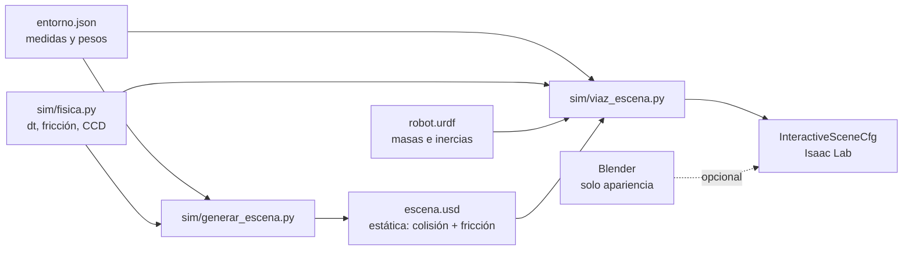

# Escena en Isaac Lab

Cómo se arma el mapa donde trabaja el robot, para que la física (pesos, fricción, contactos) sea creíble.



## Decisión: el mapa se genera con código, no en Blender

- **Física en el USD:** Blender no exporta masa, fricción ni cuerpos rígidos de PhysX en forma confiable. Esas propiedades se definen en código de todas formas.
- **Colisiones simples:** una malla detallada como colisión vuelve la simulación lenta e inestable. Por eso todo choca como cajas.
- **Una escena por cliente:** la escena sale de `entorno.json`. Una escena hecha a mano sirve para una sola planta.
- **Blender, opcional:** sirve para mallas visuales (panel con marco, tracker detallado). Se montan encima de la caja de colisión y no reemplazan la física.

## Tres capas

| Capa | Qué tiene | Archivo | Masa |
|---|---|---|---|
| **Estática** | Suelo, tubos de torsión y postes | `escena.usd` (de `sim/generar_escena.py`) | No. Un colisionador sin cuerpo rígido es fijo |
| **Dinámica** | Paneles | `sim/viaz_escena.py` → `RigidObjectCfg` | Sí: `panel.peso_kg` de `entorno.json` |
| **Robot** | Base, ruedas, brazo y ventosa | `robot.urdf` (de `backend/viaz/urdf.py`) → `ArticulationCfg` | Sí: por link, con inercia calculada de su forma |

## Dos escenas del mismo `entorno.json`

| | Escena de entrenamiento (RF-MAP-12) | Escena del demo (RF-MAP-06, RF-MAP-13, RF-MAP-15) |
|---|---|---|
| Para qué | Entrenar el brazo con PPO | `video.mp4`, clips de `entrenamiento_rapido.mp4` y la web |
| Qué tiene | Un tramo de tubo de la fila 0 con sus postes, el robot detenido frente al punto de montaje y su pila de paneles | 2 filas completas, el robot avanzando por el pasillo de la fila 0 y la fila 1 ya instalada |
| Copias | N entornos en paralelo (`num_envs`), con `replicate_physics=True` | 1 |
| Suelo | Una caja plana chica bajo cada copia | Plano, con la apariencia del desierto |
| Cámaras | Ninguna | Cámara lateral 3/4 fija |

- **Por qué dos escenas:** cada copia de entrenamiento solo necesita un punto de montaje. Cargar las 2 filas en cada copia gasta memoria y tiempo de GPU sin cambiar lo que aprende el brazo.
- **Mismo origen:** las dos escenas leen las medidas de `entorno.json` (altura del tubo, panel, separación). Así la política entrenada sirve en el parque del demo.
- **Base detenida con ruido:** en cada episodio, la base queda a ±15 cm y ±5° del punto de montaje (RF-INT-19). En el demo, la base llega a cada punto con el controlador programado (RF-INT-18).

## Parque del demo: desierto de Atacama

| Elemento | Valor | Física |
|---|---|---|
| Filas | 2, de 30 m, a 6 m entre sí | Sí: tubo y postes de acero |
| Estructura | Tracker de 1 eje, tubo horizontal a 1,5 m (posición de montaje) | Sí |
| Fila 0 | Vacía al inicio. El robot instala 3 a 5 paneles | Sí: paneles con masa |
| Fila 1 | ~25 paneles ya instalados | No: solo visuales |
| Pila | Sobre la base del robot, como en `sim/plan.py` | Sí |
| Suelo | Plano, tierra ocre con gravilla (`suelo: "desierto_atacama"`) | Sí: fricción de tierra seca |
| Cielo y luz | Despejado, sol de mediodía | No |
| Fondo | Cerros lejanos | No: solo visuales |

- **Apariencia:** el color y la textura del suelo y los cerros son visuales. Se pueden hacer en Blender y montar encima, sin tocar la física.
- **Sin pendiente:** el suelo plano deja la base siempre a z = 0. Así la política no tiene que compensar la inclinación.

## Física del entrenamiento RL

| Tema | Decisión | Requerimiento |
|---|---|---|
| Agarre | Unión física fija entre ventosa y panel. El brazo carga los 32 kg | RF-INT-22 |
| Motores | Límites de torque y velocidad de `robot.urdf` | RF-INT-23 |
| Base | Cinemática: se mueve por código, sin tracción de ruedas | RF-INT-18 |
| Variaciones por episodio | Masa del panel ±10 %, fricción ±20 %, base ±15 cm y ±5° | RF-INT-24, RF-INT-19 |
| Viento | Opcional, si sobra tiempo | RF-INT-25 |
| Fijación | El panel queda apoyado, sin abrazaderas | RF-TAR-04, RF-INT-11 |

- **Las variaciones son eventos de Isaac Lab** (`randomize_rigid_body_mass`, `randomize_rigid_body_material`, `apply_external_force_torque`). Isaac Lab no los aplica solo: se declaran en la configuración del entorno, una línea cada uno.
- **El plan de `sim/ejecutar_tarea.py` no cambia.** Ahí el panel agarrado sigue a la ventosa por código. Eso sirve para el planificador de respaldo (RF-INT-01), no para el entorno RL.

## Parámetros de física ([`sim/fisica.py`](../sim/fisica.py))

| Parámetro | Valor | Por qué |
|---|---|---|
| Paso de física | 1/120 s | Con pasos más grandes, un panel de 4 cm puede atravesar el tubo |
| CCD | Activado | Detecta choques entre pasos en objetos delgados |
| Iteraciones del solver | 16 de posición / 1 de velocidad | Hacen falta para cuerpos pesados apilados |
| Fricción suelo | 0,9 / 0,7 | Tierra seca compactada del desierto |
| Fricción acero | 0,6 / 0,5 | Tubo y postes galvanizados |
| Fricción panel | 0,5 / 0,4 | Marco de aluminio contra acero |
| Restitución | 0 en todo | Un panel que rebota es un error de simulación |
| Margen de contacto | 5 mm | Contactos estables en objetos delgados |

Los valores son **supuestos**: se calibran con la prueba de física.

## Masas del clon ([`backend/viaz/urdf.py`](../backend/viaz/urdf.py))

| Pieza | Masa | Origen |
|---|---|---|
| Base | 600 kg | Supuesto: chasis + baterías de una base que carga paneles |
| Ruedas | 4 × 15 kg | Supuesto |
| Brazo (hombro a muñeca) | ~54 kg | Aluminio hueco: 2700 kg/m³ × 30 % × volumen de cada pieza |
| Ventosa | 6 kg | Supuesto |
| **Total** | **~720 kg** | |

- **Inercias:** cada link tiene la inercia de una caja o un cilindro sólido de su tamaño. Antes eran 0,01, y eso hace inestable a PhysX.
- **Torque:** el hombro aguanta 3000 N·m. Con el brazo horizontal y un panel de 32 kg en la punta necesita unos 1230 N·m (ver test).
- **Pendiente:** cuando tengamos la ficha del robot real, hay que reemplazar los `MASA_*` de `urdf.py`.

## Prueba de física: lo primero en el pod

```bash
mkdir -p /tmp/viaz && cp backend/viaz/fixtures/entorno.json /tmp/viaz/
$ISAACLAB_SH -p sim/prueba_fisica.py --headless --dir /tmp/viaz --paneles 3
```

La prueba suelta 3 paneles 10 cm sobre el tubo, espera 3 s y revisa:

| Revisión | Tolerancia |
|---|---|
| Masa de cada panel | ±1 % de `peso_kg` |
| Altura final (apoyado sobre el tubo) | ±1 cm |
| Corrimiento en el plano | ±2 cm |
| Inclinación | < 2° |
| Velocidad final | < 1 cm/s |

- **Resultado:** escribe `prueba_fisica.json` y termina con código 1 si algo falla.
- **Con robot:** `--con-robot` necesita `clon.json` y `robot.urdf` en la carpeta. Revisa las 6 articulaciones y la masa total. Ambos archivos se sacan de una corrida en modo simulado.

### Qué hacer si falla
- **El panel atraviesa el tubo:** bajar `DT_S` o subir `CONTACTO_OFFSET_M`.
- **El panel rebota o vibra:** subir `ITER_POSICION` o bajar `DESPENETRACION_MAX_M_S`.
- **El panel resbala del tubo:** subir la fricción de `acero` y `panel`.
- **Error de importación o de nombre de API:** el código es para Isaac Lab 2.x y **no se ha probado en Isaac**. Hay que ajustar el nombre según la versión instalada.

## Supuestos y límites

- **Panel suelto:** el panel queda apoyado sobre la cara plana de 10 cm del tubo, sin abrazaderas. En una planta real se fija con abrazaderas, que el modelo todavía no tiene.
- **Suelo plano:** el parque del demo tiene `pendiente_grados: 0` (RF-MAP-14). Una pendiente distinta de 0 todavía no se modela, porque el plan supone la base en z = 0.
- **Base cinemática:** en `ejecutar_tarea.py` la base se mueve fijando su pose en cada paso, no con tracción de ruedas.
