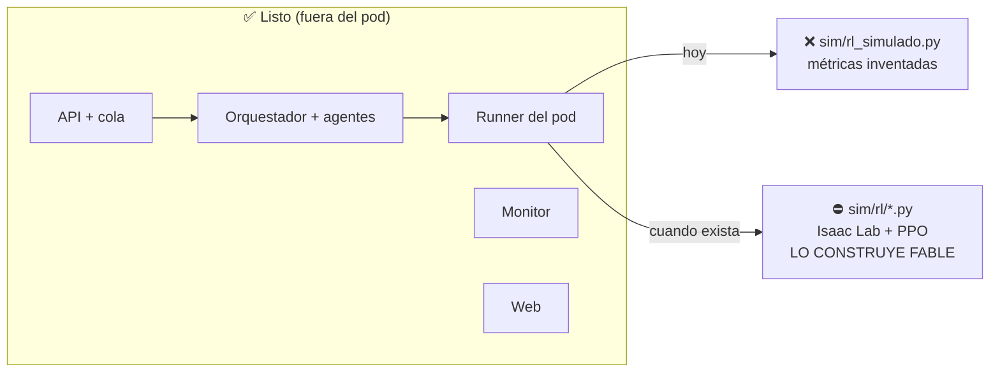
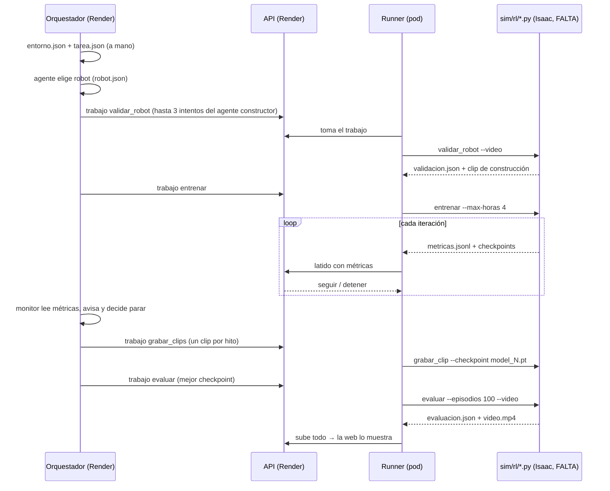
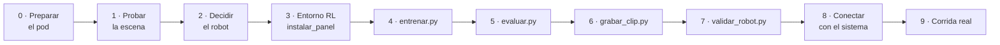

# Fable: qué hay y qué falta

> Estado al 2026-11-21. Para Fable y el equipo que construye el entrenamiento en Isaac Lab.
> Regla de este documento: **nada se da por hecho.** Cada pieza dice si es real, falsa (de relleno), sin probar o inexistente.

## 1. Resumen en una tabla

| Pieza | Estado | Quién |
|---|---|---|
| API, base de datos, cola de trabajos | ✅ Real, probada en local (SQLite) | — |
| Orquestador (flujo `rl`) | ✅ Real, probado en local | — |
| Runner del pod (`worker-gpu/runner.py`) | ✅ Real, probado en local en modo simulado | — |
| Monitor, latido, parada por NaN, regla del 90 % | ✅ Real, probado en local | — |
| Armado de videos (rótulos, mini curva, unión) | ✅ Real, probado en local | — |
| Web (3 videos, éxito por tolerancia) | ✅ Real, probada en local | — |
| Instalador del pod (`worker-gpu/pod/`) | ✅ Real, probado en la RTX 5090 | — |
| **Entrenamiento** (`sim/rl_simulado.py`) | ❌ **FALSO.** Inventa métricas, no aprende | Reemplazar: Fable |
| Agentes con Claude (`VIAZ_AGENTES=claude`) | ⚠️ Sin probar nunca | Equipo / Claude Code |
| Escena en Isaac (`sim/viaz_escena.py`, `sim/prueba_fisica.py`) | ⚠️ Escrita, sin correr en Isaac | **Fable** |
| `crear_articulacion_cfg()` de `robot_cfg.py` | ⚠️ Escrita, sin correr en Isaac | **Fable** |
| **Entorno RL `instalar_panel`** | ⛔ No existe | **Fable** |
| **`sim/rl/entrenar.py`, `evaluar.py`, `grabar_clip.py`, `validar_robot.py`** | ⛔ No existen | **Fable** |
| Despliegue (Render, Postgres, R2, Vercel) | ⛔ Nunca desplegado | Equipo |
| Webhook de Discord | ⛔ No creado | Equipo |
| Corrida demo real | ⛔ No existe. La de `/corridas/demo` en local es falsa | Sale del trabajo de Fable |



## 2. Cómo funciona el sistema (lo que ya existe)



### 2.1 Backend (`backend/viaz/`)

| Archivo | Qué hace | Estado |
|---|---|---|
| `api.py` | Corridas, archivos, métricas (`GET /corridas/{id}/metricas`), detener (`POST /corridas/{id}/detener`), cola del pod (`tomar`, `latido`, `fin`) | ✅ Probado en local |
| `db.py` | Tablas `corridas`, `trabajos` (con `latido_en`, `detener`, `parametros`), `metricas`. Devuelve a la cola los trabajos sin latido | ✅ Probado en local con SQLite. ⚠️ Postgres sin probar |
| `orquestador.py` | Flujo `rl`: entorno → escena → tarea → robot → construir robot → entrenar (con monitor) → clips → evaluar → listo | ✅ Probado en local |
| `agentes/` | Selección de robot y constructor. Modo `fijo` = reglas. Modo `claude` = Claude Opus 5.5 con salida estructurada | ✅ `fijo` probado. ⚠️ `claude` **nunca probado** |
| `monitor.py` | Revisa las métricas cada 10 min, detecta hitos (primer éxito, 50 %, 90 %), recomienda parar, avisa por Discord | ✅ Reglas probadas. ⚠️ Con Claude y Discord, sin probar |
| `robot_cfg.py` | Valida el ensamblaje del constructor, genera `robot_cfg.py` (con `PARAMETROS`) y `clon.json`. CLI: `python -m viaz.robot_cfg --robot <id> --salida <ruta>` | ✅ Python probado. ⚠️ `crear_articulacion_cfg()` sin probar en Isaac |
| `urdf.py` | Genera `robot.urdf` propio de VIAZ (6 articulaciones, masas, geometría del visor) | ✅ Probado (sin Isaac) |
| `catalogo/robots/` | 4 robots reales + 1 ficticio | ⚠️ Datos débiles (§4.4) |
| `catalogo/assets_isaaclab.json` | Brazos (UR10, Franka), efectores (ventosas, pinza), bases | ⚠️ Todo `verificado: false` salvo `base_movil_simple`. Rutas y medidas supuestas |
| `fixtures/entorno.json`, `tarea.json` | El parque del demo: 2 filas de 30 m en Atacama, paneles de 2,38 × 1,13 m y 32 kg | ✅ Es la entrada a mano del demo |
| `esquemas/` | 12 JSON Schemas: el contrato de cada archivo | ✅ |

### 2.2 Pod (`worker-gpu/`)

| Archivo | Qué hace | Estado |
|---|---|---|
| `runner.py` | Toma trabajos, lanza los 4 comandos del entorno RL, manda el latido con métricas, crea `DETENER`, arma `curva.json`, rotula y une los clips, sube los archivos | ✅ En modo `simulado`. ⚠️ En modo `isaac`, sin probar (faltan los scripts) |
| `pod/instalar.sh` | Instala Isaac Sim 5.1 + Isaac Lab 2.3.2 + torch cu128. Escribe `/workspace/pod.env` | ✅ Probado en la RTX 5090 |
| `pod/espejo_assets.py`, `assets.txt` | Copia los modelos de Omniverse al disco del pod | ✅ Pero solo trae Cartpole y el suelo |
| `pod/humo.sh` | Prueba de humo: Cartpole con PPO | ✅ Pasó: 150 405 pasos/s |

### 2.3 Simulación (`sim/`)

| Archivo | Qué hace | Estado |
|---|---|---|
| `generar_escena.py` | `entorno.json` → `escena.usd`: suelo, tubos y postes con colisión y fricción. Sin paneles ni robot | ✅ Python puro, probado |
| `fisica.py` | Paso de física, fricciones, masas, espesores | ⚠️ Valores supuestos, no medidos |
| `plan.py` | Geometría: `slots()` = dónde va cada panel sobre el tubo. Planificador de trayectorias | ✅ Probado sin Isaac |
| `viaz_escena.py` | `describir()` (Python puro, probado) y `construir_cfg()` (escena de Isaac Lab) | ⚠️ `construir_cfg()` sin correr en Isaac |
| `prueba_fisica.py` | Suelta paneles sobre el tubo y revisa que queden quietos | ⚠️ Sin correr en Isaac. **Es lo primero que hay que correr** |
| `isaac_comun.py`, `validar_clon.py`, `ejecutar_tarea.py` | Scripts del flujo anterior (planificador, sin RL) | ⚠️ Sin correr en Isaac. Sirven de base para reusar código |
| `rl_simulado.py` | **Imita** los 4 comandos del contrato sin Isaac: métricas sintéticas, checkpoints vacíos, videos dibujados en 2D | ❌ **Falso a propósito.** Solo para probar el sistema sin GPU |
| `video.py` | Rótulos, mini curva, tarjetas y unión de clips (ffmpeg) | ✅ Probado |
| `rl/robot_cfg_ejemplo.py` | Robot de prueba: Leapting MMR = UR10 ×2,192 + ventosa larga + base móvil simple | ✅ Generado. ⚠️ `crear_articulacion_cfg()` sin probar |

### 2.4 Web (`web/`)

- `/corridas/[id]`: muestra "1 · El agente construye el robot", "2 · El robot aprendiendo" (cámara rápida) y "3 · El robot ya entrenado", más el éxito a 5 cm/5° y a 2 cm/2°, el robot con sus alternativas y las diferencias del clon.
- ✅ Probada en local con la corrida falsa.
- ⚠️ El PR #9 (web nueva) está abierto y toca 27 archivos. Si lo unen, hay que revisar que siga mostrando lo anterior.

## 3. Lo que tiene que construir Fable

Todo va en el pod con la RTX 5090. Orden obligatorio: cada paso bloquea al siguiente.



### Paso 0 · Preparar el pod

- [ ] `source /workspace/pod.env`. Revisar que `nvidia-smi` muestre un driver de la rama 580.
- [ ] Clonar el repo en el pod y hacer `git pull` de `main` (o de la rama `docs/entorno-antes-que-robot` mientras el PR #14 no esté unido).
- [ ] `apt install fonts-dejavu-core`: sin esta fuente, los rótulos de los videos salen sin tildes.
- [ ] `pip install requests imageio-ffmpeg pillow` en el Python que corre `worker-gpu/runner.py`.
- [ ] Agregar a `worker-gpu/pod/assets.txt` los USD que use el robot. Para el UR10, la ruta sale de `UR10_CFG` en `isaaclab_assets.robots.universal_robots`. Correr de nuevo `instalar.sh`.
- [ ] **No destruir la instancia de Vast.ai, solo detenerla:** `/workspace` se pierde al destruirla.

**Listo cuando:** `bash worker-gpu/pod/humo.sh` pasa y el USD del UR10 está en `/workspace/isaac_assets`.

### Paso 1 · Probar la escena (el código existe, nunca se corrió)

```bash
mkdir -p /workspace/prueba && cp backend/viaz/fixtures/entorno.json /workspace/prueba/
$ISAACLAB_SH -p sim/prueba_fisica.py --headless --dir /workspace/prueba --paneles 3
```

- [ ] Arreglar los nombres de la API de Isaac Lab que fallen en `sim/viaz_escena.py` y `sim/isaac_comun.py` (se escribieron para Isaac Lab 2.x sin probar).
- [ ] Si los paneles atraviesan el tubo o rebotan, ajustar `sim/fisica.py` (`DT_S`, fricción, espesor).

**Listo cuando:** la prueba pasa: cada panel queda a ±1 cm de altura, ±2 cm en el plano, menos de 2° y quieto.

### Paso 2 · Decidir cómo se carga el robot

Hay **dos caminos** y hoy el código tiene los dos a medias:

| | A · Asset de Isaac Lab (UR10 escalado) | B · URDF propio de VIAZ (`robot.urdf`) |
|---|---|---|
| De dónde sale | `robot_cfg.py` → `crear_articulacion_cfg()` (usa `UR10_CFG`) | `backend/viaz/urdf.py` |
| A favor | Calza con la historia del pitch: "el agente arma el robot con piezas de Isaac Lab". Actuadores ya afinados | Masas e inercias calculadas. Misma geometría que el visor 3D y `sim/plan.py`. `viaz_escena.py --con-robot` ya lo usa |
| En contra | Para el Leapting, el UR10 queda ×2,192 y con 3705 N·m: puede volver inestable la física. Base y ventosa no vienen en `UR10_CFG`: hay que agregarlas | El runner **no le pasa `robot.urdf`** a los comandos del RL (`ENTRADAS_RL` en `orquestador.py`). Hay que agregarlo (cambio de una línea) |

- [ ] Probar A primero con `sim/rl/robot_cfg_ejemplo.py`. Si la física es inestable, probar con un robot más liviano (`python -m viaz.robot_cfg --robot relu-bison ...`) o pasar a B.
- [ ] Si eligen B, avisar para agregar `robot.urdf` a `ENTRADAS_RL` y pasar `--urdf` en `_comunes()` de `runner.py`.
- [ ] En los dos caminos, **la base no se mueve durante el entrenamiento** (RL solo en el brazo) y la ventosa es una unión fija que se activa y desactiva.

**Listo cuando:** el robot aparece en la escena de entrenamiento, quieto, sin chocar, con sus 6 articulaciones.

### Paso 3 · Entorno RL `instalar_panel` (la pieza principal, no existe)

Archivo sugerido: `sim/rl/instalar_panel.py` (clase `DirectRLEnv` o `ManagerBasedRLEnv`) y su registro en gym.

| Parte | Qué lleva | Fuente |
|---|---|---|
| Escena | Un tramo de tubo de la fila 0 con sus postes, el robot detenido frente al punto de montaje y su pila de paneles. Copiada en N entornos en paralelo | RF-MAP-12, `sim/plan.py` → `slots()`, `sim/viaz_escena.py` → `describir()` |
| Robot | **Todo desde `PARAMETROS`:** articulaciones, alcance, carga, `esfuerzo_max_nm`, `velocidad_max_rad_s`. Nada escrito a mano | Contrato §0 y §7 |
| Observaciones | Ángulos y velocidades de las articulaciones, pose de la ventosa, pose del panel agarrado o del siguiente en la pila, pose del objetivo sobre el tubo, ventosa activa sí/no | — |
| Acciones | 6 articulaciones del brazo (posición relativa o esfuerzo) + 1 acción de ventosa (activar/soltar) | RF-INT-18: la base no la controla el RL |
| Agarre | Unión fija ventosa–panel al activar cerca del panel, con la masa real (`panel.peso_kg`, 32 kg) | RF-INT-22 |
| Límites del motor | Torque y velocidad de `PARAMETROS` | RF-INT-23 |
| Variación por episodio | Masa del panel ±10 %, fricción ±20 %, pose de la base ±15 cm y ±5° | RF-INT-24, RF-INT-19 |
| Recompensa (sugerida, por etapas) | Acercar la ventosa al panel → agarrarlo → levantarlo → llevarlo sobre el objetivo → alinearlo → soltarlo apoyado. Castigo por choques, por soltar en el aire y por movimientos bruscos | — |
| Éxito | Panel apoyado sobre el tubo, sin choque, a ≤ 5 cm y ≤ 5° del objetivo | RF-INT-11 |
| Fin del episodio | Éxito, panel caído, choque fuerte o tiempo máximo | — |
| Cámaras | **Ninguna durante el entrenamiento** (velocidad) | v0.7 |

- [ ] Arrancar con pocas etapas de recompensa. Si no aprende en 30 min, simplificar (por ejemplo, empezar con el panel ya agarrado).
- [ ] Probar con 2 robots distintos sin tocar código (`leapting-mmr` y `relu-bison`).

**Listo cuando:** con PPO de rsl_rl y miles de entornos, la recompensa sube y aparecen los primeros éxitos (`tasa_exito > 0,05`).

### Paso 4 · `sim/rl/entrenar.py`

Contrato §3. Base: `scripts/reinforcement_learning/rsl_rl/train.py` de Isaac Lab (el mismo que corrió `humo.sh`).

- [ ] Leer `--entorno --tarea --robot --escena --salida --max-horas --tolerancia-pos-m --tolerancia-ang-grados [--reanudar]`.
- [ ] Escribir `SALIDA/metricas.jsonl`: una línea por iteración, con `flush`. Campos obligatorios: `iteracion`, `pasos`, `tiempo_s`, `recompensa_media`, `tasa_exito`. Opcionales: `largo_episodio`, `perdida_valor`, `perdida_politica`, `entropia`. NaN se escribe tal cual.
- [ ] Guardar `SALIDA/checkpoints/model_N.pt` cada 50 iteraciones **sin borrar los anteriores** (los clips se graban desde ellos).
- [ ] Revisar `SALIDA/DETENER` en cada iteración: si existe, guardar un checkpoint y salir con código 0.
- [ ] Al cumplir `--max-horas`: guardar un checkpoint y salir con código 0.
- [ ] Headless, sin cámaras.

**Listo cuando:** `rl_simulado.py` y `entrenar.py` producen la misma estructura de archivos, y el runner los procesa igual.

### Paso 5 · `sim/rl/evaluar.py`

Contrato §4.

- [ ] Cargar `--checkpoint`, correr `--episodios` (100) **sin exploración**, con la base con ruido de ±15 cm y ±5°.
- [ ] Contar los éxitos para cada tolerancia de `--tolerancias 0.05:5,0.02:2`.
- [ ] Escribir `SALIDA/evaluacion.json` según `evaluacion.schema.json`: `version`, `checkpoint`, `episodios`, `tolerancias` (`pos_m`, `ang_grados`, `exitos`, `tasa_exito`), `ciclo_promedio_s`, `colisiones`, `fuente: "isaac"`.
- [ ] Con `--video`: **la muestra final.** Escena completa de las 2 filas (fila 1 ya instalada, solo visual). La base avanza por el pasillo con un **controlador programado** (no RL), se detiene en cada punto de montaje y la política instala de 3 a 5 paneles. Cámara lateral 3/4 fija, 1280 × 720, 30 fps, 20 a 40 s.
- [ ] Con `--trayectoria` (Should): un episodio en el formato de `trayectoria.schema.json`, para el visor 3D.

**Listo cuando:** `evaluacion.json` pasa el esquema y `video.mp4` se ve en el navegador.

### Paso 6 · `sim/rl/grabar_clip.py`

Contrato §5.

- [ ] Cargar `--checkpoint`, grabar `--segundos` (7) con la cámara lateral 3/4 fija, 1280 × 720, 30 fps, H.264.
- [ ] Con `--grilla`: abrir con 1–2 s de la vista de muchos entornos en paralelo.
- [ ] **Sin texto encima:** el runner pone el rótulo y la mini curva.

**Listo cuando:** los clips de `model_50.pt` y del último checkpoint se ven distintos (torpe → hábil).

### Paso 7 · `sim/rl/validar_robot.py`

Contrato §6. Base: `sim/validar_clon.py`.

- [ ] Cargar el robot de `--robot` en la escena. Revisar que no choque al inicio, que la ventosa alcance la pila y el tubo, y que aguante `panel.peso_kg`.
- [ ] Escribir `{"ok": bool, "problemas": [...], "fuente": "isaac"}`. Cada problema en una oración con números (el agente constructor la lee para corregir).
- [ ] Con `--video`: 6 a 10 s. Escena vacía (1 s) → aparece la base → el brazo → la ventosa (≈ 1 s cada una) → movimiento de prueba hacia la pila y hacia el tubo. Sin texto encima.

**Listo cuando:** con un robot que no alcanza (por ejemplo, `escala_alcance` muy baja) devuelve `ok: false` y el video muestra dónde se queda.

### Paso 8 · Conectar con el sistema

- [ ] En `/workspace/pod.env`, agregar:

```bash
export VIAZ_CMD_ENTRENAR="$ISAACLAB_SH -p /workspace/<repo>/sim/rl/entrenar.py"
export VIAZ_CMD_EVALUAR="$ISAACLAB_SH -p /workspace/<repo>/sim/rl/evaluar.py"
export VIAZ_CMD_CLIP="$ISAACLAB_SH -p /workspace/<repo>/sim/rl/grabar_clip.py"
export VIAZ_CMD_VALIDAR_ROBOT="$ISAACLAB_SH -p /workspace/<repo>/sim/rl/validar_robot.py"
export VIAZ_DIR_POD=/workspace/viaz
export VIAZ_API=<URL de la API>   # Render o un túnel a la API local
export WORKER_TOKEN=<mismo valor que en la API>
```

- [ ] La API tiene que ser alcanzable desde el pod: desplegada en Render o con un túnel (`cloudflared` o `ngrok`) a la API local.
- [ ] Correr `python worker-gpu/runner.py --modo isaac`. Si falta alguna `VIAZ_CMD_*`, el runner lo avisa al arrancar.

**Listo cuando:** una corrida corta (`VIAZ_HORAS_ENTRENAMIENTO=0.25`) llega a `listo` con videos de Isaac.

### Paso 9 · Corrida real del demo

- [ ] Correr el flujo completo con `VIAZ_AGENTES=claude` y `VIAZ_HORAS_ENTRENAMIENTO=4` (o lo que alcance).
- [ ] Poner su id en `VIAZ_CORRIDA_DEMO` para que `/corridas/demo` la muestre.
- [ ] Revisar los 3 videos en la web antes del pitch.

## 4. Lo que falta fuera de Fable

### 4.1 Agentes con Claude (nunca probados)
- [ ] Probar el agente de selección, el constructor y el monitor con `VIAZ_AGENTES=claude` y la clave real.
- [ ] Hoy el valor por defecto es `fijo` (reglas), y `render.yaml` también fija `VIAZ_AGENTES: fijo`: en Render correría con reglas, no con Claude. Para el pitch, cambiarlo a `claude` y cargar `ANTHROPIC_API_KEY` en el dashboard de Render.

### 4.2 Despliegue (nunca hecho)
- [ ] Render: API + orquestador + Postgres. Revisar que `_migrar()` cree las columnas nuevas en Postgres.
- [ ] Cloudflare R2: subida y descarga de archivos con URL firmadas.
- [ ] Vercel: la web, con `NEXT_PUBLIC_API_URL` apuntando a Render y `VIAZ_ORIGENES` con el dominio de Vercel.
- [ ] Secretos solo en Render, nunca en el repo: `ANTHROPIC_API_KEY`, `WORKER_TOKEN`, `VIAZ_ADMIN_TOKEN`, `VIAZ_DISCORD_WEBHOOK`, claves de R2.

### 4.3 Discord
- [ ] Crear el webhook del canal y ponerlo en `VIAZ_DISCORD_WEBHOOK`. Sin eso, el monitor no avisa a nadie.

### 4.4 Catálogo de robots
- [ ] Hay 4 reales + 1 ficticio. RF-ROB-01 pide de 5 a 10.
- [ ] Datos estimados: AES Maximo (todo), Trinabot (carga y alcance), Relu (efector y alcance).
- [ ] Las páginas de Relu y Trinabot no cargaron al consultarlas: revisar las fuentes antes del pitch.

### 4.5 Física
- [ ] Los valores de `sim/fisica.py` son supuestos. Calibrarlos con `sim/prueba_fisica.py`.

### 4.6 Should sin hacer
- [ ] Curva de entrenamiento en la web (RF-WEB-14). `curva.json` ya se genera; falta dibujarla.
- [ ] Plan B con planificador (RF-INT-01): si el RL no llega a un resultado presentable, mostrar el robot con trayectorias planificadas. El flujo `planificador` existe (`VIAZ_FLUJO=planificador`), pero `sim/ejecutar_tarea.py` nunca corrió en Isaac.

## 5. Riesgos

| Riesgo | Qué pasa | Qué hacer |
|---|---|---|
| El PPO no llega al 90 % en 4 h | El monitor no para solo; la evaluación muestra menos | Mostrar el mejor resultado con su tolerancia y episodios (RF-WEB-16). Simplificar la recompensa |
| UR10 ×2,2 inestable | Física que explota, NaN | El runner para por NaN. Cambiar a robot más liviano o al URDF propio (Paso 2) |
| Nombres de API de Isaac Lab | Los scripts sin probar fallan | Paso 1 primero, antes de escribir el entorno |
| El pod no ve la API | Los trabajos quedan en cola | Desplegar o usar túnel (Paso 8) |
| Se destruye la instancia | Se pierden Isaac, assets y checkpoints | Solo detener. Respaldar checkpoints buenos |
| Se muestra la corrida falsa | El pitch muestra dibujos 2D | Reemplazar `VIAZ_CORRIDA_DEMO` por la corrida real (Paso 9) |

## 6. Comandos útiles

```bash
# Todo el sistema en un Mac, sin GPU (usa el entrenamiento FALSO)
cd backend && uvicorn viaz.api:app --reload
cd backend && python -m viaz.orquestador
python worker-gpu/runner.py --modo simulado
cd web && npm run dev

# Tests
cd backend && python -m pytest -q

# robot_cfg.py de cualquier robot del catálogo
cd backend && python -m viaz.robot_cfg --robot leapting-mmr --salida ../sim/rl/robot_cfg_ejemplo.py

# Variables para acortar pruebas
VIAZ_HORAS_ENTRENAMIENTO=0.25   # entrenamiento corto
VIAZ_MONITOR_S=60               # monitor cada minuto
VIAZ_SIM_ITERACIONES=300        # solo modo simulado
```

## 7. Documentos de referencia

| Documento | Para qué |
|---|---|
| [`contrato-entorno-rl.md`](contrato-entorno-rl.md) | **El contrato de los 4 scripts.** Leer §0 primero |
| [`escena-isaac.md`](escena-isaac.md) | Las dos escenas (entrenamiento y demo) y la física |
| [`requerimientos.md`](requerimientos.md) | RF-INT-10..25, RF-MAP-12..14, RF-CLO-09 |
| [`infraestructura.md`](infraestructura.md) | Pod, driver 580, prueba de humo |
| [`plan-entrenamiento.md`](plan-entrenamiento.md) | Ideas para acelerar el RL (demostraciones, BC) |
| [`agentes/`](agentes/) | Contratos de los agentes |
