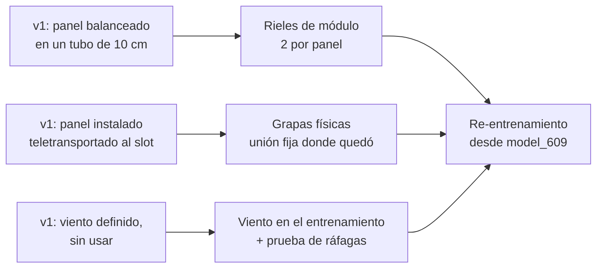

# Física más real del entrenamiento (v2, 2026-11-22)

> Rama `feat/fisica-real`. Parte de la política respaldada (`sim/rl/respaldo/model_609_multi.pt`) y la re-entrena.



## Qué era simplificado y qué cambió

| Elemento | v1 | v2 | Dónde |
|---|---|---|---|
| Apoyo del panel | Balanceado sobre un tubo de 10 cm | Dos rieles de 4 × 4 cm por slot, 60 % del largo del panel | `sim/viaz_escena.py` `poner_rieles`, `sim/fisica.py` `RIELES` |
| Panel instalado | Se teletransportaba a su slot | Queda donde lo dejó la política, unido por una grapa (unión fija) | `sim/rl/entorno.py` `_engrapar`, `fisica.GRAPAS` |
| Viento | Definido, nadie lo usaba | Ráfaga por episodio sobre el panel que se maneja (`VIAZ_VIENTO_M_S`) | `sim/rl/entorno.py` `_viento` |
| Prueba de viento | No existía | Ráfagas de 10 a 40 m/s sobre los paneles instalados | `sim/rl/prueba_viento.py` |
| Ventosa | Unión fija al sellar | Sin cambio todavía. El modo `succion` (fuerza limitada) ya existe: `VIAZ_AGARRE=succion` | `sim/rl/agarre.py` |
| Base móvil | Programada | Sin cambio | `sim/rl/base_movil.py` |
| Suelo | Plano | Sin cambio | `sim/viaz_escena.py` |

Variables: `VIAZ_RIELES=0` y `VIAZ_GRAPAS=0` vuelven a v1 para comparar. `VIAZ_RIELES_BAJO_TUBO_M=0` pone la cara de los rieles a
ras con la del tubo original y baja el tubo (geometría real); con 0,003 el tubo queda donde estaba y los rieles 3 mm más abajo.

## Resultados

### Prueba de viento (model_609, sin rieles, 32 secuencias, 96 paneles instalados por prueba)

Ráfaga de 1,5 s de lado y 40° hacia arriba sobre cada panel ya instalado. Panel de 2,38 × 1,13 m y 32 kg.

| Viento | Fuerza por panel | Sin grapas (solo apoyado) | Con grapas |
|---|---|---|---|
| 10 m/s (36 km/h) | 65 N | se quedan (0,4 mm) | se quedan |
| 20 m/s (72 km/h) | 261 N | **96 de 96 se vuelan** (2,4 m de media) | se quedan |
| 30 m/s (108 km/h) | 587 N | 96 de 96 se vuelan (9 m) | se quedan |
| 40 m/s (144 km/h) | 1 044 N (3,3 veces su peso) | 96 de 96 se vuelan (38 m) | se quedan |

- **Límite:** la grapa simulada es rígida. No modela la carga a la que se rompe una grapa real.

### model_609 con rieles, sin re-entrenar

- **0 de 64** secuencias. Con rieles 3 mm bajo el tubo, también 0.
- **Causa medida:** la política aprendió a terminar de acomodar el panel deslizándolo sobre el tubo. Con rieles, el panel
  queda apoyado y quieto, a la altura correcta, pero a 17 cm del slot.
- **También medido:** con rieles del 85 % del largo, la punta del riel quedaba 5 cm bajo el panel de la pila del robot y lo
  trababa al levantarlo. Por eso los rieles miden 60 % del largo.
- **Conclusión:** la física nueva necesita re-entrenar el aterrizaje del panel. No basta con cambiar la geometría.

### Re-entrenamiento con rieles desde model_609 → model_990

Rieles a ras del tubo original y tubo 4 cm más abajo (`VIAZ_RIELES_BAJO_TUBO_M=0`), ventosa como unión fija, sin viento.
4096 copias. Se detuvo solo en la iteración 990 (28 min): criterio cumplido y la curva ya no subía.

| Hito | Iteración | Minuto | Éxito sin ayuda (media de 10 iteraciones) |
|---|---|---|---|
| Inicio (model_609) | 609 | 0 | 0 % |
| Primer éxito | 639 | 3 | éxitos aislados |
| 50 % | 787 | 14 | 66 % |
| Umbral (criterio) | 918 | 23 | 97,5 % |
| Final | 990 | 28 | 97,8 % |

### Evaluación de model_990 con la física nueva (sin teletransporte)

| Prueba | v1 (model_609, física vieja) | v2 (model_990, rieles y grapas) | **v3 (model_1164, + ventosa real y viento)** |
|---|---|---|---|
| 100 episodios, éxito a 5 cm y 5° | 100 % | 99 % | **99 %** |
| 100 episodios, éxito a 2 cm y 2° | 97 % | 84 % | 83 % |
| 100 secuencias de 4 paneles, completas | 100 con teletransporte · 79 sin él | 93, con grapas físicas | **98**, con grapas físicas |
| Paneles instalados en las secuencias | 400 de 400 (teletransporte) | 379 de 386 (98,2 %) | **393 de 395 (99,5 %)** |
| Choques y caídas | 0 y 0 | 0 y 0 | 0 y 0 |
| Error medio de posición | 1,0 cm | 1,3–1,4 cm | 1,1–1,2 cm |
| Paneles que se vuelan con 20 m/s sin grapas | 96 de 96 | 90 de 93 | — |
| Paneles que se mueven con 40 m/s con grapas | 0 | 0 | — |

v3 se evalúa en sus condiciones de entrenamiento: ventosa con fuerza limitada (`VIAZ_AGARRE=succion`) y ráfagas de hasta
8 m/s sobre el panel que se maneja (`VIAZ_VIENTO_M_S=8`). Re-entrenado desde model_990: se detuvo solo en la iteración 1164,
a los 9 min, con 99 % de éxito sin ayuda.

- Las 7 secuencias incompletas fallan por tiempo en el segundo panel: no hay choques ni caídas.
- La precisión fina (2 cm) baja de 97 % a 84 %: el panel ya no se acomoda deslizándolo sobre el tubo.
- Archivos: `sim/rl/respaldo/model_990_rieles.pt`, `evaluacion_990_rieles.json`, `secuencia_990_rieles_grapas.json`,
  `viento_990_*.json`. Videos de los 4 hitos: `clips_fisica/` en el pod.

- v3: `sim/rl/respaldo/model_1164_succion_viento.pt`, `evaluacion_1164_succion_viento.json`, `secuencia_1164_succion_viento.json`.

### Lo que sigue simplificado

- **Base móvil:** se mueve por código, sin tracción ni orugas que toquen el suelo.
- **Suelo:** plano. El terreno realista es solo visual.
- **Grapa:** rígida. No modela la carga a la que se rompe una grapa real.
- **Masa del brazo:** unos 72 kg, menos que un brazo industrial real de 100 kg de carga útil.

## Cómo correrlo en el pod

```bash
# Re-entrenar con rieles (geometría real) desde la política respaldada
VIAZ_RIELES_BAJO_TUBO_M=0 $ISAACLAB_SH -p sim/rl/entrenar.py --entorno E --tarea T --robot R \
  --salida DIR --max-horas 0.75 --reanudar sim/rl/respaldo/model_609_multi.pt --parar-al-cumplir

# Prueba de viento, con y sin grapas
$ISAACLAB_SH -p sim/rl/prueba_viento.py --entorno E --tarea T --robot R --checkpoint C --salida DIR [--sin-grapas]
```

`tarea.json` y `entorno.json` tienen que estar en el formato nuevo de `main` (`objetivo.cantidad`, `espacio`, `elementos`).
