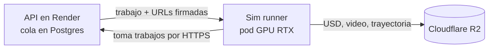

# Infraestructura de simulación

> Estado: **propuesta** (2026-11-21). Decisión del equipo: la simulación corre en una **GPU RTX en la nube, en un host con driver 580** (RTX PRO 6000 o RTX 5090).
> Las versiones marcadas **[Verificar]** se confirman en la primera hora con la prueba de humo (§5).

## 1. Decisión

| Tema | Elección | Por qué |
|---|---|---|
| GPU | **RTX PRO 6000 Blackwell (96 GB)**; respaldo **RTX 5090 (32 GB)**. Las dos en un host con driver 580 | Los videos de salida (RF-INT-13, RF-INT-15) necesitan RT cores. A100 y H100 entrenan headless sin cámaras, pero no renderizan. La PRO 6000 es la GPU "Ideal" de NVIDIA para 5.1 ([`investigacion-isaac-gpu.md`](investigacion-isaac-gpu.md) §1) |
| Sistema operativo | **Ubuntu 22.04 LTS** (x86_64) | Es la base más probada con Isaac Sim 5.1; en 24.04 hay reportes de caídas con Blackwell |
| Isaac Sim | **5.1.0** **[Verificar]** | Versión estable con Isaac Lab 2.3 y cuRobo; hay reportes de setups funcionando en RTX 50 |
| Isaac Lab | **2.3.x** **[Verificar en la tabla de compatibilidad]** | Par de Isaac Sim 5.1 |
| Driver NVIDIA | Rama **580** (580.65.06 o 580.95.05) | Son los drivers probados para 5.1. **La rama 595 rompe Isaac Sim 5.1 en todas las RTX**, también en Ada (RTX 4090), y también en headless. NVIDIA lo confirma en IsaacSim #517 y #602 |
| Python / PyTorch | Python 3.11, PyTorch con CUDA 12.8 (`cu128`) | Blackwell (sm_120) necesita CUDA 12.8 o superior |
| Forma de instalar | Contenedor oficial `nvcr.io/nvidia/isaac-sim:5.1.0` **[Verificar tag]**, o pip si el proveedor no permite Docker con GPU | El contenedor fija versiones y evita pelear con dependencias |
| Modo | Headless; para depurar, noVNC o videos grabados | El pipeline no necesita GUI (RF-GPU-02). WebRTC no funciona en RunPod (sin UDP) ni en Vast.ai (NAT) |

**Plan B de versión:** si no hay host con driver 580, pasar a **Isaac Sim 6.x** con el driver **595.58.03** (el probado para 6.x). **Esto es una migración, no un cambio de versión:** 6.x va con Isaac Lab 3.0, que cambia los cuaterniones de WXYZ a XYZW y depreca `isaacsim.core.utils`. `sim/` usa las dos cosas. Ubuntu 22.04 o 24.04; 22.04 está en desuso desde Isaac Sim 6. Antes del plan B, prueba otro host con 580 (§2).

## 2. Máquina en la nube

| Recurso | Mínimo | Recomendado |
|---|---|---|
| GPU | 1× RTX 5090 | 1× RTX PRO 6000 Blackwell |
| RAM | 64 GB | 64 GB o más (Isaac Lab y RL piden más). Muchas 5090 de Vast.ai traen solo 30 GB: filtra por `cpu_ram>=64` |
| Disco | 100 GB SSD | 200 GB NVMe (Isaac Sim + assets + caché de shaders + videos) |
| CPU | 8 vCPU | 16 vCPU |
| Red | Salida HTTPS (assets de Omniverse, API en Render, R2) | Sin puertos de entrada |

- **Proveedor:** **Vast.ai**, con filtro `driver_version` 580.x, `cpu_ram>=64` y `disk_space>=200`. Requisitos: acceso SSH, Docker con NVIDIA Container Toolkit (o imagen base con CUDA 12.8) y disco persistente entre reinicios. El 2026-11-21 a las 06:05 UTC tenía 4 RTX PRO 6000 con driver 580 desde US$1,49/h y 9 RTX 5090 con driver 580 desde US$0,49/h.
- **RunPod no sirve hoy con 5.1:** a las 06:03 UTC no tenía 5090, y todo su stock Secure estaba en hosts CUDA 13.2 (driver 595). Un pod de RunPod no puede cambiar su driver.
- **Si Vast.ai falla:** una VM con L40S en Brev o AWS g6e, donde instalas tú el driver 580.
- **Vulkan en Vast.ai:** pon `-e NVIDIA_DRIVER_CAPABILITIES=compute,utility,graphics` en las opciones de Docker del template. Exportarlo después no sirve.
- Detalle, precios y fuentes en [`investigacion-isaac-gpu.md`](investigacion-isaac-gpu.md).
- **Que el proveedor controle el driver:** en muchas nubes el driver lo fija el host. Revisar con `nvidia-smi` **antes** de instalar nada. Si es de la rama 595, suelta esa máquina y toma otra con 580; el plan B es el último recurso.

## 3. Cómo se conecta con el pipeline

La conexión completa está en [`arquitectura.md`](arquitectura.md) §2. Resumen del lado GPU:



- **Pull, no push:** el runner pide trabajos a la API. El pod no expone puertos.
- **SSH solo para desarrollo:** el equipo entra al pod por SSH con llave (VS Code Remote o Cursor).
- **La clave de Claude no vive en el pod.** Los agentes corren en Render.

## 4. Variables de entorno del pod

```bash
API_URL=https://<api>.onrender.com   # API en Render
WORKER_TOKEN=...                     # mismo valor que en Render
```

El pod las lee del gestor de secretos del proveedor o de un `.env` fuera de git. Ver [`requerimientos.md`](requerimientos.md) §7.3.

## 5. Prueba de humo (primera hora)

1. `nvidia-smi` muestra la GPU arrendada y un driver de la rama 580. Si muestra 595, cambia de máquina (§2). `vulkaninfo --summary` también ve la GPU.
2. Isaac Sim arranca headless y cierra sin errores.
3. Isaac Lab corre un ejemplo incluido (ej.: entorno de cartpole) en modo headless.
4. cuRobo planifica una trayectoria de ejemplo.
5. Se graba un video corto de una escena y se sube a R2 con una URL firmada.

Si los 5 pasos pasan, la versión queda fijada: se anota en la tabla de §1 y en la bitácora de [`ciclo-desarrollo.md`](ciclo-desarrollo.md).

## 6. Costo y operación

- Apagar la instancia cuando no se usa; dejar el disco persistente.
- Una persona es dueña de la máquina **[Por definir]**: la prende, la apaga y vigila el gasto.
- Estimar horas de uso: CP1 → CP2 → freeze, y fijar un tope de gasto **[Por definir]**.

## Fuentes

- Requisitos de Isaac Sim 5.1: https://docs.isaacsim.omniverse.nvidia.com/5.1.0/installation/requirements.html (consultado 2026-11-21)
- Requisitos de la versión más reciente: https://docs.isaacsim.omniverse.nvidia.com/latest/installation/requirements.html (consultado 2026-11-21)
- Compatibilidad Isaac Sim / Isaac Lab: https://docs.isaacsim.omniverse.nvidia.com/latest/installation/compatibility.html
- Caídas de 5.1 en RTX 5090 con driver 580-open: https://forums.developer.nvidia.com/t/isaac-sim-5-1-0-rc-19-crashes-on-startup-with-rtx-5090-and-nvidia-580-open-driver/374184
- Caídas de 5.1 en Ubuntu 24.04 con RTX 5080: https://forums.developer.nvidia.com/t/isaac-sim-5-1-crashes-with-segmentation-fault-on-ubuntu-24-04-rtx-5080-driver-580-open/363553
- Isaac Sim 5.1 y el driver 595 (NVIDIA): https://github.com/isaac-sim/IsaacSim/issues/602 y https://github.com/isaac-sim/IsaacSim/issues/517 (consultado 2026-11-21)
- Investigación de GPU y proveedores: [`investigacion-isaac-gpu.md`](investigacion-isaac-gpu.md)
