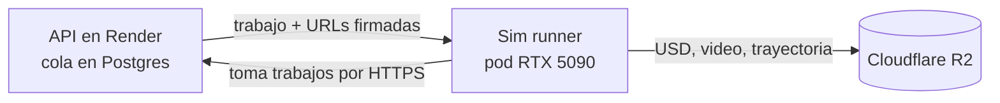

# Infraestructura de simulación

> Estado: **propuesta** (2026-11-21). Decisión del equipo: la simulación corre en una **GPU RTX 5090 en la nube**.
> Las versiones marcadas **[Verificar]** se confirman en la primera hora con la prueba de humo (§5).

## 1. Decisión

| Tema | Elección | Por qué |
|---|---|---|
| GPU | NVIDIA GeForce RTX 5090 (Blackwell, 32 GB VRAM) en la nube | Tiene RT cores (Isaac Sim no corre en A100/H100) y duplica el mínimo de 16 GB de VRAM |
| Sistema operativo | **Ubuntu 22.04 LTS** (x86_64) | Es la base más probada con Isaac Sim 5.1; en 24.04 hay reportes de caídas con Blackwell |
| Isaac Sim | **5.1.0** **[Verificar]** | Versión estable con Isaac Lab 2.3 y cuRobo; hay reportes de setups funcionando en RTX 50 |
| Isaac Lab | **2.3.x** **[Verificar en la tabla de compatibilidad]** | Par de Isaac Sim 5.1 |
| Driver NVIDIA | Rama **580** (580.65.06 o 580.95.05) | Son los drivers probados para 5.1. **Evitar la rama 595 con Isaac Sim 5.1**: hay caídas reportadas en Blackwell |
| Python / PyTorch | Python 3.11, PyTorch con CUDA 12.8 (`cu128`) | Blackwell (sm_120) necesita CUDA 12.8 o superior |
| Forma de instalar | Contenedor oficial `nvcr.io/nvidia/isaac-sim:5.1.0` **[Verificar tag]**, o pip si el proveedor no permite Docker con GPU | El contenedor fija versiones y evita pelear con dependencias |
| Modo | Headless; visualización por livestream (WebRTC) solo para depurar | El pipeline no necesita GUI (RF-GPU-02) |

**Plan B de versión:** si 5.1 falla en la 5090 del proveedor, pasar a **Isaac Sim 6.x** con el driver **595.58.03** (el probado para 6.x), Ubuntu 22.04 o 24.04, y la versión de Isaac Lab que indique la tabla de compatibilidad. Ubuntu 22.04 está en desuso desde Isaac Sim 6.

## 2. Máquina en la nube

| Recurso | Mínimo | Recomendado |
|---|---|---|
| GPU | 1× RTX 5090 | 1× RTX 5090 |
| RAM | 32 GB | 64 GB (Isaac Lab y RL piden más) |
| Disco | 100 GB SSD | 200 GB NVMe (Isaac Sim + assets + caché de shaders + videos) |
| CPU | 8 vCPU | 16 vCPU |
| Red | Salida HTTPS (assets de Omniverse, API en Render, R2) | Sin puertos de entrada; livestream solo para depurar |

- **Proveedor:** RunPod o Vast.ai **[Por definir]**. Requisitos: RTX 5090 disponible, acceso SSH, Docker con NVIDIA Container Toolkit (o imagen base con CUDA 12.8), disco persistente entre reinicios.
- **Que el proveedor controle el driver:** en muchas nubes el driver lo fija el host. Revisar con `nvidia-smi` **antes** de instalar nada; si es de la rama 595, ir directo al plan B.

## 3. Cómo se conecta con el pipeline

La conexión completa está en [`arquitectura.md`](arquitectura.md) §2. Resumen del lado GPU:



- **Pull, no push:** el runner pide trabajos a la API. El pod no expone puertos.
- **SSH solo para desarrollo:** el equipo entra al pod por SSH con llave (VS Code Remote o Cursor).
- **La clave de Claude no vive en el pod.** Los agentes corren en Render.

## 4. Variables de entorno del pod

```bash
API_URL=https://<api>.onrender.com   # API en Render
WORKER_TOKEN=...                     # mismo valor que en Render
```

El pod las lee del gestor de secretos del proveedor o de un `.env` fuera de git. Ver [`requerimientos.md`](requerimientos.md) §7.3.

## 5. Prueba de humo (primera hora)

1. `nvidia-smi` muestra la RTX 5090 y un driver de la rama 580 (o 595 → plan B).
2. Isaac Sim arranca headless y cierra sin errores.
3. Isaac Lab corre un ejemplo incluido (ej.: entorno de cartpole) en modo headless.
4. cuRobo planifica una trayectoria de ejemplo.
5. Se graba un video corto de una escena y se sube a R2 con una URL firmada.

Si los 5 pasos pasan, la versión queda fijada: se anota en la tabla de §1 y en la bitácora de [`ciclo-desarrollo.md`](ciclo-desarrollo.md).

## 6. Costo y operación

- Apagar la instancia cuando no se usa; dejar el disco persistente.
- Una persona es dueña de la máquina **[Por definir]**: la prende, la apaga y vigila el gasto.
- Estimar horas de uso: CP1 → CP2 → freeze, y fijar un tope de gasto **[Por definir]**.

## Fuentes

- Requisitos de Isaac Sim 5.1: https://docs.isaacsim.omniverse.nvidia.com/5.1.0/installation/requirements.html (consultado 2026-11-21)
- Requisitos de la versión más reciente: https://docs.isaacsim.omniverse.nvidia.com/latest/installation/requirements.html (consultado 2026-11-21)
- Compatibilidad Isaac Sim / Isaac Lab: https://docs.isaacsim.omniverse.nvidia.com/latest/installation/compatibility.html
- Caídas de 5.1 en RTX 5090 con driver 580-open: https://forums.developer.nvidia.com/t/isaac-sim-5-1-0-rc-19-crashes-on-startup-with-rtx-5090-and-nvidia-580-open-driver/374184
- Caídas de 5.1 en Ubuntu 24.04 con RTX 5080: https://forums.developer.nvidia.com/t/isaac-sim-5-1-crashes-with-segmentation-fault-on-ubuntu-24-04-rtx-5080-driver-580-open/363553
