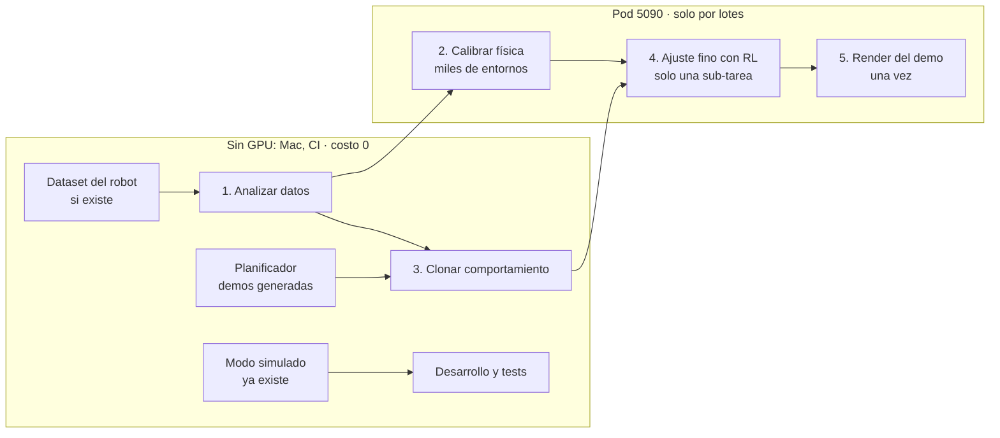

# Plan de entrenamiento rápido

> Estado: **propuesta**. Las horas de GPU son estimaciones de orden de magnitud, no mediciones.
> Objetivo: una simulación fiel en Isaac Lab con **pocas horas de RTX 5090 arrendada**.

## 1. Idea central

La velocidad no sale de entrenar mejor, sino de **entrenar menos y casi nunca renderizar**.

- **VIAZ entrega un demo en simulación,** no un robot real funcionando. "Fiel" significa que la simulación respeta las specs y los datos del robot.
- **No hace falta robustez sim-a-real:** la aleatorización masiva para pasar de la simulación al robot físico es lo que más horas de GPU consume, y VIAZ no la necesita.
- **La GPU se usa por lotes cortos** y se apaga sola. Todo lo demás corre sin GPU.

## 2. Principios

### 2.1 No entrenar lo que se puede planificar
- **Movimiento con planificador:** un planificador (cuRobo, en GPU) resuelve tomar el panel, llevarlo y dejarlo. No requiere entrenamiento.
- **RL solo para lo fino:** por ejemplo, alinear el panel sobre el tubo. Una sub-tarea corta converge mucho antes que la tarea completa.

### 2.2 Los datos dan fidelidad y ahorran horas
| Qué datos hay | Para qué sirven | Ahorro |
|---|---|---|
| **Posiciones, velocidades y torques de las articulaciones del robot** | **Calibrar la física:** reproducir en la simulación los comandos reales y ajustar masas, fricción, amortiguamiento y ganancias hasta que calce | Mucha fidelidad. Minutos con miles de entornos en paralelo |
| **Demostraciones** (estado + acción) | **Clonar comportamiento (BC):** la política parte imitando al robot. Isaac Lab trae integración con robomimic, e Isaac Lab Mimic genera más demostraciones a partir de pocas | El RL baja de horas a minutos. BC se entrena sin GPU o con poca |
| **Solo videos** (sin datos de articulaciones) | Validación visual. Con estimación de pose dan trayectorias aproximadas | Poco ahorro directo |
| **Ningún dato del robot** | Specs del fabricante + **demostraciones generadas por el planificador** en la propia simulación | El planificador hace de "experto" para BC |

- **Sin dataset público:** según [`investigacion-datasets.md`](investigacion-datasets.md), no existe un dataset público de montaje de paneles. Si el equipo no tiene datos propios de articulaciones, el camino es la última fila.
- **Argumento para el pitch:** esto refuerza la propuesta. Nadie publica estos datos, y la simulación de VIAZ puede generarlos.

### 2.3 Perillas de velocidad en Isaac Lab
- **Headless sin cámaras durante el entrenamiento:** renderizar es lo más caro. El video se graba una sola vez, al final.
- **Política basada en estado** (posiciones y fuerzas), no en imágenes.
- **Miles de entornos en paralelo** (2048 a 8192) en la misma GPU, con `replicate_physics=True`.
- **Decimación:** la física corre a 120 Hz ([`sim/fisica.py`](../sim/fisica.py)) y la política decide a 30 Hz.
- **Colisiones con cajas**, como en [`escena-isaac.md`](escena-isaac.md).
- **Poca aleatorización:** solo la necesaria para que la política no dependa de un valor exacto, como la masa del panel ±10 %.

### 2.4 La GPU se usa por lotes y se apaga sola
- **Desarrollo sin GPU:** todo se desarrolla en Mac o en CI con el modo `simulado` ([`desarrollo.md`](desarrollo.md)).
- **Un script por fase:**
  - corre sin nadie mirando;
  - guarda checkpoints en el volumen persistente (`/workspace`);
  - termina **apagando el pod**.
- **Pods interrumpibles (spot) para entrenar:** son más baratos, y si se cortan se retoma desde el último checkpoint.
- **Bitácora de costo:** cada fase anota las horas de GPU que usó, para comparar con este plan.

## 3. Fases

| Fase | Qué | Dónde | Horas GPU (estimado) | Criterio de éxito |
|---|---|---|---|---|
| 0 | Instalar Isaac y correr `sim/prueba_fisica.py` | Pod | ~0,5 | Paneles quietos sobre el tubo, masa ±1 % |
| 1 | Analizar los datos: formato, frecuencia y señales | Mac | 0 | Saber qué fila de la tabla 2.2 aplica |
| 2 | Calibrar la física: reproducir trayectorias reales en paralelo y ajustar parámetros | Pod | ~0,5–1 | Error de articulación simulado vs. real < 2–3° |
| 3 | BC con demostraciones reales o del planificador | Mac o pod chico | 0–0,5 | La política imita las demostraciones |
| 4 | RL de la sub-tarea (alinear el panel), partiendo de BC | Pod, spot | ~1–2 | Panel instalado ≥ 90 % de los intentos |
| 5 | Render del demo y métricas | Pod | ~0,5 | `video.mp4` + `resultado.json` con `"fuente": "isaac"` |
| **Total** | | | **~3–5 h** | |

- **Sin datos de articulaciones:** la fase 2 se salta y la fidelidad depende de las specs del fabricante.
- **Orden:** cada fase empieza solo si la anterior cumplió su criterio. Si la fase 0 falla, no se arrienda tiempo para las siguientes.

## 4. Riesgos

| Riesgo | Impacto | Mitigación |
|---|---|---|
| Los datos son de otro robot, no del que elige el catálogo | La calibración no aplica | Usarlos solo como referencia de movimiento |
| Solo hay videos, sin datos de articulaciones | La fase 2 pierde fuerza | Specs del fabricante + demostraciones del planificador |
| El contacto de la ventosa no se reproduce bien | Métricas poco creíbles | Mostrar en el demo las diferencias con el robot real |
| El RL no converge en el tiempo estimado | Más horas de GPU | Cortar a las 2 h y usar el planificador solo; el RL es un extra |
| El pod se interrumpe (spot) | Se pierde trabajo | Checkpoints frecuentes en `/workspace` |

## 5. Preguntas abiertas

- ¿El equipo tiene datos propios del robot? ¿En qué formato (LeRobot, rosbag, HDF5, CSV)?
- ¿Qué robot es, y está en el catálogo?
- ¿Qué señales trae: posiciones, torques, acciones o solo video?
