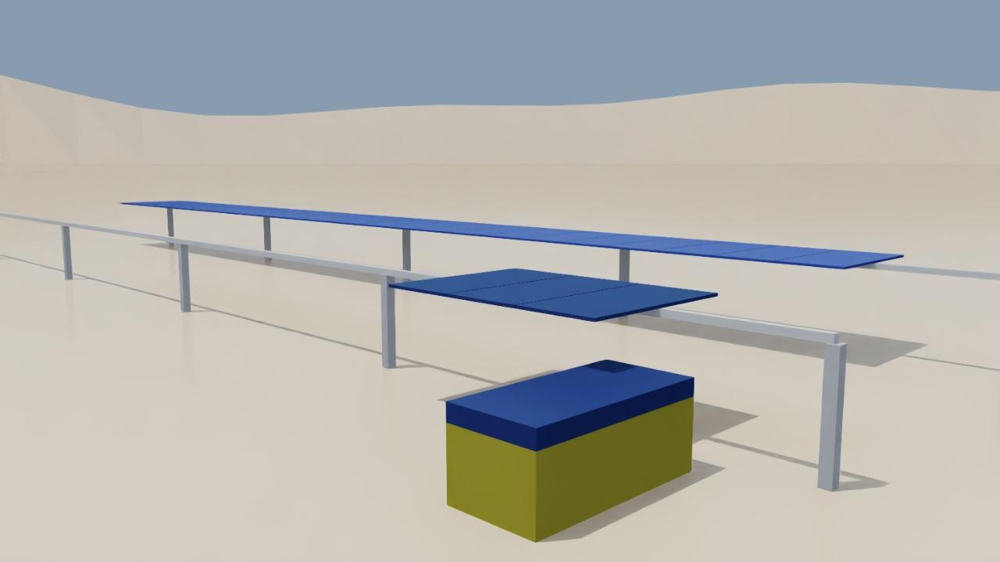
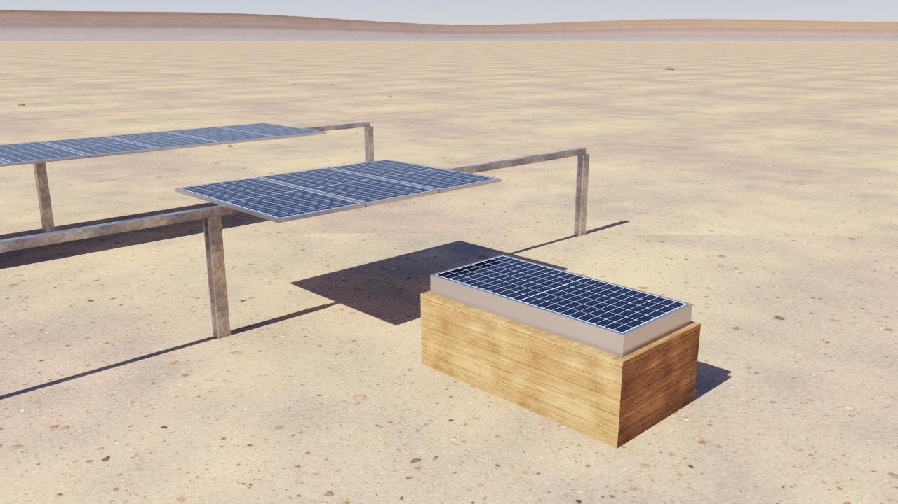

# Especificación perceptual de calidad

> Sale de comparar las 43 capturas del desarrollo de la escena del demo, de la primera versión a la aprobada.
> No dice **cómo** construir (eso es técnico y cambia con cada lugar). Dice **qué tiene que percibir quien mira**. Vale para cualquier escena de VIAZ.
> Complementa las revisiones con números de Fable (color del suelo ΔE, fracción de cielo, frecuencia de la textura, tamaño en pantalla): los números miden; esto dice a qué apuntan.

| Primera versión | Versión aprobada |
|---|---|
|  |  |

## Las 8 cualidades

### 1 · Identidad: cada objeto se reconoce solo
- **v1:** son símbolos. Un rectángulo azul "significa" panel y una caja amarilla "significa" pila, pero sin leyenda nadie lo sabría.
- **Aprobada:** alguien que nunca vio el proyecto nombra todo en 5 segundos: paneles solares, estructura de acero, pila de paneles, desierto.
- **Exigencia:** ningún objeto depende de una explicación para entenderse.

### 2 · Verdad del material: cada superficie dice de qué está hecha
- **v1:** todo tiene el mismo acabado de plástico mate. Cambia el color, no el material.
- **Aprobada:** el vidrio del panel refleja el cielo, el marco de aluminio atrapa un brillo en el canto, el acero galvanizado tiene manchas, la madera tiene veta y el suelo es granular.
- **Exigencia:** se adivina el material sin color: si la imagen fuera en blanco y negro, igual se distinguiría vidrio de metal, de madera y de tierra.

### 3 · Una sola luz, coherente
- **Errores vistos:** doble luz, cielo rosado sobre suelo de luz blanca, escena oscura.
- **Aprobada:** un sol, todas las sombras van en la misma dirección y tienen la misma dureza, y el color del cielo coincide con la luz que recibe el suelo.
- **Exigencia:** la luz responde a la pregunta "¿qué hora es y qué tiempo hace?", y todas las partes de la imagen dan la misma respuesta.

### 4 · Escala legible
- **v1:** nada indica el tamaño. La caja podría medir 20 cm o 20 m.
- **Aprobada:** detalles de tamaño conocido (las celdas del panel, las piedritas del suelo, la veta de la madera) dejan que el ojo calcule el tamaño sin ayuda.
- **Exigencia:** sin ninguna cifra, quien mira estima bien el tamaño de las cosas.

### 5 · Continuidad: nada delata que es un modelo
- **Errores vistos:** el suelo cortado en dos con una línea recta, los paneles flotando como una losa elevada, el suelo plano sin textura.
- **Exigencia:** sin costuras, sin cortes, sin cosas flotando, sin superficies que se repiten como baldosas. El suelo es una sola superficie continua hasta el horizonte.

### 6 · Sentido del lugar: se reconoce **dónde** es
- **Aprobada:** se lee como Atacama: tierra ocre pálida con gravilla, cielo despejado, bruma en el horizonte, sin vegetación.
- **Exigencia:** la escena se parece al lugar del cliente, no a "un lugar genérico". Se compara con los frames reales del cliente.

### 7 · Coherencia: toda la imagen al mismo nivel
- **Error visto:** paneles detallados encima de una caja amarilla plana.
- **Exigencia:** no mezclar en una toma objetos terminados con objetos provisorios. Si algo no está listo, la toma no está lista.

### 8 · Detalle donde mira el ojo
- **Aprobada:** de cerca, el panel sigue siendo creíble: celdas, marco y reflejo.
- **Exigencia:** la densidad de detalle es proporcional a lo cerca que llega la cámara. Lo que el robot toca y lo que sale en primer plano se ve bien a 1 m.

## Lo que todavía le falta a la versión aprobada

Para no tomarla como techo:

| Qué | Se ve en | Qué se percibe |
|---|---|---|
| La pila parece una caja con un panel de tapa | [`aprobadas/paneles_pila_detalle.jpg`](aprobadas/paneles_pila_detalle.jpg) | No se leen paneles apilados uno sobre otro |
| El suelo se repite como baldosas a lo lejos | Captura 39 del desarrollo | Patrón de cuadrícula hacia el horizonte |
| La estructura no muestra cómo se sujetan los paneles | [`aprobadas/paneles_general.jpg`](aprobadas/paneles_general.jpg) | Los paneles "apoyados" sobre el tubo, sin abrazaderas |

## Prueba rápida antes de decir "listo"

1. **5 segundos:** mostrar la vista general a alguien fuera del proyecto. ¿Nombra todos los objetos y el tipo de lugar?
2. **Blanco y negro:** ¿se distinguen los materiales sin color?
3. **Entrecerrar los ojos:** ¿hay una sola dirección de luz? ¿Algo salta como "pegado"?
4. **De cerca:** ¿lo que toca el robot aguanta la vista a 1 m?
5. **Contra la referencia:** ¿es igual o mejor que la versión aprobada en las 8 cualidades?
