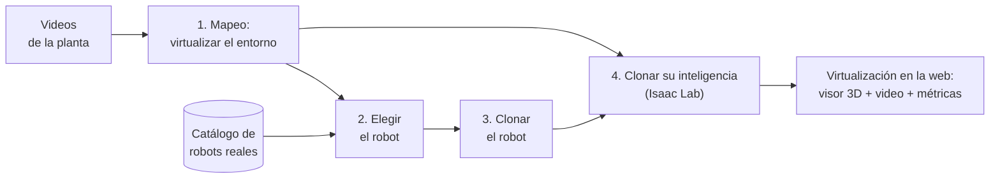
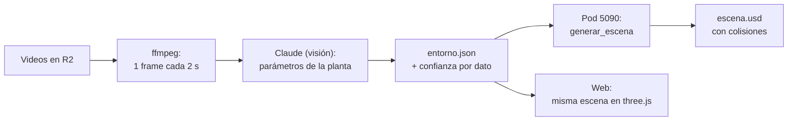
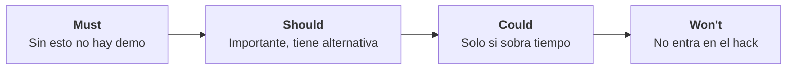
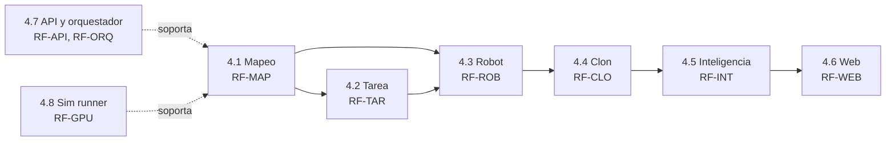
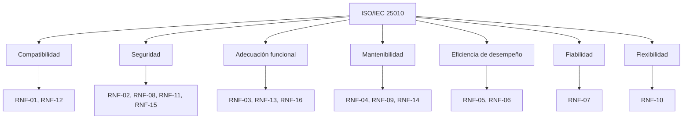
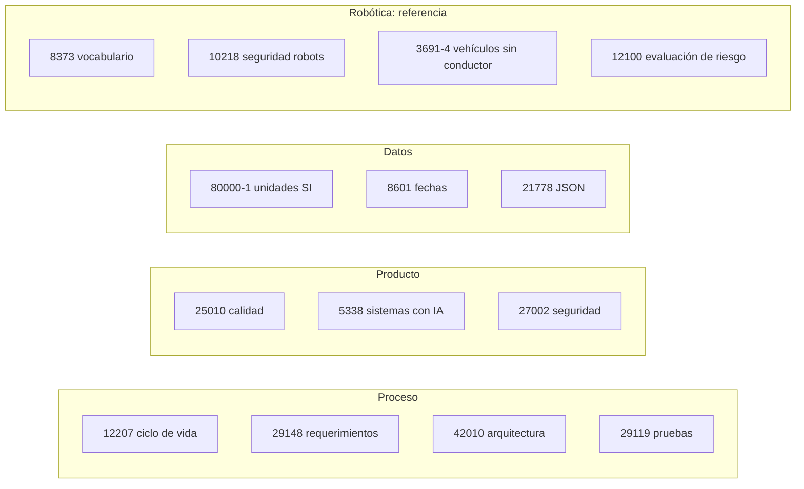
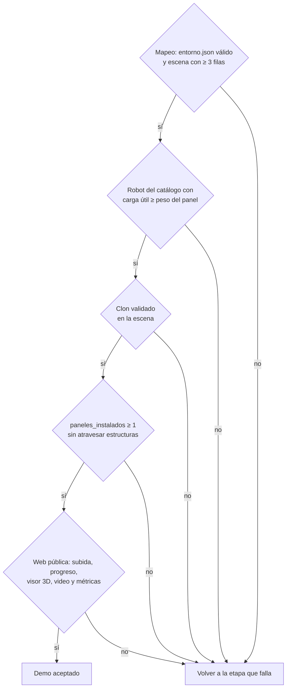

# Especificación de requerimientos de VIAZ

> Estado: **borrador v0.3** (2026-11-21). Basado en [`arquitectura.md`](arquitectura.md), [`contrato-datos.md`](contrato-datos.md) y [`../READMEVIAZ.md`](../READMEVIAZ.md).
> Estructura según ISO/IEC/IEEE 29148. Prioridades según el método **MoSCoW**. Calidad según ISO/IEC 25010.
> **Orden de trabajo:** primero el **mapeo** (videos → entorno virtual). Después el resto de las etapas.
> Lo marcado **[Por definir]** lo decide el equipo. Cada requerimiento tiene un ID: cítalo en issues, PRs y pruebas.

## Índice

1. [Propósito y alcance](#1-propósito-y-alcance)
2. [Actores e interesados](#2-actores-e-interesados)
3. [Método de priorización MoSCoW](#3-método-de-priorización-moscow)
4. [Requerimientos funcionales](#4-requerimientos-funcionales)
5. [Requerimientos no funcionales](#5-requerimientos-no-funcionales)
6. [Fuera del alcance (Won't)](#6-fuera-del-alcance-wont)
7. [Normas ISO](#7-normas-iso)
8. [Criterios de aceptación del demo](#8-criterios-de-aceptación-del-demo)
9. [Trazabilidad con los checkpoints](#9-trazabilidad-con-los-checkpoints)
10. [Supuestos y dependencias](#10-supuestos-y-dependencias)
11. [Preguntas abiertas](#11-preguntas-abiertas)

## 1. Propósito y alcance



- **Problema:** muchas industrias no usan robots. No saben qué robot sirve ni cómo trabajaría en su planta.
- **Solución:** VIAZ es una aplicación web. El cliente sube videos y recibe un robot real trabajando en su planta virtual.
- **Caso del demo:** un megaparque solar. El robot instala paneles en las estructuras.

**Dentro del alcance:**
- Un tipo de planta: `parque_solar`.
- Una tarea: `instalar_panel`.
- Un catálogo curado de 5 a 10 robots reales.
- Una web pública con subida de videos, progreso de la corrida y visor 3D.
- Una corrida de respaldo guardada en R2.

### 1.1 Qué es el mapeo

El **mapeo** es la etapa 1 (Entorno). Convierte los videos de la planta en un entorno virtual.



- **Entrada:** videos de la planta.
- **Salida:** `entorno.json`, `escena.usd` y la escena equivalente en el visor web.
- **Por qué va primero:** todas las demás etapas leen `entorno.json`. Sin mapeo no hay robot, clon ni simulación.

## 2. Actores e interesados

| Actor | Necesidad |
|---|---|
| **Cliente industrial** | Subir videos, seguir el progreso y ver un robot real trabajando en su planta |
| **Jurado / visitante** | Entender el flujo en menos de 2 min y ver el robot trabajando |
| **Equipo (operador)** | Correr el pipeline, repetir una etapa y depurar salidas |
| **Fabricantes de robots** | Ver sus specs citadas con fuente y fecha |
| **Sim runner (pod 5090)** | Tomar trabajos de la API y subir resultados a R2 (actor de sistema) |

## 3. Método de priorización MoSCoW



| Nivel | Significado | Regla en el hack |
|---|---|---|
| **Must (M)** | Sin este requerimiento, el demo falla | Si está en riesgo, se reemplaza por un stub. Nunca se elimina |
| **Should (S)** | Aporta mucho valor, pero el demo funciona sin él | Se hace después de todos los Must del checkpoint |
| **Could (C)** | Mejora el demo, el impacto es bajo | Se hace solo después del CP2 y si sobra tiempo |
| **Won't (W)** | Se excluye de forma explícita en esta versión | No se trabaja. Queda registrado para después del hack |

**Resumen actual:**

| Tipo | Must | Should | Could | Won't |
|---|---|---|---|---|
| Funcionales | 46 | 9 | 4 | — |
| No funcionales | 12 | 4 | 0 | — |
| Fuera del alcance | — | — | — | 7 |

## 4. Requerimientos funcionales

Las secciones siguen el **orden de trabajo**: el mapeo va primero.



### 4.1 Mapeo — virtualizar el entorno (`agentes/entorno/`, `sim/`) · **primera prioridad**

| ID | Requerimiento | MoSCoW |
|---|---|---|
| RF-MAP-01 | El orquestador extrae 1 frame cada 2 s de cada video con `ffmpeg` | **M** |
| RF-MAP-02 | El agente Entorno (Claude con visión) analiza una muestra de frames y llena `entorno.json`: terreno, filas, estructura y panel | **M** |
| RF-MAP-03 | El agente asigna a cada dato inferido un valor de `confianza` entre 0 y 1 | **M** |
| RF-MAP-04 | El agente clasifica la estructura como `tracker_1_eje` o `fijo` | **M** |
| RF-MAP-05 | El script `generar_escena` crea `escena.usd` desde `entorno.json`: terreno, filas, estructuras y pila de paneles, con colisiones | **M** |
| RF-MAP-06 | La escena de referencia tiene al menos 3 filas de estructuras y una pila de paneles | **M** |
| RF-MAP-07 | La web genera la misma escena en three.js desde `entorno.json`, con las mismas reglas que `generar_escena` | **M** |
| RF-MAP-08 | Si un dato tiene `confianza` menor a 0,5, el sistema usa un valor por defecto documentado y lo marca en la web | **S** |
| RF-MAP-09 | El equipo puede corregir `entorno.json` a mano y volver a generar la escena sin repetir el análisis | **S** |
| RF-MAP-10 | El sistema genera un fondo visual reconstruido (NuRec u OVER) sin física. Si no, deja `fondo_reconstruido_usd: null` | **C** |

### 4.2 Tarea (`agentes/tarea/`)

| ID | Requerimiento | MoSCoW |
|---|---|---|
| RF-TAR-01 | El agente Tarea genera `tarea.json` desde la descripción del proyecto y los frames | **M** |
| RF-TAR-02 | `tarea.json` define un objetivo medible: número de paneles y tiempo de ciclo en segundos | **M** |
| RF-TAR-03 | `tarea.json` lista restricciones operativas (ej.: no pisar estructuras, panel horizontal) | **S** |

### 4.3 Robot (`agentes/robot/`, `data/robots/`)

| ID | Requerimiento | MoSCoW |
|---|---|---|
| RF-ROB-01 | El catálogo tiene entre 5 y 10 robots reales de instalación solar, un JSON por robot | **M** |
| RF-ROB-02 | Cada robot del catálogo cita `fuente.url` y `fuente.consultado` (fecha ISO 8601) | **M** |
| RF-ROB-03 | El agente elige solo robots del catálogo. `robot.json.id` coincide con un archivo existente | **M** |
| RF-ROB-04 | `robot.json` justifica la elección con datos de `entorno.json` y `tarea.json` (ej.: peso del panel vs carga útil) | **M** |
| RF-ROB-05 | `robot.json` lista al menos 2 alternativas descartadas con su motivo | **S** |
| RF-ROB-06 | El catálogo incluye al menos un robot de origen chino comprable en Chile | **S** |
| RF-ROB-07 | Cada robot del catálogo lista en `normas` las normas de seguridad que declara su fabricante, con fuente | **C** |

### 4.4 Clon (`agentes/clon/`, `sim/`)

| ID | Requerimiento | MoSCoW |
|---|---|---|
| RF-CLO-01 | El agente Clon arma el clon con piezas de Isaac Lab (base, brazo, efector) y genera `clon.json` | **M** |
| RF-CLO-02 | El clon ajusta alcance, carga útil y velocidad a los valores de `robot.json` | **M** |
| RF-CLO-03 | El sistema genera `robot.usd` y `robot.urdf` con los mismos joints | **M** |
| RF-CLO-04 | `clon.json` lista las diferencias con el robot real | **M** |
| RF-CLO-05 | El agente encola `validar_clon`, lee el error del runner y reintenta. Máximo 3 intentos | **M** |
| RF-CLO-06 | `validar_clon` revisa que el clon no choque al inicio y que alcance la pila y la estructura | **M** |

### 4.5 Inteligencia (`sim/`)

| ID | Requerimiento | MoSCoW |
|---|---|---|
| RF-INT-01 | `ejecutar_tarea` mueve el clon con un planificador (cuRobo o RMPflow): tomar → llevar → poner | **M** |
| RF-INT-02 | `ejecutar_tarea` mide paneles instalados, intentos, tasa de éxito y ciclo promedio en `resultado.json` | **M** |
| RF-INT-03 | `ejecutar_tarea` graba `video.mp4` con una cámara de Isaac | **M** |
| RF-INT-04 | `ejecutar_tarea` guarda `trayectoria.json` con la pose por frame, a máximo 30 fps | **M** |
| RF-INT-05 | `entrenar_subtarea` entrena con PPO una sub-tarea (alinear el panel) y la integra (`metodo: planificador_rl`) | **C** |

### 4.6 Web (`web/`, Next.js en Vercel)

| ID | Requerimiento | MoSCoW |
|---|---|---|
| RF-WEB-01 | El cliente crea un proyecto con nombre y descripción | **M** |
| RF-WEB-02 | El cliente sube los videos directo a R2 con URLs firmadas | **M** |
| RF-WEB-03 | La web consulta `GET /corridas/{id}` cada 2 s y muestra el estado de cada etapa | **M** |
| RF-WEB-04 | El visor 3D (react-three-fiber) muestra la escena del mapeo y el robot desde `robot.urdf` | **M** |
| RF-WEB-05 | El visor reproduce `trayectoria.json`. El cliente pausa y mueve la cámara libremente | **M** |
| RF-WEB-06 | La web reproduce `video.mp4` como respaldo | **M** |
| RF-WEB-07 | El panel lateral muestra el robot elegido, su justificación, su fuente, las diferencias del clon y las métricas | **M** |
| RF-WEB-08 | La web muestra la corrida de respaldo (`/corridas/demo`) si el pod no responde | **M** |
| RF-WEB-09 | La web funciona en una URL pública de Vercel | **M** |
| RF-WEB-10 | La web marca los datos del mapeo con `confianza` baja | **S** |
| RF-WEB-11 | La web usa el vocabulario de ISO 8373 (manipulador, efector final, carga útil, robot móvil) | **S** |
| RF-WEB-12 | La web muestra el fondo reconstruido si existe | **C** |

### 4.7 API y orquestador (`api/`, `orquestador/`, en Render)

| ID | Requerimiento | MoSCoW |
|---|---|---|
| RF-API-01 | `POST /proyectos` crea el proyecto y devuelve las URLs firmadas de subida | **M** |
| RF-API-02 | `POST /proyectos/{id}/corridas` crea una corrida y la encola | **M** |
| RF-API-03 | `GET /corridas/{id}` devuelve el estado, las etapas, los artefactos y el error | **M** |
| RF-API-04 | `POST /worker/trabajos/tomar` entrega un trabajo con `SELECT … FOR UPDATE SKIP LOCKED`, o `204` si no hay | **M** |
| RF-API-05 | `POST /worker/trabajos/{id}/fin` registra el resultado. Un trabajo sin `fin` en 30 min vuelve a la cola | **M** |
| RF-ORQ-01 | El orquestador corre las etapas en el orden del contrato y actualiza el estado de la corrida | **M** |
| RF-ORQ-02 | El orquestador valida cada salida contra su JSON Schema de `esquemas/` | **M** |
| RF-ORQ-03 | Si una salida no valida, el orquestador reintenta la etapa 1 vez. Si falla otra vez, la corrida pasa a `error` | **M** |
| RF-ORQ-04 | El orquestador repite una sola etapa con los archivos ya guardados | **M** |
| RF-ORQ-05 | El orquestador usa salidas fijas (stubs) por etapa para correr el flujo completo antes de tener la etapa real | **M** |
| RF-ORQ-06 | El orquestador registra cada llamada a Claude y al runner: etapa, duración, tokens y resultado | **S** |

### 4.8 Sim runner (`worker-gpu/`, pod RTX 5090)

| ID | Requerimiento | MoSCoW |
|---|---|---|
| RF-GPU-01 | El runner toma trabajos de la API por HTTPS (pull). El pod no expone puertos | **M** |
| RF-GPU-02 | El runner ejecuta `generar_escena`, `validar_clon`, `ejecutar_tarea` y `entrenar_subtarea` en Isaac Sim headless | **M** |
| RF-GPU-03 | El runner ejecuta un trabajo a la vez | **M** |
| RF-GPU-04 | El runner sube los artefactos a R2 con las URLs firmadas del trabajo | **M** |
| RF-GPU-05 | Si el pod se reinicia, el runner retoma la cola sin intervención | **S** |

## 5. Requerimientos no funcionales

Cada RNF lleva su característica de calidad según ISO/IEC 25010:2023.



| ID | Característica (ISO/IEC 25010) | Requerimiento | Norma relacionada | MoSCoW |
|---|---|---|---|---|
| RNF-01 | Compatibilidad · interoperabilidad | Toda salida cumple el contrato: unidades SI, rutas relativas, `version: 1` | ISO 80000-1 | **M** |
| RNF-02 | Seguridad · responsabilidad | Todo dato externo cita URL y fecha. Todo dato inferido lleva `confianza` | ISO/IEC 5338 | **M** |
| RNF-03 | Adecuación funcional · corrección | La web no afirma fidelidad exacta. Muestra métricas y diferencias con el real | ISO 12100 | **M** |
| RNF-04 | Mantenibilidad · capacidad de prueba | Cada etapa se repite sin volver a correr las anteriores | ISO/IEC/IEEE 29119 | **M** |
| RNF-05 | Eficiencia de desempeño (web) | La página carga en menos de 3 s. El visor arranca en menos de 5 s | — | **S** |
| RNF-06 | Eficiencia de desempeño (pipeline) | Mapeo: menos de 5 min. Etapas 1 a 4: menos de 15 min. Simulación sin RL: menos de 30 min **[Por medir en el pod]** | — | **S** |
| RNF-07 | Fiabilidad · disponibilidad | La corrida de respaldo en R2 se muestra aunque fallen el pod o Claude | — | **M** |
| RNF-08 | Seguridad · confidencialidad | La clave de Claude vive solo en Render. El repo no contiene secretos | ISO/IEC 27002 | **M** |
| RNF-09 | Mantenibilidad · modularidad | Cada agente tiene su prompt en un archivo propio y lee solo archivos del contrato | ISO/IEC/IEEE 42010 | **M** |
| RNF-10 | Flexibilidad · instalabilidad | El runner corre en un pod RTX 5090 con versiones fijadas ([`infraestructura.md`](infraestructura.md)) | — | **M** |
| RNF-11 | Seguridad · autenticidad | Las rutas `/worker/*` exigen `Authorization: Bearer <WORKER_TOKEN>` | ISO/IEC 27002 | **M** |
| RNF-12 | Compatibilidad · interoperabilidad | Los archivos del contrato son JSON UTF-8. Las fechas usan ISO 8601 (`AAAA-MM-DD`) | ISO/IEC 21778, ISO 8601 | **M** |
| RNF-13 | Adecuación funcional · corrección | El orquestador trata cada salida de un agente como no confiable hasta validarla | ISO/IEC 5338 | **M** |
| RNF-14 | Mantenibilidad · analizabilidad | Cada requerimiento Must tiene al menos una prueba o un paso manual documentado | ISO/IEC/IEEE 29119 | **S** |
| RNF-15 | Seguridad · confidencialidad | Las URLs firmadas de R2 vencen en 1 h o menos. Los videos del cliente no son públicos | ISO/IEC 27002 | **S** |
| RNF-16 | Adecuación funcional · coherencia | La escena web y `escena.usd` salen del mismo `entorno.json` con las mismas reglas | — | **M** |

## 6. Fuera del alcance (Won't)

| ID | Qué no hacemos en el hack | Por qué |
|---|---|---|
| W-01 | Malla física desde la reconstrucción del video | Trae agujeros y ruido. La física usa la escena procedural |
| W-02 | Búsqueda web de robots durante la corrida | Agrega riesgo en vivo. El agente usa solo el catálogo |
| W-03 | Gemelo digital exacto del robot real | El clon es paramétrico. La web muestra las diferencias (RNF-03) |
| W-04 | Otras industrias o tareas | Un solo caso: parque solar, `instalar_panel` |
| W-05 | RL de la tarea completa | No converge en las horas del hack. Solo una sub-tarea (RF-INT-05) |
| W-06 | Cuentas de usuario e inicio de sesión | El demo no las necesita |
| W-07 | Certificación ISO | Usamos las normas como referencia, no como certificación |

## 7. Normas ISO

No buscamos certificación. Usamos las normas como referencia para ordenar el trabajo y dar credibilidad al pitch.



### 7.1 Normas que aplicamos

| Norma | Tema | Cómo la aplicamos | Requerimientos |
|---|---|---|---|
| ISO/IEC/IEEE 12207:2017 | Ciclo de vida del software | Ciclo incremental por checkpoint ([`ciclo-desarrollo.md`](ciclo-desarrollo.md)) | — |
| ISO/IEC/IEEE 29148:2018 | Ingeniería de requerimientos | Estructura de este documento. ID único, prioridad y verificación por requerimiento | Todos |
| ISO/IEC/IEEE 42010:2022 | Descripción de arquitectura | Vistas y decisiones con su porqué en [`arquitectura.md`](arquitectura.md). Interesados en §2 | RNF-09 |
| ISO/IEC 25010:2023 | Calidad del producto | Clasificación de los RNF (§5) | RNF-01..16 |
| ISO/IEC/IEEE 29119 | Pruebas de software | Niveles de prueba: esquema, etapa, sistema y aceptación | RNF-04, RNF-14 |
| ISO/IEC 5338:2023 | Ciclo de vida de sistemas con IA | Salidas de agentes validadas y registradas. El agente no inventa robots | RNF-02, RNF-13, RF-ORQ-06, RF-ROB-03 |
| ISO/IEC 27002:2022 | Controles de seguridad | Secretos solo en Render, token del worker, URLs firmadas con vencimiento | RNF-08, RNF-11, RNF-15 |
| ISO 80000-1 | Magnitudes y unidades | Unidades SI con la unidad en el nombre del campo (`peso_kg`) | RNF-01 |
| ISO 8601 | Fechas y horas | Fechas `AAAA-MM-DD` en fuentes y registros | RNF-12, RF-ROB-02 |
| ISO/IEC 21778:2017 | Sintaxis JSON | Archivos del contrato en JSON UTF-8 validados con JSON Schema | RNF-12 |

### 7.2 Normas que referenciamos (robótica)

Estas normas aplican a los **robots reales**, no a nuestro software.

| Norma | Tema | Uso en el proyecto | Requerimientos |
|---|---|---|---|
| ISO 8373:2021 | Vocabulario de robótica | Términos de la web y del catálogo | RF-WEB-11 |
| ISO 10218-1/-2:2025 | Seguridad de robots industriales | Campo `normas` del catálogo y pitch | RF-ROB-07 |
| ISO 3691-4:2023 | Vehículos industriales sin conductor | Robots con base móvil del catálogo | RF-ROB-07 |
| ISO 12100:2010 | Evaluación de riesgo de máquinas | Pitch: la simulación revisa alcance y carga antes de comprar. No certifica nada | RNF-03 |

### 7.3 Controles de seguridad (ISO/IEC 27002, mínimo)

- **Secretos:** la clave de Claude y las credenciales de R2 viven en variables de entorno de Render. Nunca en git.
- **Worker:** el pod se autentica con `WORKER_TOKEN` y no expone puertos.
- **Videos del cliente:** viven en R2, sin acceso público. Se accede solo con URLs firmadas.
- **Costo y exposición:** el equipo apaga el pod cuando no lo usa.

## 8. Criterios de aceptación del demo



1. El mapeo de un video real produce un `entorno.json` válido y una escena con al menos 3 filas.
2. El robot elegido existe en `data/robots/` y su carga útil es mayor o igual al peso del panel.
3. `clon.json.validado_en_escena` es `true`.
4. `resultado.json.metricas.paneles_instalados >= 1`, y el video muestra al clon sin atravesar estructuras.
5. La web pública permite subir videos, muestra el progreso, el visor 3D, el video y las métricas.
6. La corrida de respaldo funciona con el pod apagado.

## 9. Trazabilidad con los checkpoints

```mermaid
timeline
  title Requerimientos Must por checkpoint
  CP1 (sáb 11:00) : Mapeo con stubs (RF-MAP-05..07) : API, cola y worker (RF-API, RF-GPU-01..04) : Flujo completo con stubs (RF-ORQ-05)
  CP2 (sáb 23:00) : Mapeo desde video real (RF-MAP-01..04) : Robot y clon (RF-ROB-01..04, RF-CLO) : Visor reproduce trayectoria (RF-WEB-04..05)
  Freeze (dom 05:00) : Inteligencia (RF-INT-01..04) : Web completa (RF-WEB) : Corrida de respaldo (RNF-07)
```

| Checkpoint | Must | Should / Could (si hay tiempo) |
|---|---|---|
| **CP1** (sáb 11:00) | RF-MAP-05..07, RF-API-01..05, RF-ORQ-01..05, RF-GPU-01..04, RF-WEB-01..03, RF-WEB-09, RNF-01, RNF-12 | RF-ORQ-06, RF-MAP-09 |
| **CP2** (sáb 23:00) | RF-MAP-01..04, RF-TAR-01..02, RF-ROB-01..04, RF-CLO-01..06, RF-WEB-04..05 | RF-MAP-08, RF-TAR-03, RF-ROB-05..06, RF-GPU-05 |
| **Freeze** (dom 05:00) | RF-INT-01..04, RF-WEB-06..08, RNF-07, criterios de §8 | RF-WEB-10..12, RF-ROB-07, RF-INT-05, RF-MAP-10 |

## 10. Supuestos y dependencias

- Hay un pod RTX 5090 (RunPod o Vast.ai) que aprobó la prueba de humo de [`infraestructura.md`](infraestructura.md) §5.
- Hay crédito en Render (US$50) y una cuenta de Cloudflare R2.
- Hay acceso a la API de Claude con visión y tool use **[Origen de los créditos por definir]**.
- Hay al menos un video de parque solar utilizable (propio, o público con licencia que permita usarlo).
- El equipo reverifica las specs de robots antes del freeze (datos base del 2026-09-28).

## 11. Preguntas abiertas

- ¿RunPod o Vast.ai? ¿Quién crea la cuenta y carga el saldo?
- ¿De dónde salen los créditos de la Claude API?
- ¿Videos reales o públicos? (bloquea RF-MAP-01..04)
- ¿Qué robot es la referencia del demo?
- ¿Quién es responsable de cada área?
- ¿Los tiempos de RNF-06 son realistas en la 5090? Se mide en la prueba de humo.
- ¿Qué valores por defecto usa el mapeo cuando la `confianza` es baja? (RF-MAP-08)
