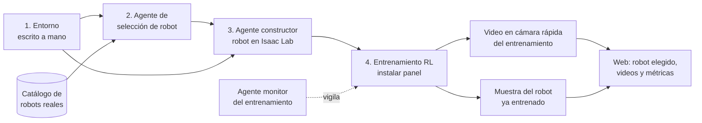
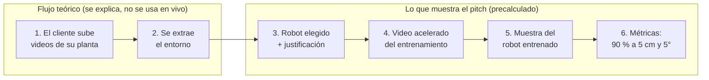
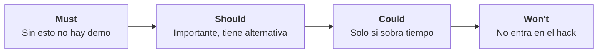
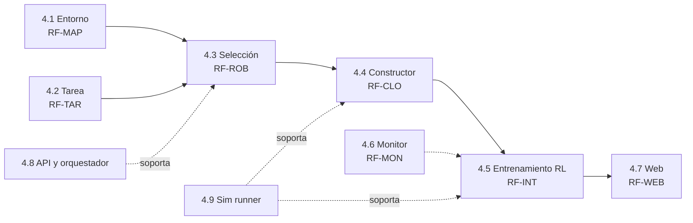
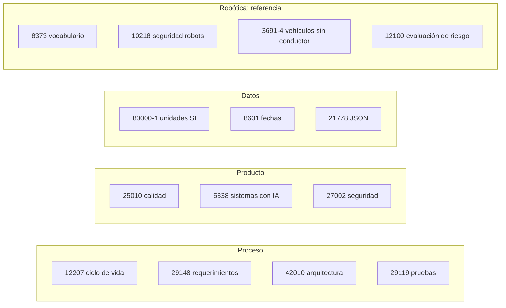
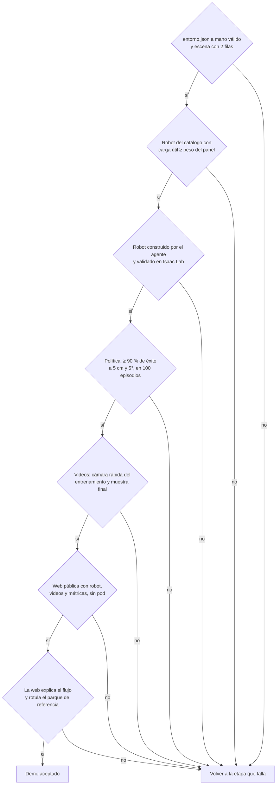

# Especificación de requerimientos de VIAZ

> Estado: **borrador v0.9** (2026-11-21). Basado en [`arquitectura.md`](arquitectura.md), [`contrato-datos.md`](contrato-datos.md), [`agentes/`](agentes/README.md) y el [README](../README.md).
> Estructura según ISO/IEC/IEEE 29148. Prioridades según el método **MoSCoW**. Calidad según ISO/IEC 25010.
> **Cambio de v0.4:** el demo usa un entorno escrito a mano y una política entrenada con RL. El mapeo desde video pasa a Could.
> **Cambio de v0.5:** base móvil con navegación programada y RL en el brazo; meta de 90 % a 5 cm y 5° en 100 episodios; tiempo fijo; avisos por Discord.
> **Cambio de v0.6:** la web explica el flujo teórico (subir videos → extraer entorno → robot → entrenamiento) sin usarlo en vivo. El pitch muestra los resultados precalculados del parque de referencia.
> **Cambio de v0.7:** los clips del video acelerado se graban desde checkpoints, no durante el entrenamiento (RF-INT-13, RF-MON-06). La GPU es una RTX en un host con driver 580, no solo una 5090 ([`investigacion-isaac-gpu.md`](investigacion-isaac-gpu.md)).
> **Cambio de v0.8:** el parque del demo tiene 2 filas en el desierto de Atacama. El entrenamiento usa una escena chica con un tramo de tubo, y el demo usa el parque completo (RF-MAP-06, RF-MAP-12..15). La física del RL agarra con unión fija, usa los límites del robot real y varía masa y fricción (RF-INT-22..25).
> **Cambio de v0.9:** contrato v3 de selección: requisitos por perfil de dominio, búsqueda web de robots, hasta 3 finalistas comparados en corridas hijas, `fidelidad` del clon y reuso de modelos comprobados (RF-ROB-08..12, RF-CLO-10..11, RF-ORQ-07..08). Prioridad **S** hasta que el equipo decida.
> Lo marcado **[Por definir]** lo decide el equipo. Cada requerimiento tiene un ID: cítalo en issues, PRs y pruebas.

## Índice

1. [Propósito y alcance](#1-propósito-y-alcance)
2. [Actores e interesados](#2-actores-e-interesados)
3. [Método de priorización MoSCoW](#3-método-de-priorización-moscow)
4. [Requerimientos funcionales](#4-requerimientos-funcionales)
5. [Requerimientos no funcionales](#5-requerimientos-no-funcionales)
6. [Fuera del alcance (Won't)](#6-fuera-del-alcance-wont)
7. [Normas ISO](#7-normas-iso)
8. [Criterios de aceptación del demo](#8-criterios-de-aceptación-del-demo)
9. [Trazabilidad con los checkpoints](#9-trazabilidad-con-los-checkpoints)
10. [Supuestos y dependencias](#10-supuestos-y-dependencias)
11. [Preguntas abiertas](#11-preguntas-abiertas)

## 1. Propósito y alcance

- **Problema:** muchas industrias no usan robots. No saben qué robot sirve ni cómo trabajaría en su planta.
- **Solución:** VIAZ elige un robot real, lo construye en simulación y le enseña la tarea con aprendizaje por refuerzo (RL).
- **Caso del demo:** un megaparque solar. El robot toma un panel y lo deja apoyado sobre la estructura.

### 1.1 Plan del demo



| Paso | Qué hace | Quién |
|---|---|---|
| 1 | Escribe `entorno.json` y `tarea.json` del parque del demo | El equipo, a mano |
| 2 | Elige el robot real del catálogo y justifica | Agente de selección de robot |
| 3 | Construye el robot en Isaac Lab con las specs del real y lo valida | Agente constructor |
| 4 | Entrena con RL el brazo para instalar el panel y graba el entrenamiento. La base móvil navega con un controlador programado | Script de Isaac Lab en el pod |
| 5 | Vigila el entrenamiento, avisa por Discord y recomienda seguir, parar o ajustar | Agente monitor |
| 6 | Muestra los videos, el robot elegido y las métricas | Web (Vercel) |

**Dentro del alcance:**
- Un tipo de planta: `parque_solar`, con su entorno escrito a mano.
- Una tarea: `instalar_panel`. El robot **solo pone el panel** sobre la estructura: sin cables, pernos ni conexión eléctrica.
- Un catálogo curado de 5 a 10 robots reales.
- Una web pública que explica el flujo completo, incluida la subida de videos, sin usarla en vivo.
- Resultados precalculados del parque de referencia: robot elegido, video en cámara rápida del entrenamiento y muestra del robot entrenado.

### 1.2 Flujo teórico y lo que muestra el pitch



| Parte | En la web | En el pitch |
|---|---|---|
| Subir videos y extraer el entorno | Una sección explica el flujo completo con sus pasos (RF-WEB-19). El formulario de subida del esqueleto puede quedar, pero no se usa (Could) | Se explica: "en producción, el cliente sube sus videos y VIAZ extrae el entorno" |
| Entorno del demo | Se muestra el parque de referencia y se dice que su entorno se escribió a mano (RNF-20) | Se dice con claridad |
| Robot, videos y métricas | Precalculados (RF-WEB-06..08, RF-WEB-13, RF-WEB-15..16) | Es el centro del pitch |

## 2. Actores e interesados

| Actor | Necesidad |
|---|---|
| **Cliente industrial** | Entender cómo VIAZ pasa de sus videos a un robot real trabajando en su planta |
| **Jurado / visitante** | Entender el flujo en menos de 2 min y ver al robot aprender y trabajar |
| **Equipo (operador)** | Escribir el entorno, lanzar el entrenamiento y decidir con la ayuda del monitor |
| **Fabricantes de robots** | Ver sus specs citadas con fuente y fecha |
| **Pod GPU RTX** | Ejecutar validación, entrenamiento y grabación (actor de sistema) |

## 3. Método de priorización MoSCoW



| Nivel | Significado | Regla en el hack |
|---|---|---|
| **Must (M)** | Sin este requerimiento, el demo falla | Si está en riesgo, se reemplaza por un stub. Nunca se elimina |
| **Should (S)** | Aporta mucho valor, pero el demo funciona sin él | Se hace después de todos los Must del checkpoint |
| **Could (C)** | Mejora el demo, el impacto es bajo | Se hace solo después del CP2 y si sobra tiempo |
| **Won't (W)** | Se excluye de forma explícita en esta versión | No se trabaja. Queda registrado para después del hack |

**Resumen actual:**

| Tipo | Must | Should | Could | Won't |
|---|---|---|---|---|
| Funcionales | 56 | 33 | 18 | — |
| No funcionales | 14 | 6 | 0 | — |
| Fuera del alcance | — | — | — | 11 |

## 4. Requerimientos funcionales



### 4.1 Entorno (`entorno.json`, `sim/`)

| ID | Requerimiento | MoSCoW |
|---|---|---|
| RF-MAP-11 | El equipo escribe a mano el `entorno.json` del parque del demo, con `confianza` 1 en cada dato y la fuente de cada medida | **M** |
| RF-MAP-05 | El script `generar_escena` crea `escena.usd` desde `entorno.json`: terreno, filas, estructuras y paneles, con colisiones | **M** |
| RF-MAP-06 | La escena del demo tiene 2 filas de tracker de 1 eje, de 30 m cada una y 6 m entre filas, con el tubo horizontal | **M** |
| RF-MAP-12 | La escena de entrenamiento tiene un tramo de tubo de la fila 0, el robot detenido frente al punto de montaje y su pila de paneles. Isaac Lab la copia en N entornos en paralelo. Sale del mismo `entorno.json` que la escena del demo | **M** |
| RF-MAP-13 | En la escena del demo, la fila 1 ya tiene sus paneles instalados, solo visuales y sin física. El robot instala en la fila 0 | **M** |
| RF-MAP-14 | El suelo es plano (`pendiente_grados: 0`), con la fricción de tierra seca de `sim/fisica.py` | **M** |
| RF-MAP-15 | La escena del demo se ve como el desierto de Atacama: tierra ocre con gravilla, cielo despejado, sol de mediodía y cerros lejanos. Los cerros son solo visuales, sin física | **S** |
| RF-MAP-07 | La web genera la misma escena en three.js desde `entorno.json`, con las mismas reglas que `generar_escena` | **S** |
| RF-MAP-09 | El equipo corrige `entorno.json` y vuelve a generar la escena sin repetir otras etapas | **S** |
| RF-MAP-01 | El orquestador extrae frames de cada video con `ffmpeg` | **C** |
| RF-MAP-02 | El agente Entorno (Claude con visión) analiza los frames y llena `entorno.json` | **C** |
| RF-MAP-03 | El agente asigna a cada dato inferido un valor de `confianza` entre 0 y 1 | **C** |
| RF-MAP-04 | El agente clasifica la estructura como `tracker_1_eje` o `fijo` | **C** |
| RF-MAP-08 | Si un dato tiene `confianza` menor a 0,5, el sistema usa un valor por defecto documentado | **C** |
| RF-MAP-10 | El sistema genera un fondo visual reconstruido (NuRec u OVER) sin física | **C** |

### 4.2 Tarea (`tarea.json`)

| ID | Requerimiento | MoSCoW |
|---|---|---|
| RF-TAR-04 | El equipo escribe a mano el `tarea.json` del demo: `instalar_panel`, sin cables ni pernos | **M** |
| RF-TAR-02 | `tarea.json` define un objetivo medible: paneles y tiempo de ciclo en segundos | **M** |
| RF-TAR-03 | `tarea.json` lista restricciones operativas (ej.: no chocar con estructuras, panel horizontal) | **S** |
| RF-TAR-01 | El agente Tarea genera `tarea.json` desde la descripción del cliente y los frames | **C** |

### 4.3 Selección de robot (`agentes/`, `catalogo/robots/`)

| ID | Requerimiento | MoSCoW |
|---|---|---|
| RF-ROB-01 | El catálogo tiene entre 5 y 10 robots reales que hacen la tarea del cliente (en el demo, instalación solar), un JSON por robot. Crece con los robots que encuentra la búsqueda, por PR | **M** |
| RF-ROB-02 | Cada robot del catálogo cita `fuente.url` y `fuente.consultado` (fecha ISO 8601) | **M** |
| RF-ROB-03 | El agente elige solo entre fichas que pasan la validación de `robot.schema.json`: del catálogo, o encontradas por la búsqueda con `fuente.url` y `fuente.consultado`. `robot.json.id` coincide con una de esas fichas | **M** |
| RF-ROB-04 | `robot.json` justifica la elección con datos de `entorno.json` y `tarea.json` (ej.: peso del panel vs carga útil) | **M** |
| RF-ROB-05 | `robot.json` lista al menos 2 alternativas descartadas con su motivo | **S** |
| RF-ROB-06 | El catálogo incluye al menos un robot de origen chino comprable en Chile | **S** |
| RF-ROB-07 | Cada robot del catálogo lista en `normas` las normas de seguridad que declara su fabricante | **C** |
| RF-ROB-08 | Un perfil de dominio (código, sin LLM) escribe `requisitos.json` desde `entorno.json` y `tarea.json`. La selección lee solo `requisitos.json`. Las reglas solares de hoy forman el perfil `solar` | **S** |
| RF-ROB-09 | Un paso de búsqueda web, encendido por defecto y acotado en robots, consultas y tiempo, trae fichas de robots reales que no están entre las fichas conocidas, con `origen: "busqueda"`. Cada spec de selección tiene una fuente con URL y cita (`evidencia`) o un motivo en `estimados`. El código rechaza y registra las fichas inválidas y los duplicados. Las fichas válidas quedan en un catálogo compartido del almacén para las corridas siguientes. Si la búsqueda falla, la selección sigue con las fichas conocidas | **S** |
| RF-ROB-10 | El código descarta cada candidato que no cumple un requisito obligatorio y lista sus fallas en `seleccion.json → descartados` | **S** |
| RF-ROB-11 | El agente devuelve de 1 a 3 finalistas (`VIAZ_MAX_FINALISTAS`, por defecto 3) y las demás fichas válidas como alternativas con `por_que_no`. Si ninguna pasa las reglas, devuelve un solo finalista y lo dice en la primera oración | **S** |
| RF-ROB-12 | Para ser finalista, la ficha tiene el núcleo de `fisica`: `largo_m`, `ancho_m`, `masa_kg`, `altura_cubierta_m` y `traccion`. Sin él, el robot queda como alternativa y la web muestra el motivo. Si ningún candidato que cumple tiene el núcleo, hay un solo finalista, el primero por las preferencias: su clon usa la base genérica y la justificación lo dice en la primera oración | **S** |

### 4.4 Agente constructor del robot en Isaac Lab (`agentes/`, `sim/`)

| ID | Requerimiento | MoSCoW |
|---|---|---|
| RF-CLO-01 | El agente constructor arma el robot en Isaac Lab desde `robot.json`, con assets existentes de Isaac Lab (base, brazo, efector) | **M** |
| RF-CLO-02 | El robot construido respeta el alcance, la carga útil y la velocidad de `robot.json` | **M** |
| RF-CLO-03 | El agente entrega `robot_cfg.py` (configuración de Isaac Lab), `robot.usd` y `clon.json` | **M** |
| RF-CLO-04 | `clon.json` lista las diferencias con el robot real | **M** |
| RF-CLO-05 | El agente encola `validar_clon`, lee el error del pod y corrige. Máximo 3 intentos | **M** |
| RF-CLO-06 | `validar_clon` revisa que el robot cargue, no choque al inicio y alcance el panel y la estructura | **M** |
| RF-CLO-07 | Si el agente no logra un robot válido en 3 intentos, el sistema usa el clon determinista de `urdf.py` | **S** |
| RF-CLO-08 | El agente entrega `robot.urdf` con los mismos joints, para el visor web | **C** |
| RF-CLO-09 | `validar_robot` graba la construcción de cada intento: la escena vacía, las piezas que aparecen (base, brazo, ventosa) y una prueba de alcance. El runner rotula cada intento, agrega una tarjeta por cada intento rechazado por reglas y los une en `construccion.mp4` | **M** |
| RF-CLO-10 | `clon.json` declara `fidelidad`: `generico`, `medido` o `verificado`. El código escribe `generico` o `medido`; `verificado` necesita la rúbrica humana | **S** |
| RF-CLO-11 | Si el robot tiene un modelo comprobado (su ensamblaje pasó `validar_robot`) con la misma ficha y el mismo catálogo de assets, el sistema lo reutiliza sin el agente constructor. Siempre corre `validar_robot` en la escena de la corrida. La política entrenada no se reutiliza. Un modelo aprobado, además, pasó la rúbrica de calidad con una persona | **S** |

### 4.5 Entrenamiento RL de instalar el panel (`sim/`, pod GPU RTX)

| ID | Requerimiento | MoSCoW |
|---|---|---|
| RF-INT-10 | Existe un entorno de Isaac Lab `instalar_panel`: con la base detenida, el brazo toma un panel y lo deja apoyado sobre el tubo de la estructura | **M** |
| RF-INT-18 | La base móvil avanza entre puntos de montaje con un controlador programado, sin RL | **M** |
| RF-INT-19 | En cada episodio, la base se detiene con ruido de ±15 cm y ±5° respecto del punto de montaje | **M** |
| RF-INT-22 | En el entorno `instalar_panel`, la ventosa agarra el panel con una unión física fija. El brazo carga la masa real del panel | **M** |
| RF-INT-23 | Las articulaciones del brazo usan los límites de torque y velocidad de `robot.urdf`. Hoy son supuestos de `backend/viaz/urdf.py` (`ESFUERZO_NM`, `VELOCIDAD_RAD_S`). Se reemplazan por los de la ficha del robot elegido cuando exista | **M** |
| RF-INT-24 | En cada episodio, un evento de Isaac Lab varía la masa del panel ±10 % y la fricción de panel, tubo y ventosa ±20 % | **M** |
| RF-INT-25 | Un evento de Isaac Lab aplica viento lateral sobre el panel agarrado | **C** |
| RF-INT-11 | El episodio termina con éxito si el panel queda apoyado, sin chocar con la estructura, a 5 cm o menos y 5° o menos de la pose ideal | **M** |
| RF-INT-12 | El script entrena la política con PPO en Isaac Lab, con entornos en paralelo en la GPU del pod, sin cámaras, y guarda un checkpoint cada 50 iteraciones sin borrar los anteriores | **M** |
| RF-INT-13 | Al terminar el entrenamiento, el script carga 4 checkpoints (inicio, `primer_exito`, `exito_50` y `umbral_alcanzado`, o `mejor_recompensa` si no llega al 90 %), graba un clip de ~7 s de cada uno con la cámara lateral 3/4 fija y arma `entrenamiento_rapido.mp4` de ~30 s. Cada clip muestra el tiempo de entrenamiento y una mini curva de éxito. El primer clip abre con 1–2 s de la grilla de entornos. Si no hay `primer_exito`, usa el checkpoint del 25 % | **M** |
| RF-INT-14 | El script evalúa la política final en 100 episodios y escribe `resultado.json` (`metodo: "rl"`, `politica`) | **M** |
| RF-INT-20 | La evaluación también informa la tasa de éxito a 2 cm y 2° | **S** |
| RF-INT-21 | Si sobra tiempo, el entrenamiento se afina con tolerancia de 2 cm y 2° desde el mejor checkpoint | **C** |
| RF-INT-15 | El script graba `video.mp4`: la muestra del robot ya entrenado avanzando e instalando paneles | **M** |
| RF-INT-16 | El script guarda la curva de entrenamiento (recompensa y tasa de éxito por iteración) en `curva.json` | **S** |
| RF-INT-17 | El script guarda `trayectoria.json` de un episodio de la política, para el visor web | **S** |
| RF-INT-01 | Si el RL no converge, un planificador (cuRobo o RMPflow) hace la tarea y graba la muestra (`metodo: "planificador"`) | **S** |

### 4.6 Agente monitor del entrenamiento (`agentes/`, pod)

| ID | Requerimiento | MoSCoW |
|---|---|---|
| RF-MON-01 | El agente corre en Render y lee las métricas que llegan con cada latido, cada 10 min **[Por definir]**: recompensa media, tasa de éxito, largo de episodio y pérdidas | **M** |
| RF-MON-02 | En cada chequeo, el agente clasifica el estado: `mejorando`, `estancado`, `divergiendo` o `terminado` | **M** |
| RF-MON-03 | El agente escribe cada chequeo en `monitoreo.jsonl`, con evidencia numérica y una recomendación | **M** |
| RF-MON-04 | El agente avisa por Discord (webhook a un canal del equipo) si detecta NaN, divergencia o estancamiento por 3 chequeos seguidos | **M** |
| RF-MON-09 | El agente avisa por Discord los hitos: primer éxito, 50 %, 90 % y fin del entrenamiento | **S** |
| RF-MON-10 | El agente manda como máximo 1 aviso por tipo cada 30 min, salvo NaN | **S** |
| RF-MON-05 | El agente recomienda el mejor checkpoint para la muestra final | **S** |
| RF-MON-06 | El agente marca hitos (`primer_exito`, `exito_50`, `umbral_alcanzado`, `mejor_recompensa`) con su iteración, para elegir los checkpoints de los clips (RF-INT-13) | **S** |
| RF-MON-07 | El agente escribe un resumen final del entrenamiento para la web y el pitch | **S** |
| RF-MON-08 | El agente detiene el entrenamiento solo con NaN. Otras acciones las aprueba un humano | **M** |

### 4.7 Web (`web/`, Next.js en Vercel)

| ID | Requerimiento | MoSCoW |
|---|---|---|
| RF-WEB-20 | La web reproduce `construccion.mp4`: el agente construyendo el robot, intento por intento | **M** |
| RF-WEB-13 | La web reproduce `entrenamiento_rapido.mp4`: el video en cámara rápida del entrenamiento | **M** |
| RF-WEB-06 | La web reproduce `video.mp4`: la muestra del robot ya entrenado | **M** |
| RF-WEB-07 | El panel lateral muestra el robot elegido, su justificación, su fuente, las diferencias del clon y las métricas | **M** |
| RF-WEB-08 | La web muestra la corrida del demo precalculada (`/corridas/demo`) sin depender del pod | **M** |
| RF-WEB-19 | La web explica el flujo completo en pasos: subir videos, extraer el entorno, elegir el robot, construirlo, entrenarlo y mostrar el resultado | **M** |
| RF-WEB-09 | La web funciona en una URL pública de Vercel | **M** |
| RF-WEB-15 | La web indica cuánto tiempo real y cuántos pasos de simulación representa el video acelerado | **M** |
| RF-WEB-16 | La web muestra la tasa de éxito con la tolerancia y la cantidad de episodios (ej.: "92 % a 5 cm y 5°, 100 episodios") | **M** |
| RF-WEB-14 | La web muestra la curva de entrenamiento y los hitos del monitor | **S** |
| RF-WEB-04 | El visor 3D muestra la escena y el robot desde `robot.urdf` | **S** |
| RF-WEB-05 | El visor reproduce `trayectoria.json` de la política entrenada | **S** |
| RF-WEB-11 | La web usa el vocabulario de ISO 8373 (manipulador, efector final, carga útil, robot móvil) | **S** |
| RF-WEB-01 | El cliente crea un proyecto con nombre y descripción | **C** |
| RF-WEB-02 | El cliente sube los videos directo a R2 con URLs firmadas | **C** |
| RF-WEB-03 | La web consulta `GET /corridas/{id}` cada 2 s y muestra el estado de cada etapa | **C** |
| RF-WEB-10 | La web marca los datos del entorno con `confianza` baja | **C** |
| RF-WEB-12 | La web muestra el fondo reconstruido si existe | **C** |

### 4.8 API y orquestador (`backend/`, en Render)

| ID | Requerimiento | MoSCoW |
|---|---|---|
| RF-API-03 | `GET /corridas/{id}` y `GET /corridas/demo` devuelven el estado, las etapas y los artefactos | **M** |
| RF-API-04 | `POST /worker/trabajos/tomar` entrega un trabajo con `SELECT … FOR UPDATE SKIP LOCKED`, o `204` si no hay | **M** |
| RF-API-05 | `POST /worker/trabajos/{id}/fin` registra el resultado. Un trabajo sin latido en 30 min vuelve a la cola | **M** |
| RF-API-06 | `POST /worker/trabajos/{id}/latido` mantiene vivo un trabajo largo y recibe las métricas nuevas del entrenamiento | **M** |
| RF-ORQ-01 | El orquestador corre las etapas en orden y actualiza el estado de la corrida | **M** |
| RF-ORQ-02 | El orquestador valida cada salida contra su JSON Schema de `esquemas/` | **M** |
| RF-ORQ-05 | El orquestador acepta salidas escritas a mano por etapa (`entorno.json`, `tarea.json`) | **M** |
| RF-ORQ-03 | Si una salida no valida, el orquestador reintenta la etapa 1 vez. Si falla otra vez, la corrida pasa a `error` | **S** |
| RF-ORQ-04 | El orquestador repite una sola etapa con los archivos ya guardados | **S** |
| RF-ORQ-06 | El orquestador registra cada llamada a Claude y al runner: etapa, duración, tokens y resultado | **S** |
| RF-ORQ-07 | El orquestador corre una corrida hija por finalista con `procesar_rl` y el robot fijo. Todas usan la misma escena, las mismas horas de entrenamiento y las mismas semillas | **S** |
| RF-ORQ-08 | El código elige el ganador con una regla sobre `evaluacion.json` (primero tasa de éxito, luego tiempo de ciclo) y escribe `comparacion.json`. El LLM solo explica. El resultado muestra la fidelidad de cada clon, avisa si difiere y dice qué no compara la simulación | **S** |
| RF-API-01 | `POST /proyectos` crea el proyecto y devuelve las URLs firmadas de subida | **C** |
| RF-API-02 | `POST /proyectos/{id}/corridas` crea una corrida y la encola | **C** |

### 4.9 Sim runner (`worker-gpu/`, pod GPU RTX)

| ID | Requerimiento | MoSCoW |
|---|---|---|
| RF-GPU-01 | El runner toma trabajos de la API por HTTPS (pull). El pod no expone puertos | **M** |
| RF-GPU-02 | El runner ejecuta `generar_escena`, `validar_clon`, `entrenar` y `evaluar` en Isaac Lab headless | **M** |
| RF-GPU-03 | El runner ejecuta un trabajo a la vez | **M** |
| RF-GPU-04 | El runner sube los artefactos a R2 con las URLs firmadas del trabajo | **M** |
| RF-GPU-06 | Durante `entrenar`, el runner envía un latido cada 5 min con las métricas nuevas. Si la respuesta pide `detener`, guarda un checkpoint y termina | **M** |
| RF-GPU-05 | Si el pod se reinicia, el runner retoma el entrenamiento desde el último checkpoint | **S** |

## 5. Requerimientos no funcionales

Cada RNF lleva su característica de calidad según ISO/IEC 25010:2023.


| ID | Característica (ISO/IEC 25010) | Requerimiento | Norma relacionada | MoSCoW |
|---|---|---|---|---|
| RNF-01 | Compatibilidad · interoperabilidad | Toda salida cumple el contrato: unidades SI, rutas relativas, `version: 1` | ISO 80000-1 | **M** |
| RNF-02 | Seguridad · responsabilidad | Todo dato externo cita URL y fecha. Todo dato del entorno lleva `confianza` y fuente | ISO/IEC 5338 | **M** |
| RNF-03 | Adecuación funcional · corrección | La web no afirma fidelidad exacta. Muestra métricas y diferencias con el real | ISO 12100 | **M** |
| RNF-04 | Mantenibilidad · capacidad de prueba | Cada etapa se repite sin volver a correr las anteriores | ISO/IEC/IEEE 29119 | **S** |
| RNF-05 | Eficiencia de desempeño (web) | La página carga en menos de 3 s. Los videos empiezan en menos de 5 s | — | **S** |
| RNF-06 | Eficiencia de desempeño (agentes) | Selección de robot: menos de 2 min. Constructor con sus 3 intentos: menos de 30 min | — | **S** |
| RNF-07 | Fiabilidad · disponibilidad | La corrida del demo en R2 se muestra aunque fallen el pod o Claude | — | **M** |
| RNF-08 | Seguridad · confidencialidad | La clave de Claude y el webhook de Discord viven solo en Render. El pod no los necesita. El repo no contiene secretos | ISO/IEC 27002 | **M** |
| RNF-09 | Mantenibilidad · modularidad | Cada agente tiene su prompt en un archivo propio y lee solo archivos del contrato | ISO/IEC/IEEE 42010 | **M** |
| RNF-10 | Flexibilidad · instalabilidad | El runner corre en un pod con GPU RTX y driver 580, con versiones fijadas ([`infraestructura.md`](infraestructura.md)) | — | **M** |
| RNF-11 | Seguridad · autenticidad | Las rutas `/worker/*` exigen `Authorization: Bearer <WORKER_TOKEN>` | ISO/IEC 27002 | **M** |
| RNF-12 | Compatibilidad · interoperabilidad | Los archivos del contrato son JSON UTF-8. Las fechas usan ISO 8601 (`AAAA-MM-DD`) | ISO/IEC 21778, ISO 8601 | **M** |
| RNF-13 | Adecuación funcional · corrección | El sistema trata cada salida de un agente como no confiable hasta validarla | ISO/IEC 5338 | **M** |
| RNF-14 | Mantenibilidad · analizabilidad | Cada requerimiento Must tiene al menos una prueba o un paso manual documentado | ISO/IEC/IEEE 29119 | **S** |
| RNF-15 | Seguridad · confidencialidad | Las URLs firmadas de R2 vencen en 24 h o menos | ISO/IEC 27002 | **S** |
| RNF-16 | Adecuación funcional · coherencia | La escena web y `escena.usd` salen del mismo `entorno.json` con las mismas reglas | — | **S** |
| RNF-17 | Eficiencia de desempeño (entrenamiento) | El tiempo de entrenamiento es fijo. Termina con 90 % en 3 chequeos seguidos, al agotar el tiempo o si el equipo lo decide. Las horas se fijan tras la primera hora de entrenamiento **[Por fijar]** | — | **M** |
| RNF-18 | Adecuación funcional · corrección | Los videos se rotulan como simulación. El video acelerado dice su factor de velocidad | ISO 12100 | **M** |
| RNF-19 | Eficiencia de desempeño (video) | `entrenamiento_rapido.mp4` dura entre 30 y 90 s y pesa menos de 50 MB | — | **M** |
| RNF-20 | Adecuación funcional · corrección | La web dice que el demo usa un parque de referencia con su entorno escrito a mano, y que la subida de videos es el flujo de producción | ISO 12100 | **M** |

## 6. Fuera del alcance (Won't)

| ID | Qué no hacemos en el hack | Por qué |
|---|---|---|
| W-01 | Malla física desde la reconstrucción del video | Trae agujeros y ruido. La física usa la escena procedural |
| W-02 | Búsqueda web de robots durante la corrida | Agrega riesgo en vivo. El agente usa solo el catálogo |
| W-03 | Gemelo digital exacto del robot real | El clon usa assets de Isaac Lab. La web muestra las diferencias (RNF-03) |
| W-04 | Otras industrias o tareas | Un solo caso: parque solar, `instalar_panel` |
| W-05 | Cables, pernos, conexión eléctrica y fijación del panel | La tarea es solo dejar el panel apoyado sobre la estructura |
| W-06 | Cuentas de usuario e inicio de sesión | El demo no las necesita |
| W-07 | Certificación ISO | Usamos las normas como referencia, no como certificación |
| W-08 | Entrenamiento en vivo durante el pitch | Dura horas. La web muestra el video acelerado |
| W-10 | RL de la navegación de la base | Hace el problema mucho más difícil. La base usa un controlador programado (RF-INT-18) |
| W-09 | Política en vivo en la web | La web muestra videos grabados. El pod puede estar apagado |
| W-11 | Subir y procesar videos en vivo durante el pitch | El entorno va a mano y el entrenamiento dura horas. El flujo se explica (RF-WEB-19) |

## 7. Normas ISO

No buscamos certificación. Usamos las normas como referencia para ordenar el trabajo y dar credibilidad al pitch.



### 7.1 Normas que aplicamos

| Norma | Tema | Cómo la aplicamos | Requerimientos |
|---|---|---|---|
| ISO/IEC/IEEE 12207:2017 | Ciclo de vida del software | Ciclo incremental por checkpoint ([`ciclo-desarrollo.md`](ciclo-desarrollo.md)) | — |
| ISO/IEC/IEEE 29148:2018 | Ingeniería de requerimientos | Estructura de este documento. ID único, prioridad y verificación por requerimiento | Todos |
| ISO/IEC/IEEE 42010:2022 | Descripción de arquitectura | Vistas y decisiones con su porqué en [`arquitectura.md`](arquitectura.md). Interesados en §2 | RNF-09 |
| ISO/IEC 25010:2023 | Calidad del producto | Clasificación de los RNF (§5) | RNF-01..20 |
| ISO/IEC/IEEE 29119 | Pruebas de software | Niveles de prueba: esquema, etapa, sistema y aceptación | RNF-04, RNF-14 |
| ISO/IEC 5338:2023 | Ciclo de vida de sistemas con IA | Salidas de agentes validadas y registradas. Entrenamiento vigilado por el monitor, con decisiones humanas | RNF-02, RNF-13, RF-ORQ-06, RF-ROB-03, RF-MON-08 |
| ISO/IEC 27002:2022 | Controles de seguridad | Secretos fuera del repo, token del worker, URLs firmadas con vencimiento | RNF-08, RNF-11, RNF-15 |
| ISO 80000-1 | Magnitudes y unidades | Unidades SI con la unidad en el nombre del campo (`peso_kg`) | RNF-01 |
| ISO 8601 | Fechas y horas | Fechas `AAAA-MM-DD` en fuentes y registros | RNF-12, RF-ROB-02 |
| ISO/IEC 21778:2017 | Sintaxis JSON | Archivos del contrato en JSON UTF-8 validados con JSON Schema | RNF-12 |

### 7.2 Normas que referenciamos (robótica)

Estas normas aplican a los **robots reales**, no a nuestro software.

| Norma | Tema | Uso en el proyecto | Requerimientos |
|---|---|---|---|
| ISO 8373:2021 | Vocabulario de robótica | Términos de la web y del catálogo | RF-WEB-11 |
| ISO 10218-1/-2:2025 | Seguridad de robots industriales | Campo `normas` del catálogo y pitch | RF-ROB-07 |
| ISO 3691-4:2023 | Vehículos industriales sin conductor | Robots con base móvil del catálogo | RF-ROB-07 |
| ISO 12100:2010 | Evaluación de riesgo de máquinas | Pitch: la simulación revisa alcance y carga antes de comprar. No certifica nada | RNF-03, RNF-18, RNF-20 |

### 7.3 Controles de seguridad (ISO/IEC 27002, mínimo)

- **Secretos:** la clave de Claude y las credenciales de R2 viven en variables de entorno. Nunca en git.
- **Worker:** el pod se autentica con `WORKER_TOKEN` y no expone puertos.
- **Archivos:** viven en R2 sin acceso público. Se accede solo con URLs firmadas.
- **Costo y exposición:** el equipo apaga el pod cuando no lo usa.

## 8. Criterios de aceptación del demo



1. `entorno.json` y `tarea.json` escritos a mano validan contra su esquema, y la escena del demo tiene 2 filas.
2. El robot elegido existe en `data/robots/` y su carga útil es mayor o igual al peso del panel.
3. El agente constructor entrega un robot con `validado_en_escena: true`, en 3 intentos o menos.
4. La política entrenada deja el panel apoyado a 5 cm y 5° o menos en al menos el 90 % de 100 episodios de evaluación, con la base detenida con ruido.
   - **Si se acaba el tiempo antes del 90 %:** el demo se acepta con la mejor cifra alcanzada, mostrada tal cual en la web (RF-WEB-16).
5. Existen `entrenamiento_rapido.mp4` (30 a 90 s) y `video.mp4` con la muestra del robot entrenado.
6. La web pública muestra el robot elegido, su justificación, los dos videos y las métricas, con el pod apagado.
7. La web explica el flujo completo, incluida la subida de videos, y dice que el demo usa un parque de referencia.

**Plan B:** si la política no instala paneles de forma visible (menos de 50 %), el planificador hace la muestra final (RF-INT-01). La web dice qué método se usó.

## 9. Trazabilidad con los checkpoints

```mermaid
timeline
  title Requerimientos Must por checkpoint
  CP1 (sáb 11:00) : Entorno y tarea a mano (RF-MAP-11, RF-TAR-04) : Escena en Isaac (RF-MAP-05..06) : Agente de selección (RF-ROB-01..04) : Ejemplo de RL de Isaac Lab corre en el pod
  CP2 (sáb 23:00) : Agente constructor (RF-CLO-01..06) : Entorno RL instalar_panel (RF-INT-10..11) : Entrenamiento lanzado + monitor (RF-INT-12..13, RF-MON-01..04)
  Freeze (dom 05:00) : Evaluación y videos (RF-INT-14..15) : Web con videos (RF-WEB-06..09, 13, 15) : Corrida del demo (RNF-07)
```

| Checkpoint | Must | Should / Could (si hay tiempo) |
|---|---|---|
| **CP1** (sáb 11:00) | RF-MAP-11, RF-MAP-05..06, RF-MAP-12..14, RF-TAR-02, RF-TAR-04, RF-ROB-01..04, RF-API-03..06, RF-GPU-01..04, RF-ORQ-01..02, RF-ORQ-05, RNF-01, RNF-12; ejemplo de RL de Isaac Lab en el pod; webhook de Discord creado | RF-MAP-07, RF-ROB-05..06, RF-ORQ-06 |
| **CP2** (sáb 23:00) | RF-CLO-01..06, RF-CLO-09, RF-INT-10..13, RF-INT-18..19, RF-INT-22..24, RF-GPU-06, RF-MON-01..04, RF-MON-08 | RF-CLO-07, RF-INT-16, RF-MON-05..06, RF-MON-09..10 |
| **Freeze** (dom 05:00) | RF-INT-14..15, RF-WEB-06..09, RF-WEB-13, RF-WEB-20, RF-WEB-15..16, RF-WEB-19, RNF-20, RNF-07, RNF-18..19, criterios de §8 | RF-INT-01, RF-INT-17, RF-INT-20..21, RF-MAP-15, RF-MON-07, RF-WEB-04..05, RF-WEB-14 |

## 10. Supuestos y dependencias

- Hay un pod con GPU RTX y driver 580 (Vast.ai, ver [`infraestructura.md`](infraestructura.md) §2) que aprobó la prueba de humo de [`infraestructura.md`](infraestructura.md) §6, incluido un ejemplo de RL de Isaac Lab.
- Hay horas de pod suficientes para entrenar (RNF-17) y para repetir el entrenamiento 1 vez si falla.
- El equipo tiene un canal de Discord y crea un webhook para el monitor.
- Hay crédito en Render (US$50) y una cuenta de Cloudflare R2.
- Hay acceso a la API de Claude con tool use **[Origen de los créditos por definir]**.
- El equipo tiene datos de un parque solar real para escribir `entorno.json` (ficha técnica, fotos o imagen satelital).
- El equipo reverifica las specs de robots antes del freeze (datos base del 2026-09-28).

## 11. Preguntas abiertas

- ¿RunPod o Vast.ai? ¿Quién crea la cuenta y carga el saldo?
- ¿De dónde salen los créditos de la Claude API?
- ¿Qué parque real usamos para el `entorno.json` a mano?
- ¿Qué robot es la referencia del demo?
- ¿Quién es responsable de cada área?
- ~~¿Base fija o móvil?~~ **Resuelto:** base móvil con navegación programada; RL en el brazo (RF-INT-18..19).
- ~~¿Umbral de éxito?~~ **Resuelto:** 90 % a 5 cm y 5° en 100 episodios; se informa también a 2 cm y 2° (RF-INT-11, RF-INT-14, RF-INT-20).
- ¿Cuántas horas de pod damos al entrenamiento? Se fija tras la primera hora, con la pendiente de la curva (RNF-17).
- ~~¿Canal de avisos del monitor?~~ **Resuelto:** Discord, con webhook a un canal del equipo (RF-MON-04).
- **Assets:** ¿qué brazo de Isaac Lab soporta la carga del panel (32 kg)? Varios brazos de catálogo cargan menos de 32 kg. Ver [`agentes/constructor-robot.md`](agentes/constructor-robot.md).
