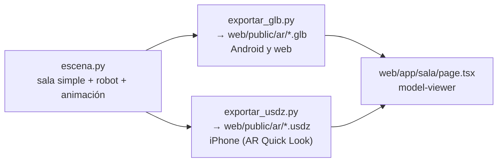

# Sala en realidad aumentada (`/sala`)

Escena esquemática de la sala + robot de servicio **animado a mano** (no entrenado), exportada para AR en el celular.



| Variante | Qué es | Escala |
|---|---|---|
| `maqueta` | La sala en miniatura (piso, muros bajos, mural, gradas, ~100 sillas) con el robot recorriendo el pasillo central | 1:20 (≈ 0,5 m sobre una mesa) |
| `robot` | Solo el robot, que avanza 3 m hacia quien mira y le ofrece el café | 1:1 |

```bash
pip install usd-core pygltflib numpy pillow
python exportar_glb.py ../../../web/public/ar mural.jpg
python exportar_usdz.py ../../../web/public/ar mural.jpg
```

- `mural.jpg`: recorte de un cuadro del video de la sala (1024 × 640).
- **Medidas aproximadas (±1 m):** salen de la nube de puntos de COLMAP y del video, no de un plano.
- **Validación:** los GLB pasan `gltf-validator` sin errores. Los USDZ se revisaron a mano (abren, traen la textura y tienen 1 044 muestras de animación). No se pasaron por `usdchecker` porque `usd-core` no lo trae.
- **Sin probar en un iPhone real** al momento de escribir esto.
