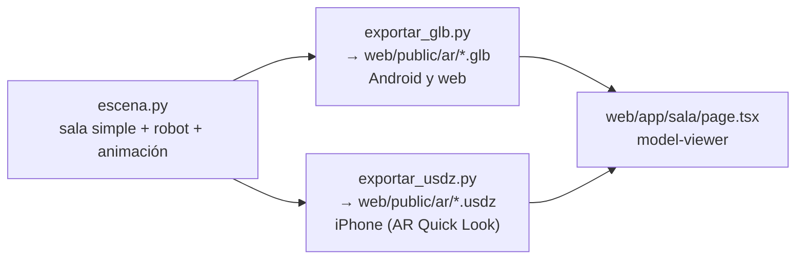

# Sala en realidad aumentada (`/sala`)

Escena esquemática de la sala + 5 robots; VIAZ elige al **Unitree H1**, que trae el café. Todo **animado a mano** (no entrenado), exportada para AR en el celular.



Secuencia (en bucle; 23 s a tamaño real, 45 s en la maqueta): **5 robots en fila** (brazo industrial, cuadrúpedo, H1 al centro, dron, servicio) → **un muro estilo Matrix de tres capas recorre el lugar en 7 s**: cada columna cae desde arriba con su propio retraso y una línea de barrido sube y baja, dejando **una grilla verde encendida en el piso** y **una caja verde de análisis** alrededor de cada robot → **un anillo y un haz de luz verde marcan al elegido** (el H1) → **los otros 4 desaparecen** → **el H1 camina con una bandeja y dos cafés** (se desliza con un vaivén por paso: la malla no mueve las piernas) → los otros reaparecen y el bucle reinicia. El cuadro 0 muestra los 5 robots completos: AR Quick Look y Scene Viewer lo usan para medir el objeto y ponerlo en el piso. Todo va dentro del archivo 3D, porque AR Quick Look (iPhone) solo reproduce la animación guardada.

Los cinco modelos usan carcasas biseladas, articulaciones separadas y materiales
propios. El robot de servicio conserva el pivote del brazo que lleva la bandeja.
Las cajas de análisis se ajustan a la silueta de cada robot.

El humanoide es la malla del modelo publicado del **Unitree H1**, de pie y quieto (la pose del cuadro 0 de
`baile.npz`). Va en `h1_pose.npz`; la animación de la escena sigue hecha a mano. Para regenerarlo:
`python generar_h1_pose.py <ruta>/baile.npz` (`baile.npz` no va en el repo).

| Variante | Qué es | Escala |
|---|---|---|
| `maqueta` | La sala en miniatura (piso, muros bajos, mural, gradas, ~100 sillas) con el robot recorriendo el pasillo central | 1:20 (≈ 0,5 m sobre una mesa) |
| `robot` | Los cinco robots a tamaño real. El de servicio avanza hacia quien mira y ofrece el café | 1:1 |

```bash
pip install usd-core pygltflib numpy pillow
python -c "import escena as E; E.texturas_matrix('.'); E.textura_grilla('grilla.png')"   # texturas del escaneo
python exportar_glb.py ../../../web/public/ar . robot maqueta
python exportar_usdz.py ../../../web/public/ar . robot maqueta
```

- `mural.jpg`: recorte de un cuadro del video de la sala (1024 × 640). `matrix.png`: números verdes con transparencia.
- **Medidas aproximadas (±1 m):** salen de la nube de puntos de COLMAP y del video, no de un plano.
- **Validación:** los GLB pasan `gltf-validator` sin errores. Los USDZ se revisaron a mano (abren, traen las dos texturas y la animación a 30 cuadros/s). No se pasaron por `usdchecker` porque `usd-core` no lo trae.
- **Sin probar en un iPhone real** al momento de escribir esto.
