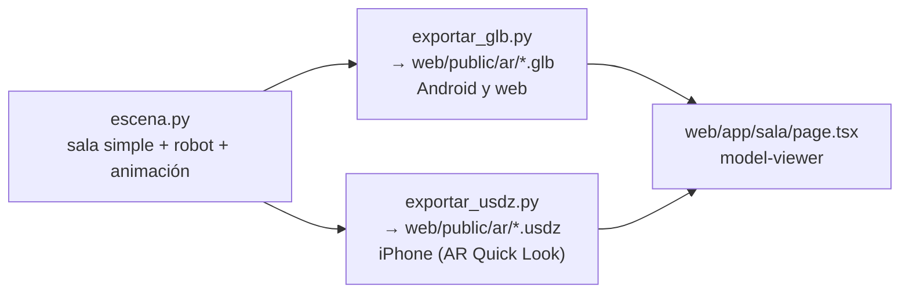

# Sala en realidad aumentada (`/sala`)

Escena esquemática de la sala + robot de servicio **animado a mano** (no entrenado), exportada para AR en el celular.



Secuencia (en bucle; 23 s a tamaño real, 45 s en la maqueta): **5 robots en fila** (brazo industrial, cuadrúpedo, servicio, dron, humanoide) → **un muro de números estilo Matrix de dos capas recorre el lugar en 7 s**, dejando **una grilla verde encendida en el piso** y **una caja verde de análisis** alrededor de cada robot → **un anillo verde marca al elegido** (el de servicio) → **los otros 4 desaparecen** → **el elegido reparte el café** → los otros reaparecen y el bucle reinicia. El cuadro 0 muestra los 5 robots completos: AR Quick Look y Scene Viewer lo usan para medir el objeto y ponerlo en el piso. Todo va dentro del archivo 3D, porque AR Quick Look (iPhone) solo reproduce la animación guardada.

| Variante | Qué es | Escala |
|---|---|---|
| `maqueta` | La sala en miniatura (piso, muros bajos, mural, gradas, ~100 sillas) con el robot recorriendo el pasillo central | 1:20 (≈ 0,5 m sobre una mesa) |
| `robot` | Solo el robot, que avanza 3 m hacia quien mira y le ofrece el café | 1:1 |

```bash
pip install usd-core pygltflib numpy pillow
python -c "import escena as E; E.textura_matrix('matrix.png'); E.textura_grilla('grilla.png')"   # texturas del escaneo
python exportar_glb.py ../../../web/public/ar .
python exportar_usdz.py ../../../web/public/ar .
```

- `mural.jpg`: recorte de un cuadro del video de la sala (1024 × 640). `matrix.png`: números verdes con transparencia.
- **Medidas aproximadas (±1 m):** salen de la nube de puntos de COLMAP y del video, no de un plano.
- **Validación:** los GLB pasan `gltf-validator` sin errores. Los USDZ se revisaron a mano (abren, traen las dos texturas y la animación a 30 cuadros/s). No se pasaron por `usdchecker` porque `usd-core` no lo trae.
- **Sin probar en un iPhone real** al momento de escribir esto.
