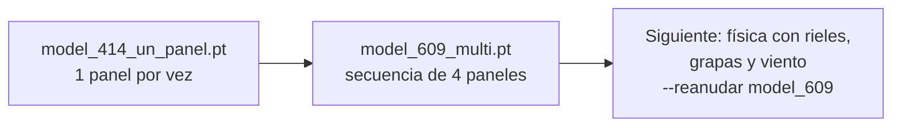

# Punto de respaldo del entrenamiento RL (2026-11-21)

Estado del robot LEAPTING MMR entrenado, antes de mejorar la física. Desde aquí se retoma el entrenamiento.



## Qué hay en esta carpeta

| Archivo | Qué es |
|---|---|
| `model_1164_succion_viento.pt` | **Política más real**: rieles, grapas, ventosa con fuerza limitada y viento hasta 8 m/s. 98 de 100 secuencias, 0 choques. Re-entrenada desde model_990 |
| `evaluacion_1164_succion_viento.json`, `secuencia_1164_succion_viento.json` | Su evaluación con `VIAZ_AGARRE=succion` y `VIAZ_VIENTO_M_S=8` |
| `model_990_rieles.pt` | **Política para la física nueva** (rieles y grapas, docs/fisica-real.md). Re-entrenada desde model_609 |
| `evaluacion_990_rieles.json`, `secuencia_990_rieles_grapas.json` | 99 % a 5 cm y 5°; 93 de 100 secuencias con grapas físicas |
| `viento_990_grapas.json`, `viento_990_sin_grapas.json` | Ráfagas de 10 a 40 m/s sobre los paneles instalados |
| `criterio_990_rieles.json` | Dónde cumplió el criterio de parada (iteración 918) |
| `model_609_multi.pt` | **Política final.** PPO de rsl_rl, entrenamiento `entrenamiento_multi`, iteración 609 |
| `model_414_un_panel.pt` | Política anterior, `entrenamiento_45`: un panel por episodio |
| `hitos_multi.json`, `criterio_multi.json` | Hitos y criterio de parada del entrenamiento final |
| `evaluacion_609.json` | 100 episodios: 100 % a 5 cm y 5°, 97 % a 2 cm y 2°, 0 choques |
| `secuencia_609_fijando.json` | 100 secuencias de 4 paneles, con el panel fijado en su slot: 400 de 400 |
| `secuencia_609_sin_fijar.json` | Lo mismo sin fijar el panel: 79 secuencias completas, 21 fallan por mover un panel vecino |
| `corrida_leapting/` | Archivos de la corrida usada para entrenar: entorno, tarea, clon, ensamblaje, `robot.urdf`, `robot_cfg.py`. `entorno.json` y `tarea.json` van en el formato nuevo de `main` (`espacio`, `elementos`, `objetivo.cantidad`) |

> Esta carpeta no entró con el PR del respaldo: un patrón local de exclusión (`respaldo/`) la dejó afuera. Se agrega aquí.

## Límites conocidos de la física (para la próxima etapa)

- El panel se apoya sobre una caja de 10 × 10 cm (el tubo), sin rieles ni grapas.
- En modo secuencia, el panel instalado se teletransporta a su slot (`fijar_instalados=True`).
- La ventosa es una unión fija: no simula la fuerza de succión.
- La base se mueve por código. No hay viento ni pendiente.
- El robot entrenado sale de `robot.urdf` (clon de `backend/viaz/urdf.py`), no de `robot_cfg.py` (UR10, sin probar).

## Respaldo completo

El archivo `viaz_respaldo_2026-11-21.tar.gz` (167 MB) trae además clips, animaciones USD, el robot detallado,
las texturas y las métricas por iteración. Copias:

- Pod: `/workspace/respaldos/viaz_respaldo_2026-11-21.tar.gz`
- SHA-256: `313ddc9443620a3604b92d3bf07128b845331ee6e54201f50bddbedc930d70e7`

No trae los `entrenar*.log` (más de 500 MB de texto): `metricas.jsonl` y `curriculo.jsonl` tienen los datos.

## Cómo retomar el entrenamiento desde aquí

En el pod, desde la raíz del repo:

```bash
source /workspace/pod.env
C=sim/rl/respaldo/corrida_leapting
$ISAACLAB_SH -p sim/rl/entrenar.py --entorno $C/entorno.json --tarea $C/tarea.json --robot $C/robot_cfg.py \
  --salida /workspace/entorno_rl/entrenamiento_fisica --max-horas 1 \
  --reanudar sim/rl/respaldo/model_609_multi.pt --parar-al-cumplir
```

`entorno.json` apunta a `escena.usd`: generarla con `sim/generar_escena.py` si la carpeta no la trae.

## Ver la política en vivo

`sim/rl/en_vivo.py` muestra la política sobre el robot detallado y el terreno realista, con ventana:

```bash
sim/rl/pod/vivo.sh              # 6 paneles por secuencia. Detener: touch /workspace/entorno_rl/DETENER_VIVO
```

`sim/rl/pod/` trae los scripts que se usaron en el pod (`multi.sh`, `post_final.sh`, `post_multi.sh`, `vivo.sh`).
Sus rutas son las del pod (`/workspace/...`).
